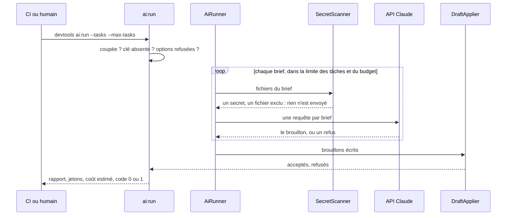
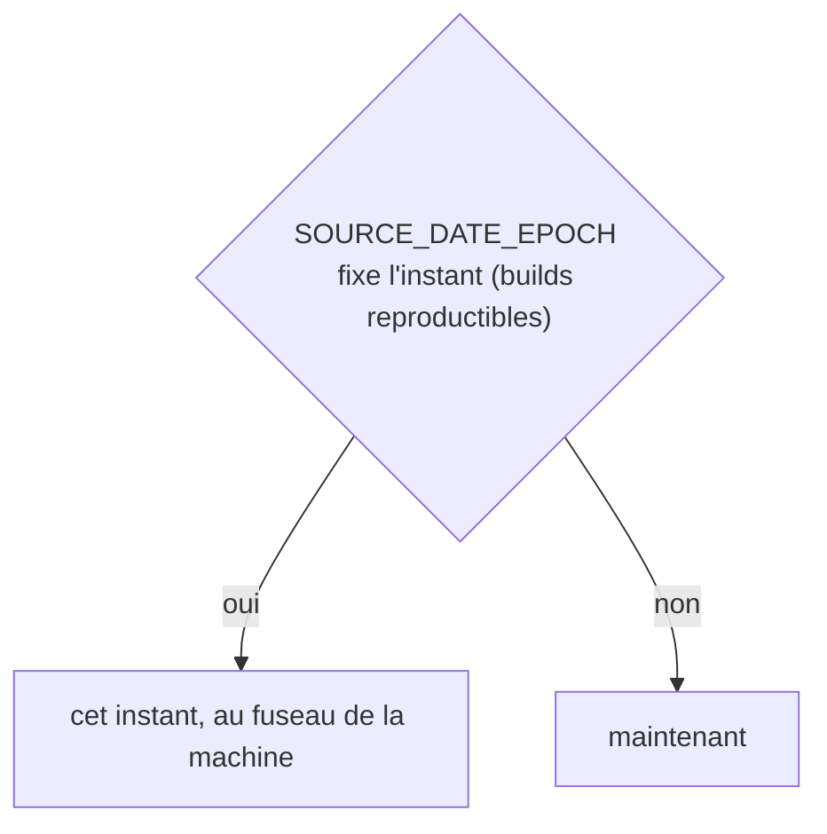
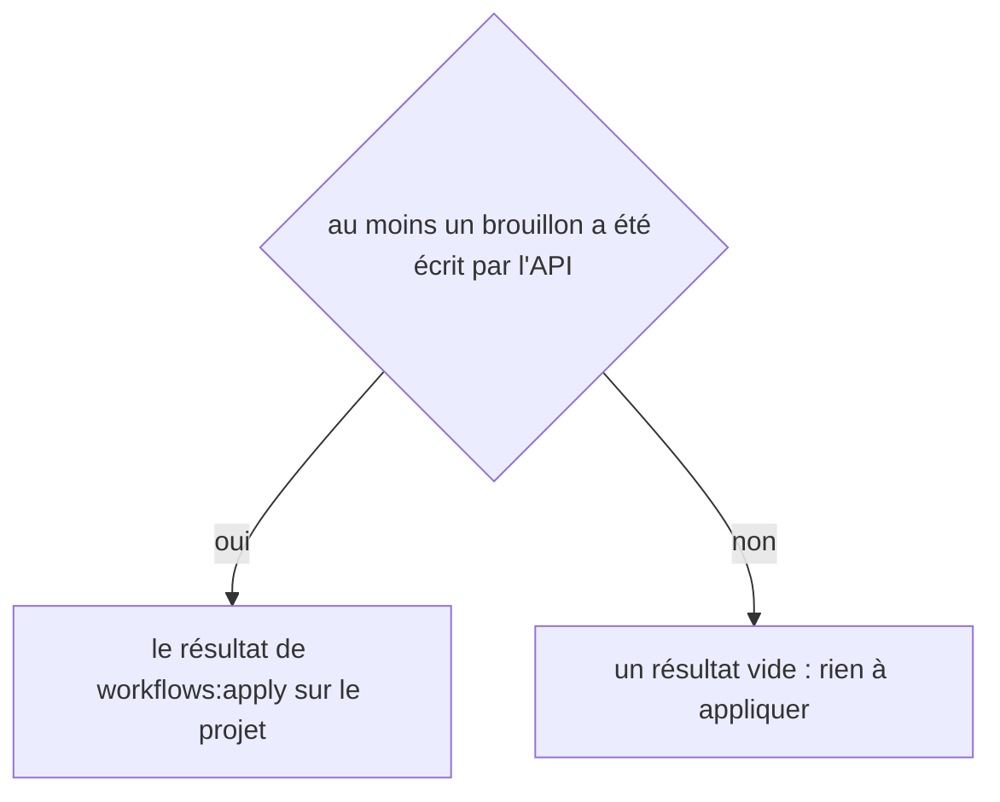
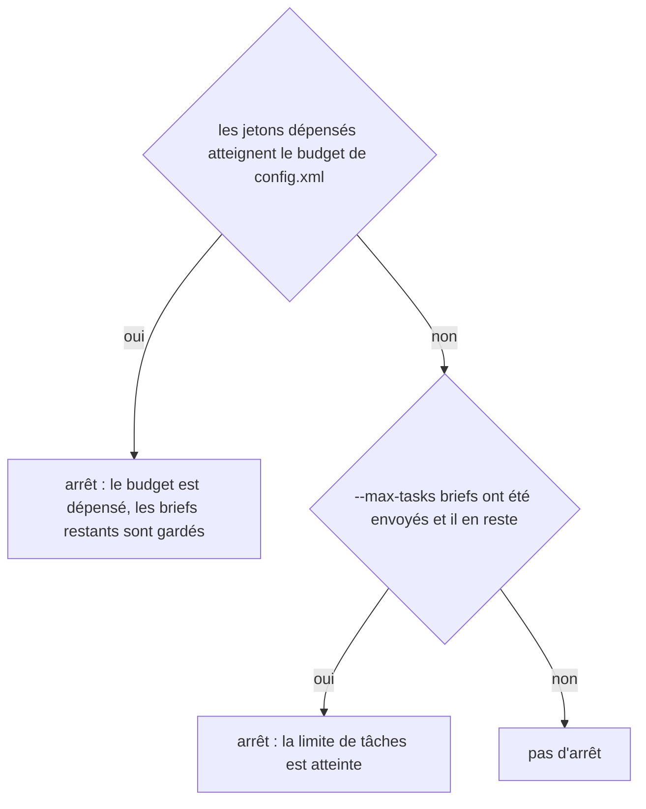
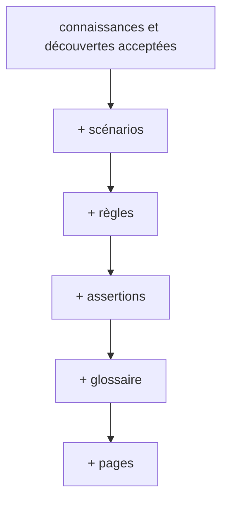
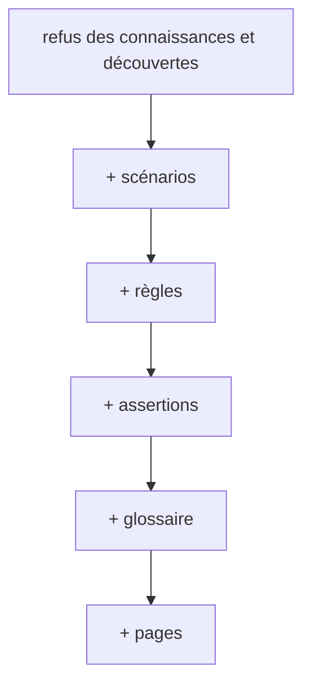
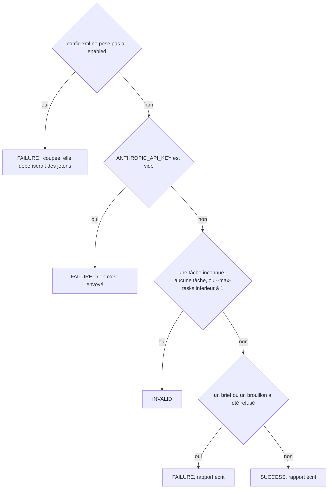
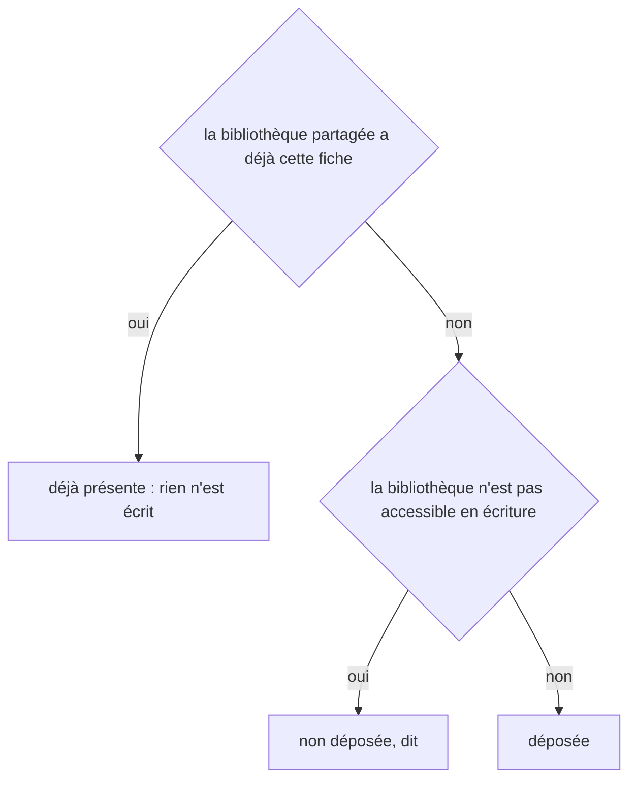
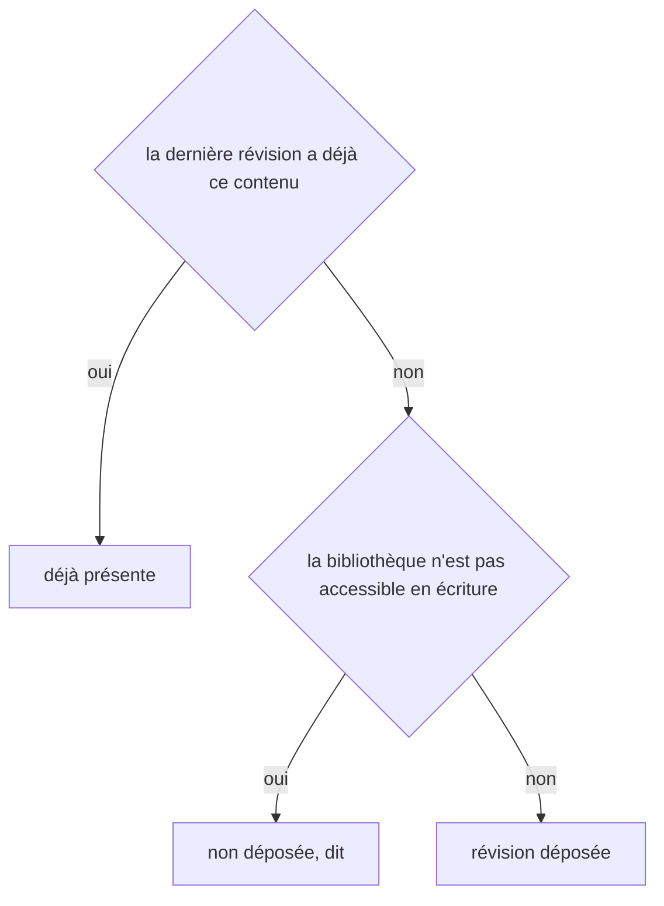

# ai:run
`command.ai.run` · type: commands · last updated: 2026-10-21 · commit: 240bcc3

## Summary

Rédige les briefs en attente par l'API Claude, hors session — en CI par exemple —, puis les applique comme `workflows:apply` (ADR-0035). Une tâche par brief — pages, groupes, connaissances, découvertes, scénarios, règles, assertions, dans cet ordre —, avec les fichiers que le brief nomme ; chaque brouillon revient dans `.devtools/pending/` et passe les mêmes validations qu'un brouillon écrit en session. La commande est **coupée par défaut** : elle ne fait rien tant que le config.xml du projet ne pose pas `<ai enabled="true"/>`, parce qu'elle dépense des jetons.

## Trigger

| Element | Value |
|---|---|
| Entry point | `ai:run` (command) |
| Security | — |
| Preconditions | Le projet a été inspecté avec des briefs, `<ai enabled="true"/>` est posé, et ANTHROPIC_API_KEY porte la clé. |

## Journey

## Decisions

**`DateTimeImmutable::timezone`**

**`Jul6Art\DevTools\Ai\Api\AiRunReport::applied`**

**`Jul6Art\DevTools\Ai\Api\AiRunReport::stopped`**

**`Jul6Art\DevTools\Ai\ApplyResult::accepted`**

**`Jul6Art\DevTools\Ai\ApplyResult::refused`**

**`Jul6Art\DevTools\Command\AiRunCommand::execute`**

**`Jul6Art\DevTools\Stack\Knowledge\KnowledgeLibrary::deposit`**

**`Jul6Art\DevTools\Stack\Knowledge\KnowledgeLibrary::depositRevision`**

## Data

Lit config.xml, les briefs de `.devtools/pending/` et les fichiers qu'ils nomment, la clé dans ANTHROPIC_API_KEY ; envoie une requête HTTPS par brief à l'API Claude ; écrit les brouillons dans `.devtools/pending/`, puis ce qu'écrit `workflows:apply`, et un rapport dans `.devtools/reports/`. La clé n'est écrite nulle part : ni fichier, ni message, ni rapport.

## Cross-cutting mechanisms

Aucun.

## Points of attention

Avant chaque envoi, les fichiers d'une tâche repassent le SecretScanner : un fichier `.env*`, un dossier exclu par la configuration, un contenu qui ressemble à un secret, et rien n'est envoyé pour cette tâche. Une fiche de connaissance demande une recherche sur le web, qu'il faut autoriser (`web-search`) ; sans elle, la fiche s'écrit en session, jamais de mémoire. Le budget plafonne une exécution, entrées et sorties comprises ; le coût affiché est une estimation. Une tâche dont le brouillon attend déjà `workflows:apply` n'est pas renvoyée. La décision sur la bibliothèque est celle de `workflows:apply`, qui dépose une fiche acceptée.

## Related workflows

—

## History

| Date | Commit | Change |
|---|---|---|
| 2026-10-21 | 240bcc3 | rédaction initiale |
| 2026-10-21 | 240bcc3 | Aucun changement de fond : le suivi d'un workflow sait s'allonger d'une révision, le renommage et l'initialisation ont été simplifiés (ADR-0036, ADR-0039), sans rien changer de ce que fait la commande. La prose a été relue et tient. (files changed: src/Ai/Api/AiRunner.php, src/Tracking/TrackingDocument.php) |
