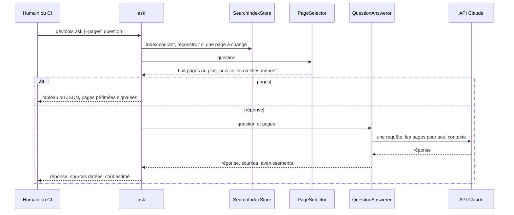
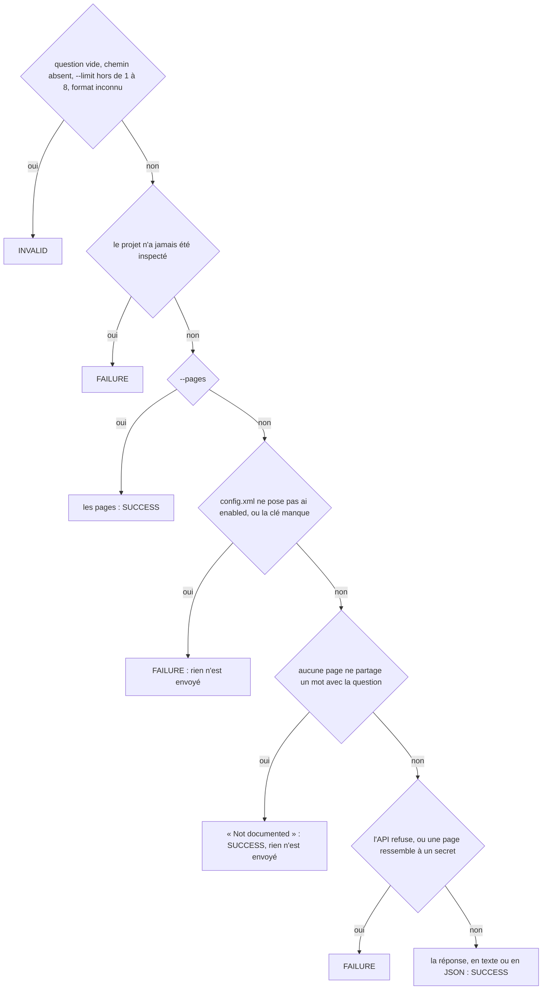
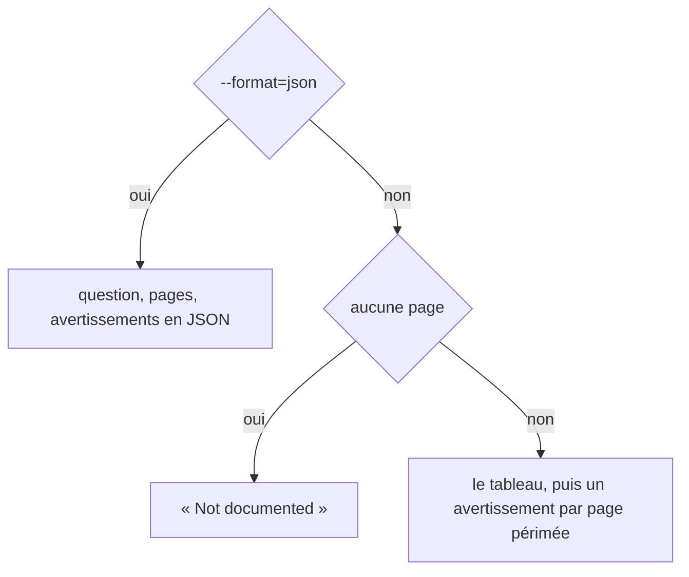
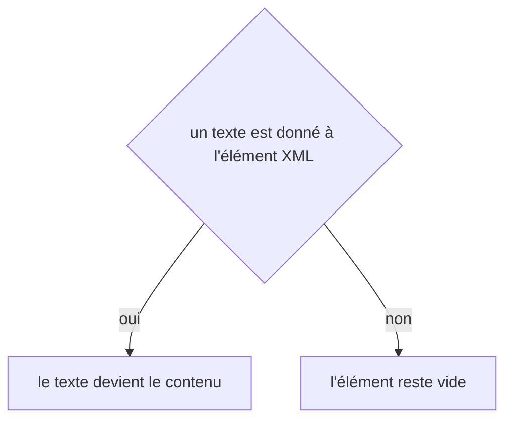

# ask
`command.ask` · type: commands · last updated: 2026-10-21 · commit: 240bcc3

## Summary

Pose une question à la documentation (ADR-0039) : « que se passe-t-il quand un opérateur valide une commande ? ». Avec `--pages`, elle liste les pages qui y répondent, choisies sans IA — BM25 sur l'index de recherche, puis un saut vers ce dont les meilleures dépendent ou vers où elles mènent, huit au plus —, avec leur score, leur date de révision et leur fraîcheur. Sans `--pages`, elle répond par l'API Claude à partir de ces seules pages, en citant les identifiants des workflows, et dit ce qu'on ne peut pas croire : une source périmée, un workflow cité qui n'était pas parmi les sources. Cette réponse est coupée tant que le projet n'a pas posé `<ai enabled="true"/>`.

## Trigger

| Element | Value |
|---|---|
| Entry point | `ask` (command) |
| Security | — |
| Preconditions | Le projet a été inspecté ; pour une réponse, `<ai enabled="true"/>` est posé et ANTHROPIC_API_KEY porte la clé. |

## Journey

## Decisions

**`Jul6Art\DevTools\Command\AskCommand::execute`**

**`Jul6Art\DevTools\Command\AskCommand::pages`**

**`element::textContent`**

## Data

Lit l'index, les pages, les fichiers de suivi, le glossaire et config.xml ; écrit l'index de recherche, .devtools/search.idx, quand il est absent ou qu'une page a changé depuis. Pour une réponse, envoie la question et le texte des pages choisies à l'API Claude, une requête, effort faible, 4 000 jetons de sortie au plus.

## Cross-cutting mechanisms

Aucun.

## Points of attention

Le choix des pages ne comprend pas la question : il compte des mots communs, après racinisation — `valide` et `validation` se rejoignent, un synonyme absent des pages et du glossaire non. Une question dont aucun mot n'est dans les pages n'est jamais envoyée. Une citation hors des sources n'est pas une erreur de la commande : c'est une affirmation que rien ne vérifie, et la sortie le dit. L'index est un cache : le supprimer ne perd rien. La décision sur `element::textContent` est celle de DomBuilder, sur le chemin de toute lecture XML : elle n'est pas propre à ce workflow.

## Related workflows

—

## History

| Date | Commit | Change |
|---|---|---|
| 2026-10-21 | 240bcc3 | rédaction initiale |
| 2026-10-21 | 240bcc3 | Aucun changement de fond : le suivi d'un workflow sait s'allonger d'une révision, le renommage et l'initialisation ont été simplifiés (ADR-0036, ADR-0039), sans rien changer de ce que fait la commande. La prose a été relue et tient. (files changed: src/Ask/SearchIndexBuilder.php) |
