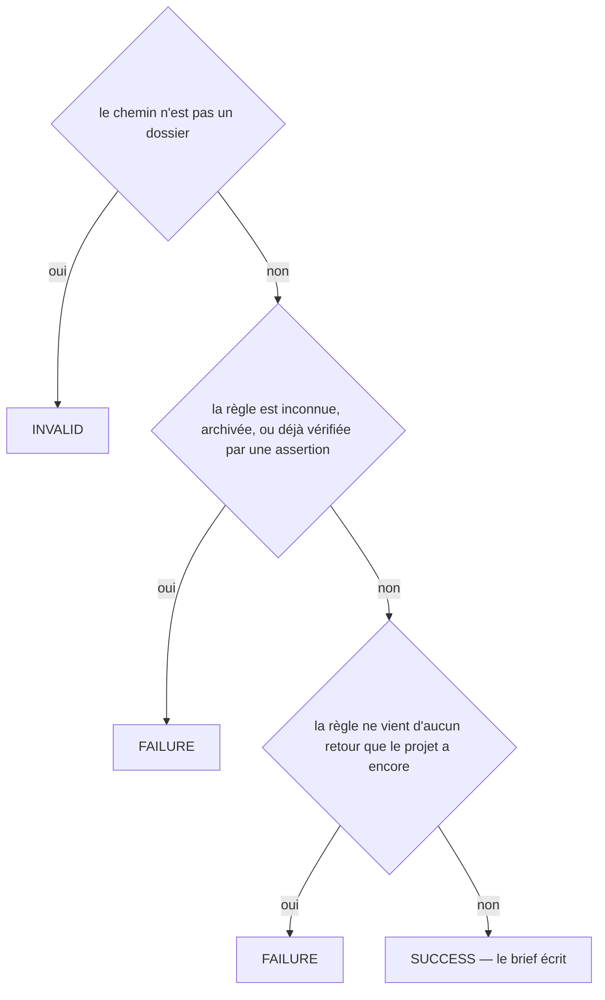
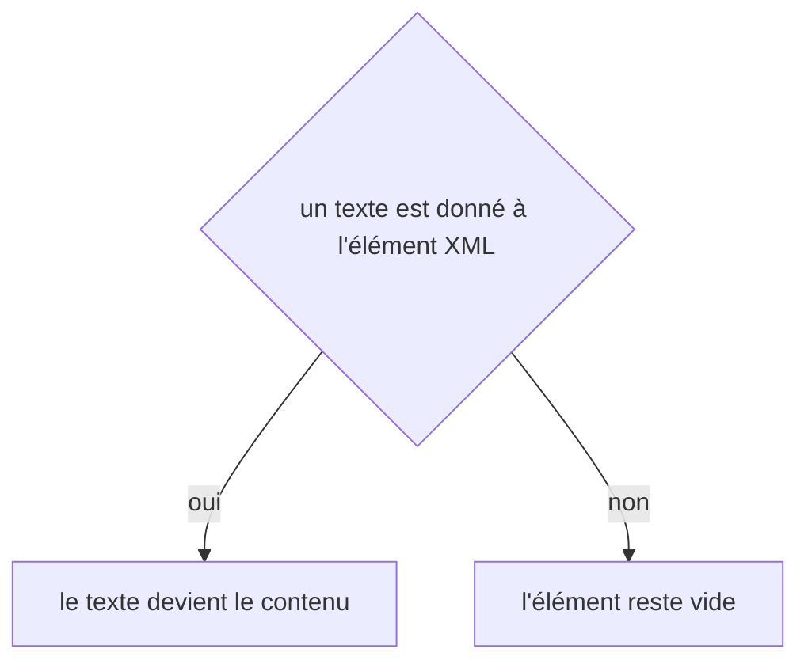

# assertions:propose
`command.assertions.propose` · type: commands · last updated: 2026-10-20 · commit: 58c02fb

## Summary

Demande à Claude l'assertion mécanique d'une règle (ADR-0027) : un brief qui donne la règle, ses retours et les commits où ils ont été signalés — où l'assertion devra échouer —, les fichiers de la règle, les captures DOM de la dernière exécution et les outils que le projet a installés. workflows:apply exécute le brouillon avant de l'écrire : il doit passer sur le projet tel qu'il est et, pour un motif, échouer à chaque commit « avant ».

## Trigger

| Element | Value |
|---|---|
| Entry point | `assertions:propose` (command) |
| Security | — |
| Preconditions | La règle existe, n'est pas archivée et n'a pas encore d'assertion ; --before nomme au besoin les commits où le défaut se trouve. |

## Journey

```mermaid
sequenceDiagram
  participant H as Humain
  participant C as assertions:propose
  participant P as AssertionProposal
  participant G as git
  participant B as Brief
  H->>C: devtools assertions:propose rule-… --before=…
  C->>P: refus éventuels
  P->>G: les commits « avant » existent-ils ?
  P->>B: le brief de la règle, dans pending/
  C-->>H: brief écrit ; workflows:apply exécutera le brouillon
```

## Decisions

**`Jul6Art\DevTools\Command\AssertionsProposeCommand::execute`**



**`element::textContent`**



## Data

Lit la règle, ses retours, les fichiers du projet et la dernière exécution de scénarios ; demande à git si les commits « avant » existent ; écrit le brief dans .devtools/pending/. N'exécute aucun outil : c'est l'application du brouillon qui exécute.

## Cross-cutting mechanisms

Aucun.

## Points of attention

Un commit de --before que git ne connaît pas est écarté sans bruit. Le défaut a pu n'être jamais commité : alors aucun commit ne montre l'échec, et l'application le dit en avertissement plutôt que de refuser. La décision sur `element::textContent` est celle de DomBuilder, sur le chemin de toute lecture ou écriture XML : elle n'est pas propre à ce workflow.

## Related workflows

—

## History

| Date | Commit | Change |
|---|---|---|
| 2026-10-20 | 58c02fb | rédaction initiale |
| 2026-10-20 | 58c02fb | Aucun changement de fond : le client git lit plus simplement les fichiers du projet et les commits d'une plage, sans rien changer de ce que fait la commande. La prose a été relue et tient. (files changed: src/Inspection/Freshness/GitClient.php) |
