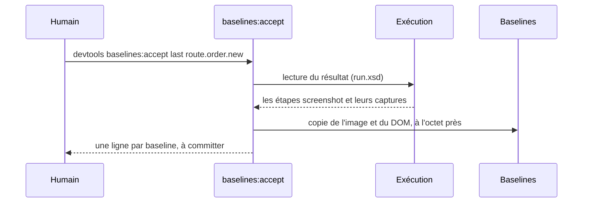
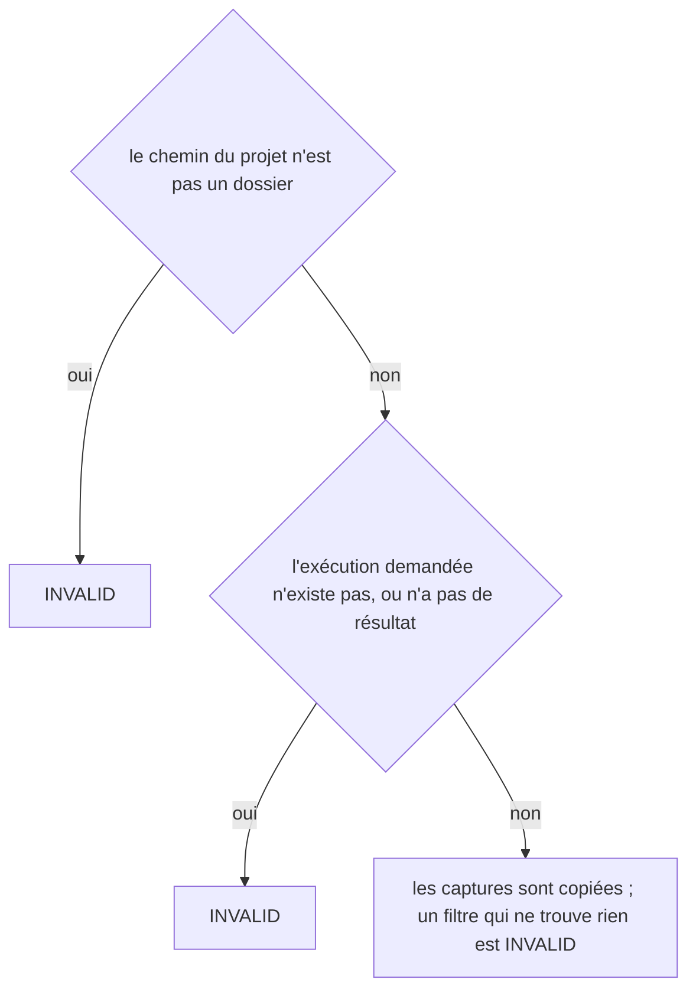
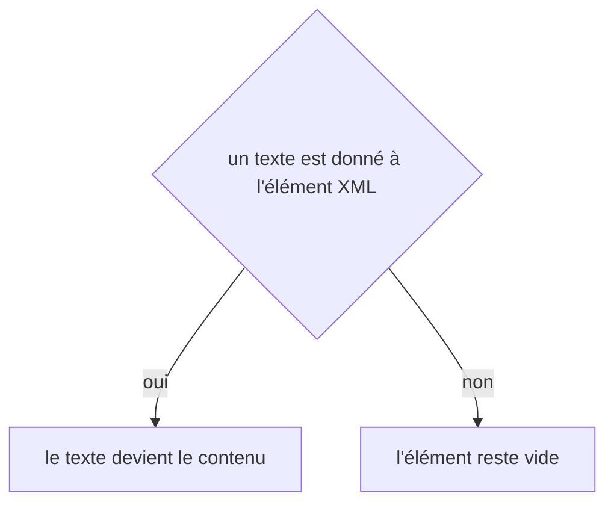

# baselines:accept
`command.baselines.accept` · type: commands · last updated: 2026-10-21 · commit: 240bcc3

## Summary

Fait des captures d'une exécution de scénarios les baselines auxquelles les exécutions suivantes seront comparées (ADR-0022). Seules les captures des étapes `screenshot` sont copiées, jamais celle d'un échec, à l'octet près, image et DOM. Rien n'accepte une baseline tout seul : c'est un humain qui a regardé les captures qui lance la commande.

## Trigger

| Element | Value |
|---|---|
| Entry point | `baselines:accept` (command) |
| Security | — |
| Preconditions | Une exécution existe dans .devtools/runs/, nommée par son dossier ou par last, et son résultat est lisible. |

## Journey

## Decisions

**`Jul6Art\DevTools\Command\BaselinesAcceptCommand::execute`**

**`element::textContent`**

## Data

Lit le résultat d'une exécution et ses captures dans .devtools/runs/ ; écrit les PNG et les DOM dans .devtools/baselines/, qui se versionnent avec le code qu'ils montrent.

## Cross-cutting mechanisms

Aucun.

## Points of attention

Une baseline acceptée par l'auteur du changement reproduirait le biais que la comparaison doit déjouer : la gate ne lance jamais cette commande, elle dit seulement qu'une capture n'a pas de baseline. La décision sur `element::textContent` est celle de DomBuilder, sur le chemin de toute lecture ou écriture XML : elle n'est pas propre à ce workflow.

## Related workflows

—

## History

| Date | Commit | Change |
|---|---|---|
| 2026-10-20 | 4979790 | rédaction initiale |
| 2026-10-20 | 58c02fb | Aucun changement de fond : la copie d'une capture passe par une classe que partage la page de revue, et le lecteur d'exécution rend aussi l'étape d'échec, que cette commande n'accepte jamais ; des tests s'ajoutent. La prose tient. (added test tests/Assertion/AssertionProposalTest.php (+10)) |
| 2026-10-21 | 240bcc3 | Aucun changement de fond : la configuration lit désormais les projets liés (ADR-0038) et le dossier .devtools/ connaît l'index de recherche (ADR-0039), sans rien changer de ce que fait la commande. La prose a été relue et tient. (added test tests/Ask/AskTest.php (+8)) |
