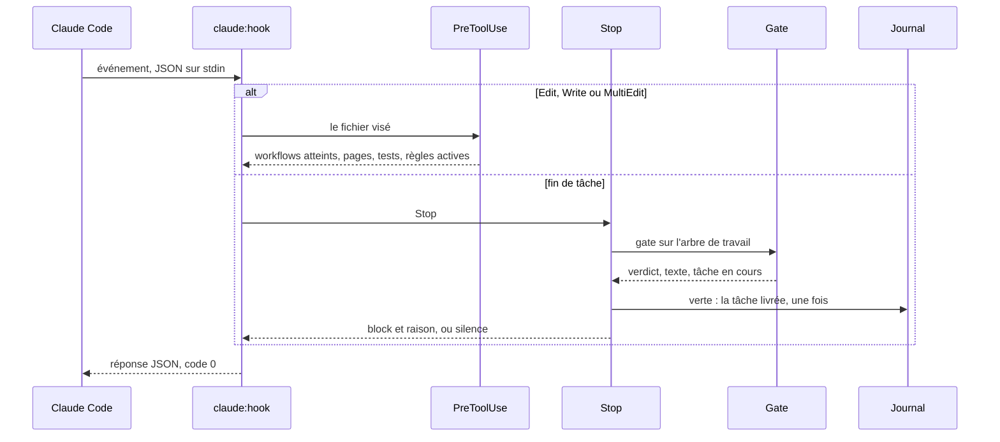
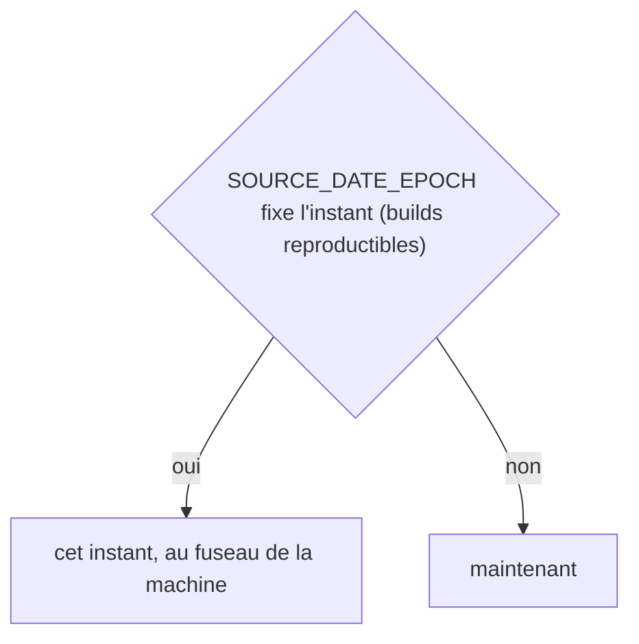
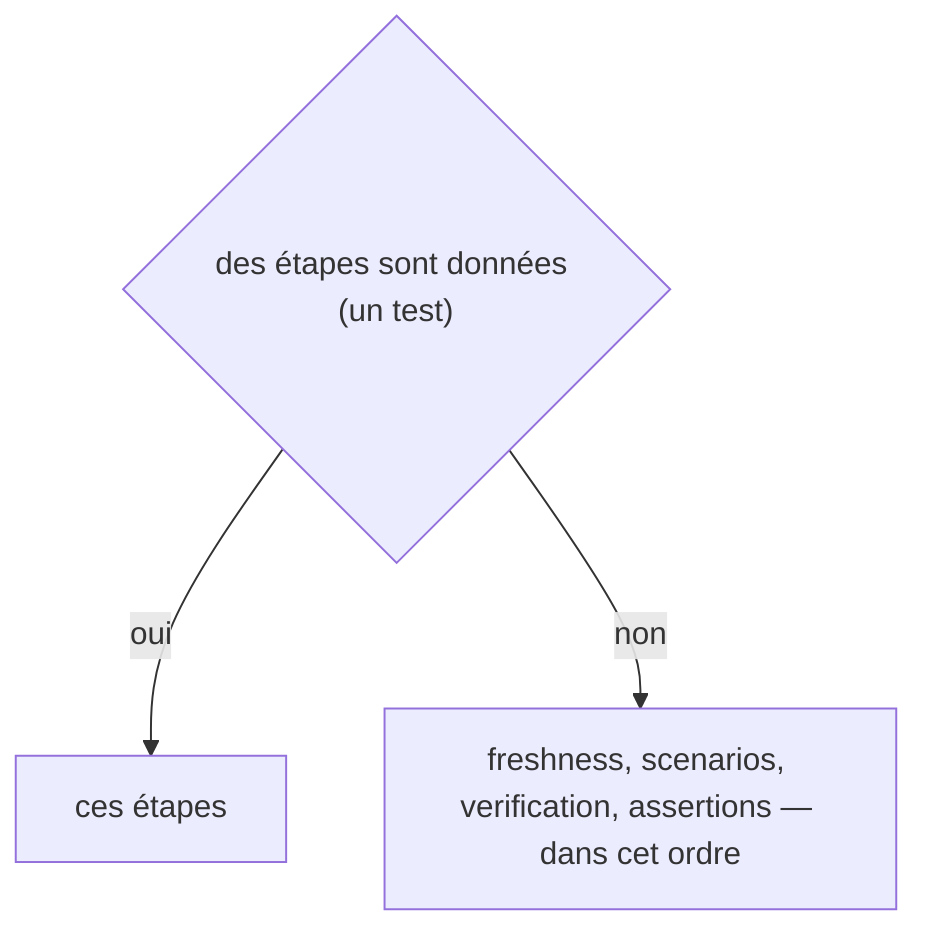
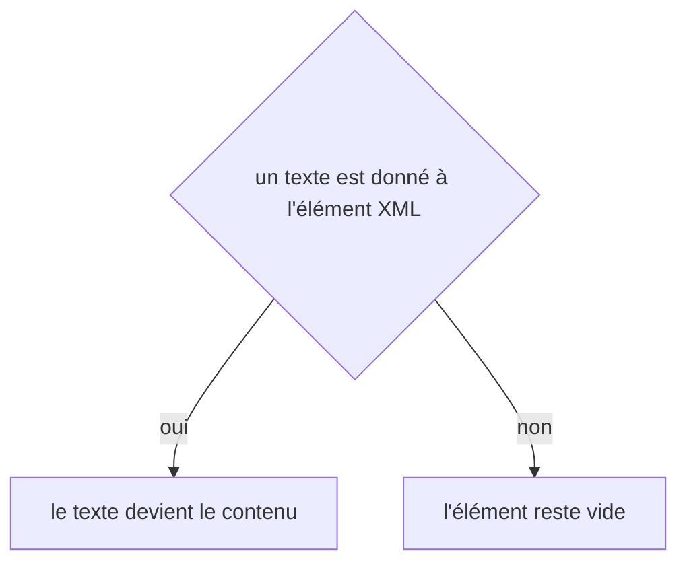

# claude:hook
`command.claude.hook` · type: commands · last updated: 2026-10-21 · commit: 240bcc3

## Summary

Le point d'entrée unique des hooks Claude Code (ADR-0019, ADR-0023) : il lit le JSON de l'événement sur l'entrée standard et répond pour PreToolUse — les workflows qu'atteint le fichier qu'on va modifier, et les règles actives qui s'y appliquent, cinq au plus (ADR-0026) —, SessionStart — l'état de la documentation — et Stop — la gate. Une erreur technique ne bloque jamais : elle part sur la sortie d'erreur avec un code 0, et rien n'est injecté. Seul Stop bloque, quand la gate échoue sur l'arbre de travail ; quand elle passe, la tâche est livrée et inscrite au journal (ADR-0029).

## Trigger

| Element | Value |
|---|---|
| Entry point | `claude:hook` (command) |
| Security | — |
| Preconditions | Claude Code lance la commande avec le JSON de l'événement sur l'entrée standard, dans un projet déjà inspecté. |

## Journey

## Decisions

**`DateTimeImmutable::timezone`**

**`Jul6Art\DevTools\Gate\Gate::steps`**

**`element::textContent`**

## Data

Lit l'index, la carte fichiers → workflows, l'index des règles et le dernier passage de la gate ; compte les règles données dans .devtools/stats/rules.xml, inscrit la tâche livrée dans .devtools/journal/ ; par la gate, rejoue les scénarios atteints et prépare un dossier de vérification. Répond en JSON sur la sortie standard.

## Cross-cutting mechanisms

Aucun.

## Points of attention

Le hook Stop peut durer : la gate relance l'analyse de `workflows:check` et rejoue les scénarios atteints — d'où un délai de 600 s à l'installation. Trois échecs identiques : il demande à Claude d'arrêter et de rendre compte ; au quatrième, il le laisse finir. Rien n'a changé depuis un succès : il ne relance pas la gate, et ne livre pas deux fois la même tâche. Le journal qu'il écrit n'est jamais un changement que la gate juge : sinon chaque tâche livrée ouvrirait la suivante. Un index des règles illisible donne une ligne d'avertissement, et l'impact reste donné. La décision sur `element::textContent` est celle de DomBuilder, sur le chemin de toute lecture ou écriture XML : elle n'est pas propre à ce workflow.

## Related workflows

—

## History

| Date | Commit | Change |
|---|---|---|
| 2026-10-20 | 4979790 | rédaction initiale |
| 2026-10-20 | 58c02fb | PreToolUse donne aussi les règles actives du fichier (ADR-0026), et Stop inscrit au journal la tâche que la gate laisse finir (ADR-0029). (added test tests/Assertion/AssertionProposalTest.php (+10)) |
| 2026-10-20 | 58c02fb | Aucun changement de fond : le code a été remis en forme (Rector, style), sans rien changer de ce que fait la commande. La prose a été relue et tient. (files changed: src/Claude/Hook/StopHandler.php, src/Gate/Gate.php, src/Gate/XmlGateStore.php, src/Retro/XmlJournalStore.php) |
| 2026-10-20 | 58c02fb | Aucun changement de fond : le client git lit plus simplement les fichiers du projet et les commits d'une plage, sans rien changer de ce que fait la commande. La prose a été relue et tient. (files changed: src/Inspection/Freshness/GitClient.php) |
| 2026-10-21 | 240bcc3 | Aucun changement de fond : la gate que lance Stop ne juge jamais l'index de recherche, et son analyse signale les liens entre projets devenus faux (ADR-0038, ADR-0039). La prose a été relue et tient. (added test tests/Ask/AskTest.php (+8)) |
| 2026-10-21 | 240bcc3 | Aucun changement de fond : le suivi d'un workflow sait s'allonger d'une révision, le renommage et l'initialisation ont été simplifiés (ADR-0036, ADR-0039), sans rien changer de ce que fait la commande. La prose a été relue et tient. (files changed: src/Tracking/TrackingDocument.php) |
