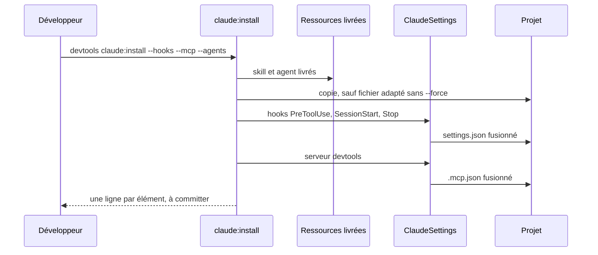
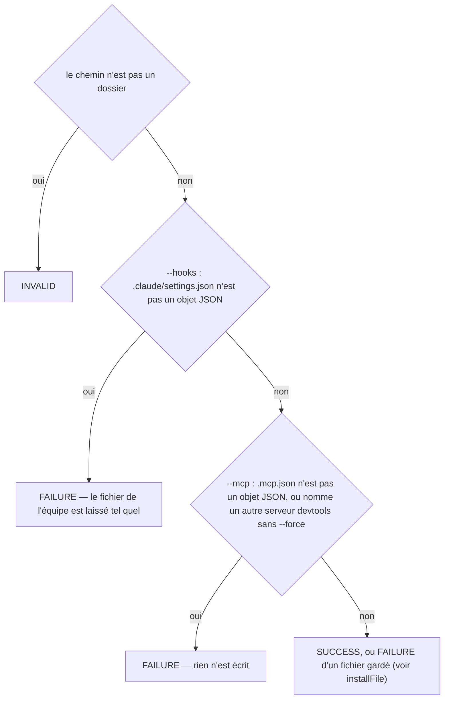
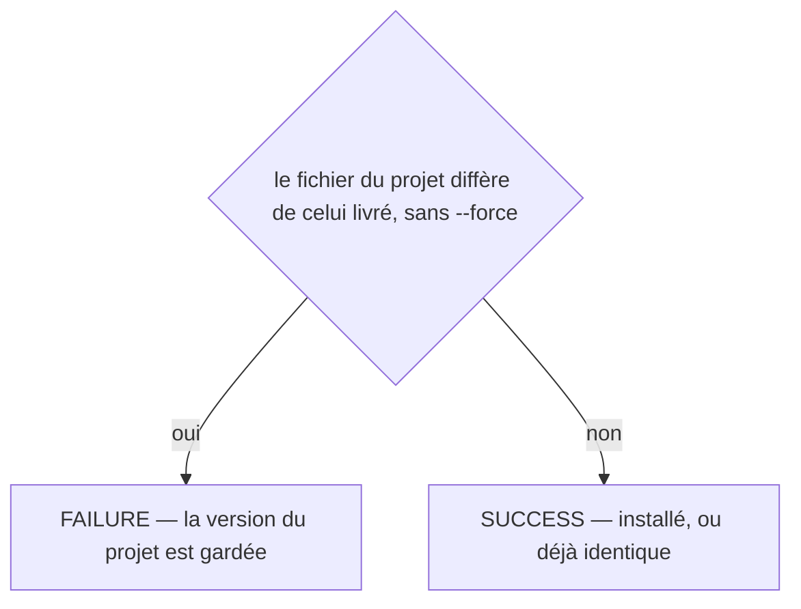
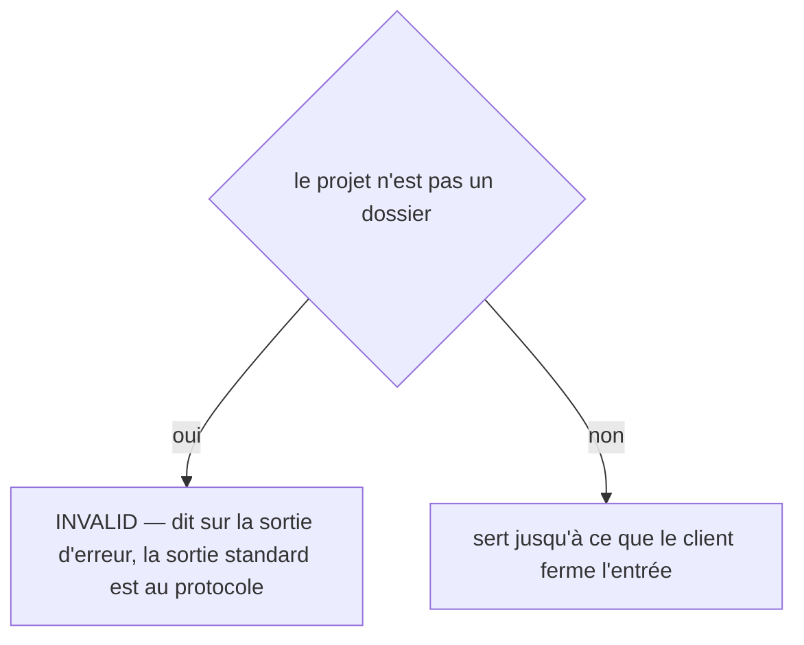
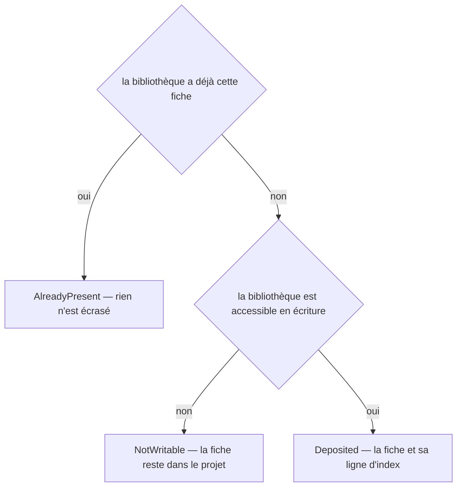
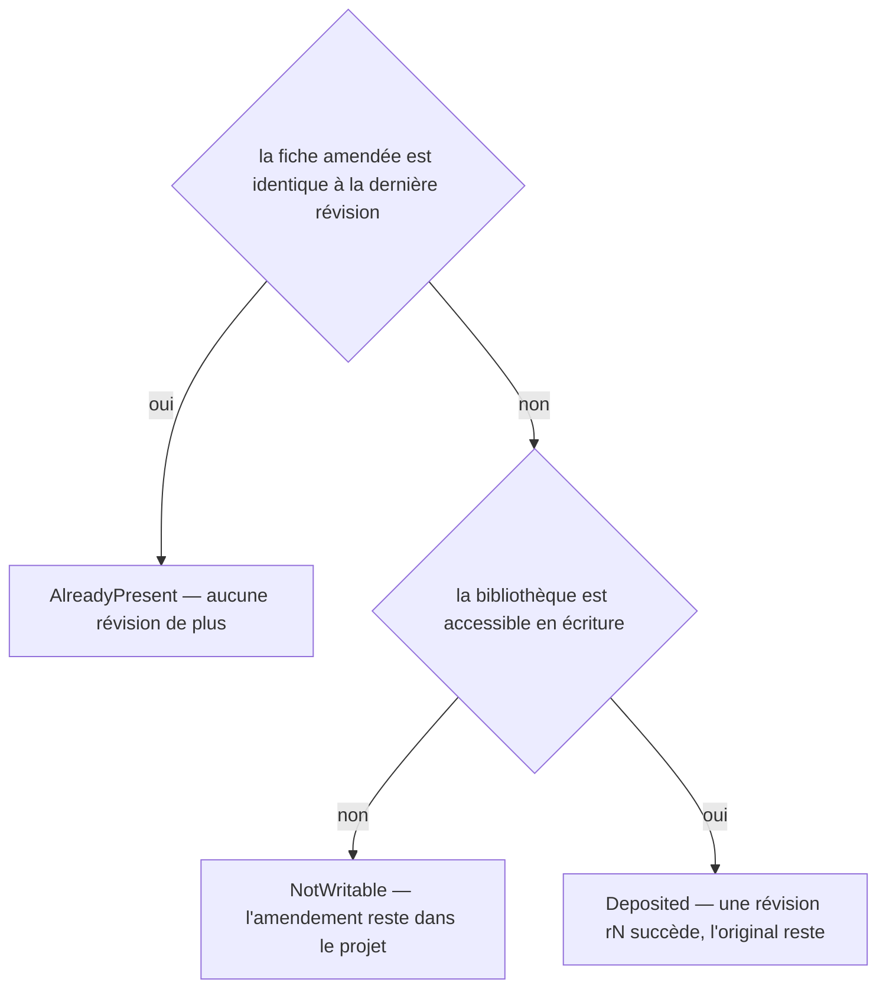
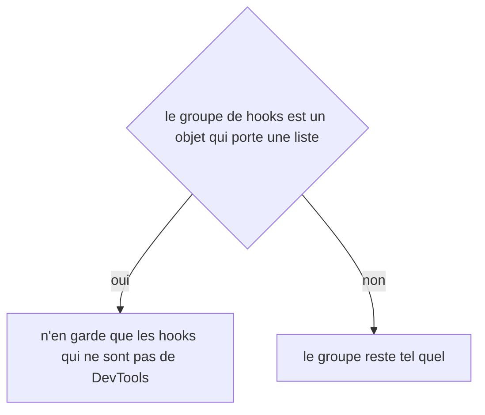
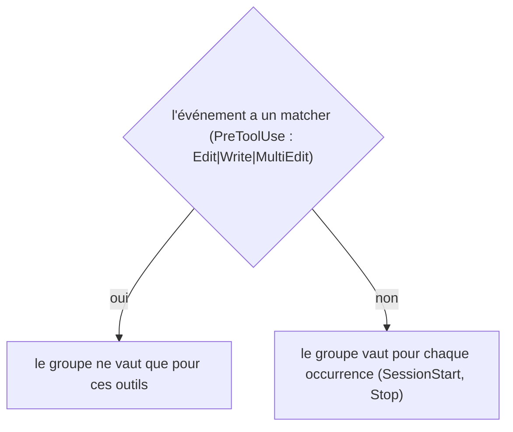

# claude:install
`command.claude.install` · type: commands · last updated: 2026-10-20 · commit: 58c02fb

## Summary

Installe ce que DevTools ajoute à un projet pour Claude Code : le skill qui rédige les pages (ADR-0011) quand rien d'autre n'est demandé, et à la demande les hooks qui donnent l'impact d'un fichier avant sa modification et lancent la gate en fin de tâche (ADR-0019, ADR-0023), le serveur MCP de .mcp.json (ADR-0018) et l'agent vérificateur (ADR-0024). Tout se fusionne avec la configuration de l'équipe et se committe ; un fichier que l'équipe a adapté n'est jamais écrasé sans --force.

## Trigger

| Element | Value |
|---|---|
| Entry point | `claude:install` (command) |
| Security | — |
| Preconditions | Le chemin donné est un dossier existant ; le serveur MCP demande en plus le SDK MCP, que DevTools ne fait que suggérer. |

## Journey

## Decisions

**`Jul6Art\DevTools\Command\ClaudeInstallCommand::execute`**

**`Jul6Art\DevTools\Command\ClaudeInstallCommand::installFile`**

**`Jul6Art\DevTools\Command\McpServeCommand::execute`**

**`Jul6Art\DevTools\Stack\Knowledge\KnowledgeLibrary::deposit`**

**`Jul6Art\DevTools\Stack\Knowledge\KnowledgeLibrary::depositRevision`**

**`stdClass::hooks`**

**`stdClass::matcher`**

## Data

Lit le skill et l'agent livrés ; écrit .claude/skills/, .claude/agents/, et fusionne .claude/settings.json et .mcp.json, lus en objets JSON pour qu'un objet vide reste un objet.

## Cross-cutting mechanisms

Aucun.

## Points of attention

Le hook Stop a un délai de 600 s : la gate peut rejouer des scénarios. Les décisions de `mcp:serve` et de la bibliothèque de connaissance apparaissent parce que l'installation nomme la commande par sa classe, et que le serveur lit la bibliothèque : l'installation n'en exécute aucune. Une entrée devtools de .mcp.json que DevTools n'a pas écrite est gardée sauf --force.

## Related workflows

—

## History

| Date | Commit | Change |
|---|---|---|
| 2026-09-18 | b8049a4 | rédaction initiale |
| 2026-09-19 | d9d6b8f | added test tests/Project/GitHooksTest.php |
| 2026-09-20 | 9e40da9 | Aucun changement de fond : seul un test s'est ajouté au périmètre du workflow. La prose a été relue contre le code et tient. (added test tests/Inspection/Adapter/Symfony/DoctrineListenersTest.php) |
| 2026-10-20 | 2885138 | Aucun changement de fond : seuls des tests se sont ajoutés au périmètre du workflow. La prose a été relue contre le code et tient. (added test tests/Ai/MenuAfterApplyTest.php (+4)) |
| 2026-10-20 | 4979790 | Aucun changement de fond : le gabarit passe à neuf sections : la navigation et la machine à états ouvrent « Decisions » (ADR-0044), et des tests se sont ajoutés. La prose a été relue contre le code et tient. (added test tests/Stack/Knowledge/KnowledgeAmendTest.php) |
| 2026-10-20 | 4979790 | modified decision Jul6Art\DevTools\Command\ClaudeInstallCommand::execute: is_file($target) && file_get_contents($target) !== $shipped && true !== $input->getOption('force') → $hooks (+26) |
| 2026-10-20 | 4979790 | S'étend au serveur MCP (--mcp), à l'agent vérificateur (--agents) et au hook Stop qui lance la gate ; un fichier adapté par l'équipe reste gardé sauf --force. (files changed: src/Command/McpServeCommand.php) |
| 2026-10-20 | 58c02fb | Aucun changement de fond : la configuration apprend les catégories de retours du projet, le client git et les chemins de .devtools ce que demandent les retours, les règles et le journal, sans rien changer de ce que fait la commande ; des tests s'ajoutent. La prose tient. (added test tests/Assertion/AssertionProposalTest.php (+10)) |
| 2026-10-20 | 58c02fb | Aucun changement de fond : le client git lit plus simplement les fichiers du projet et les commits d'une plage, sans rien changer de ce que fait la commande. La prose a été relue et tient. (files changed: src/Inspection/Freshness/GitClient.php) |
