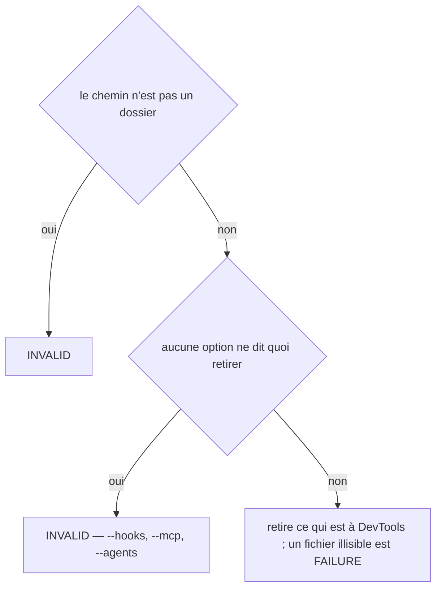
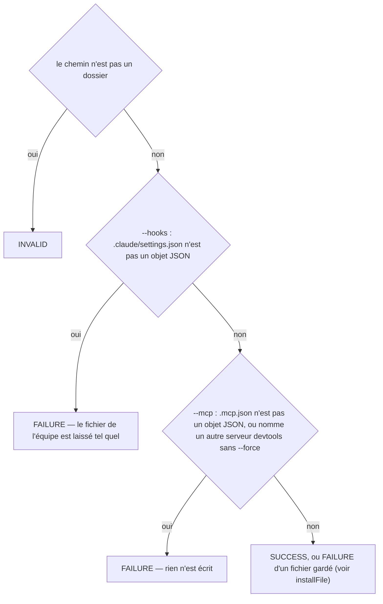
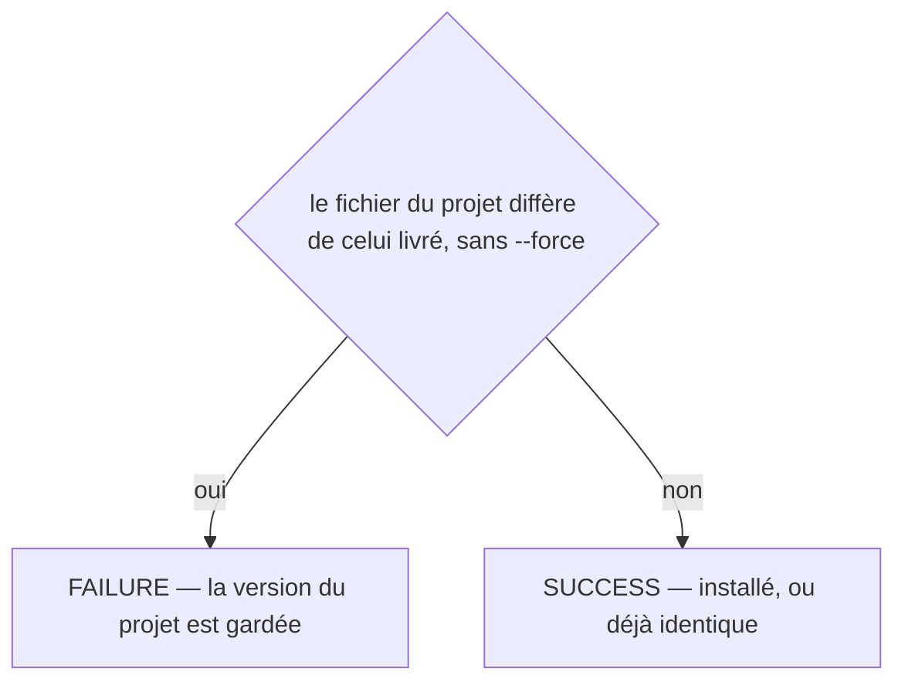
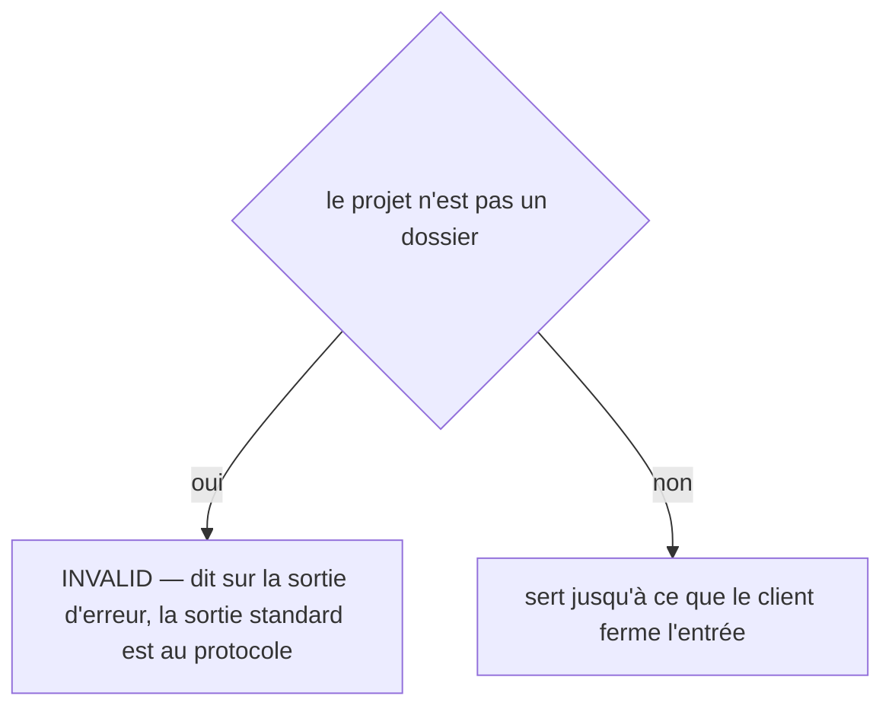
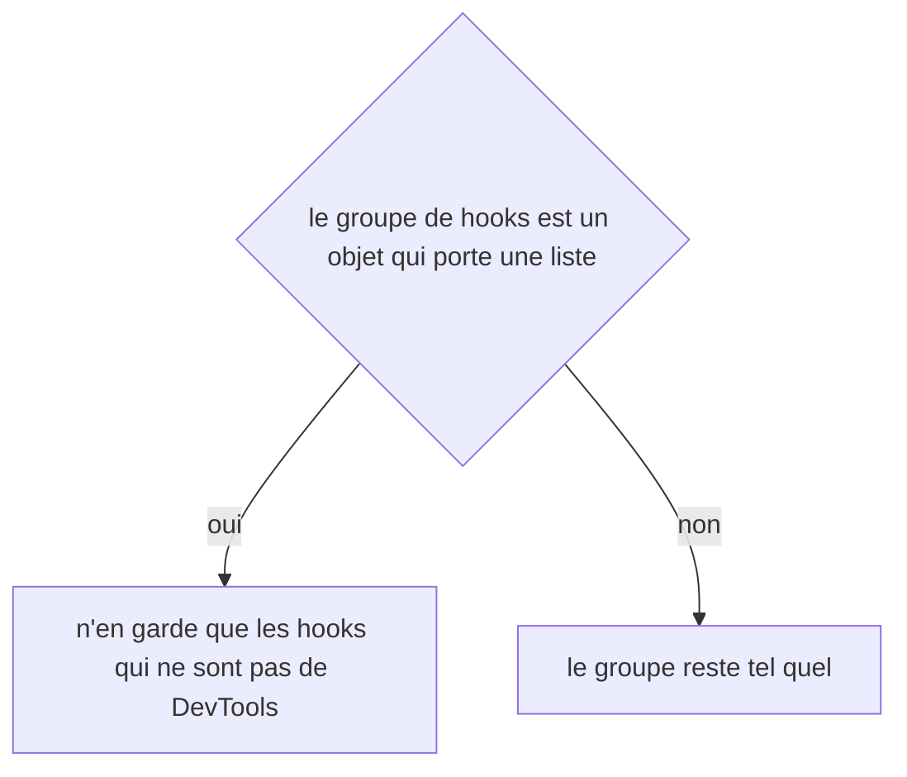
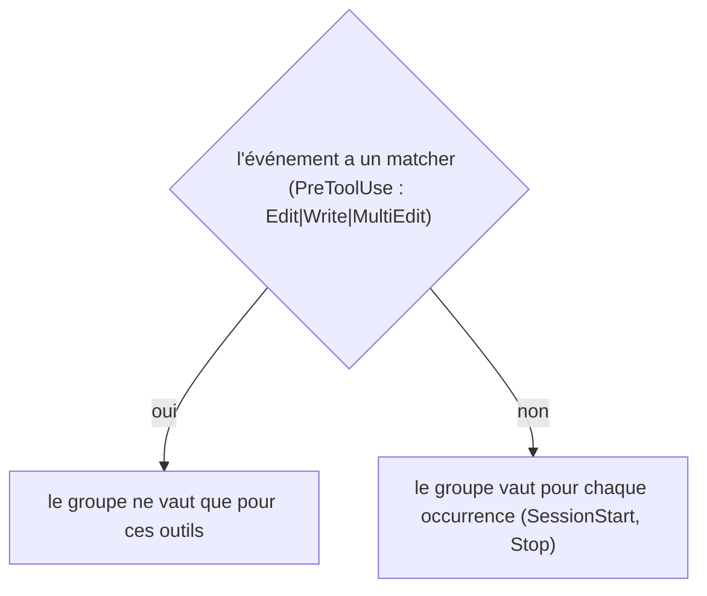

# claude:uninstall
`command.claude.uninstall` · type: commands · last updated: 2026-10-20 · commit: 58c02fb

## Summary

Retire de la configuration Claude Code d'un projet ce que `claude:install` y a ajouté, et rien d'autre (ADR-0019, ADR-0018, ADR-0024) : les hooks de DevTools, son serveur MCP, l'agent vérificateur s'il n'a pas été adapté. Un fichier qui ne contenait que les entrées de DevTools disparaît ; un fichier de l'équipe retrouve son état d'avant.

## Trigger

| Element | Value |
|---|---|
| Entry point | `claude:uninstall` (command) |
| Security | — |
| Preconditions | Le chemin est un dossier, et au moins une option dit quoi retirer : --hooks, --mcp ou --agents. |

## Journey

```mermaid
sequenceDiagram
  participant U as Développeur
  participant C as claude:uninstall
  participant S as ClaudeSettings
  participant A as Agent installé
  U->>C: devtools claude:uninstall --hooks --mcp --agents
  C->>S: hooks de DevTools retirés de settings.json
  C->>S: serveur devtools retiré de .mcp.json
  C->>A: identique à celui livré ?
  A-->>C: oui : retiré ; non : gardé
  C-->>U: une ligne par élément
```

## Decisions

**`Jul6Art\DevTools\Command\ClaudeUninstallCommand::execute`**



**`Jul6Art\DevTools\Command\ClaudeInstallCommand::execute`**



**`Jul6Art\DevTools\Command\ClaudeInstallCommand::installFile`**



**`Jul6Art\DevTools\Command\McpServeCommand::execute`**



**`stdClass::hooks`**



**`stdClass::matcher`**



## Data

Lit et réécrit .claude/settings.json et .mcp.json en objets JSON — un objet vide reste un objet ; supprime l'agent installé s'il est intact. Ne touche à rien d'autre.

## Cross-cutting mechanisms

Aucun.

## Points of attention

Les décisions de `claude:install` et de `mcp:serve` figurent ici parce que la désinstallation lit des constantes de leurs classes — le chemin de l'agent, le nom de la commande — sans les exécuter. Un serveur nommé devtools que DevTools n'a pas écrit, comme un agent adapté par l'équipe, reste en place.

## Related workflows

—

## History

| Date | Commit | Change |
|---|---|---|
| 2026-10-20 | 4979790 | initial |
| 2026-10-20 | 4979790 | rédaction initiale (files changed: src/Command/McpServeCommand.php) |
| 2026-10-20 | 58c02fb | Aucun changement de fond : des tests s'ajoutent au périmètre du workflow. La prose a été relue contre le code et tient. (added test tests/Assertion/AssertionProposalTest.php (+10)) |
