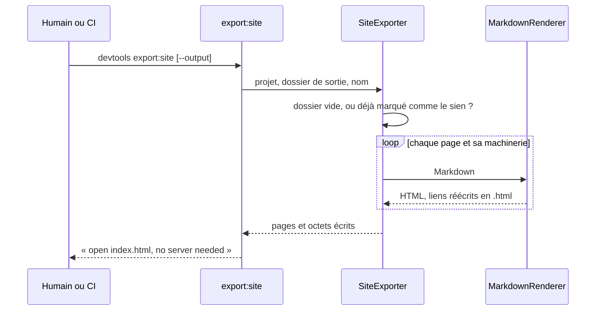
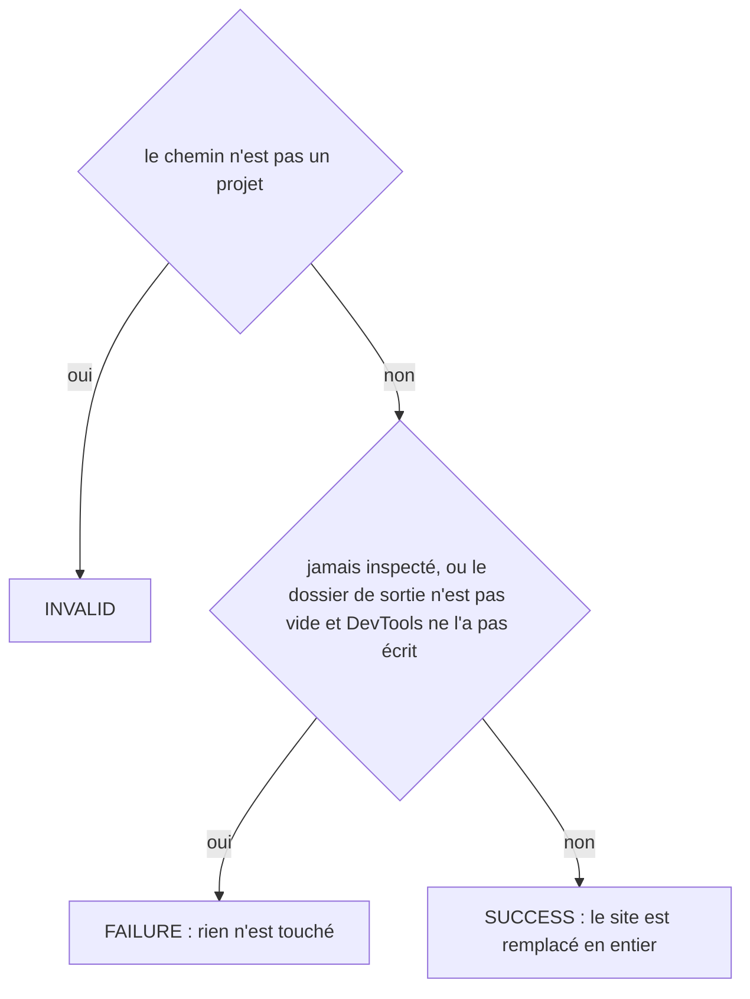
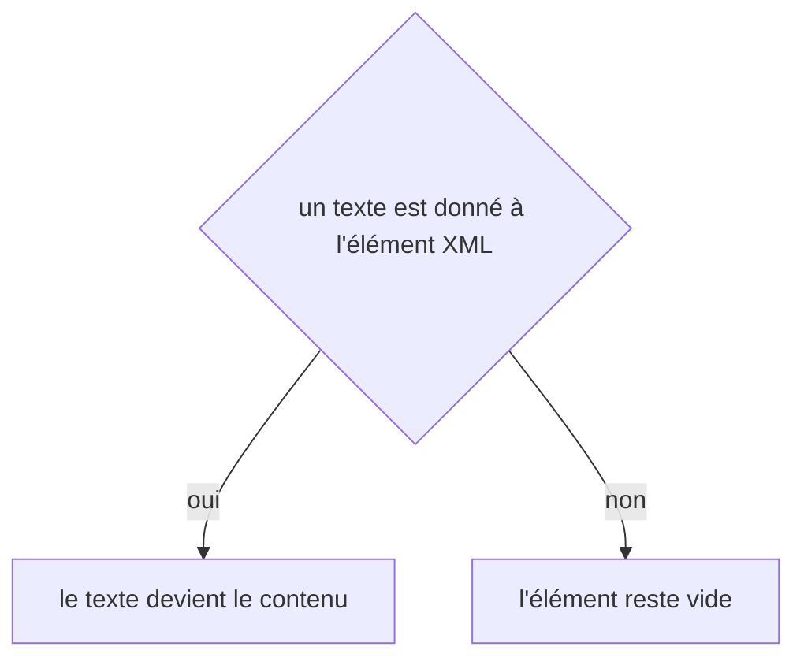

# export:site
`command.export.site` · type: commands · last updated: 2026-10-21 · commit: 240bcc3

## Summary

Exporte la documentation en site statique (ADR-0034) : chaque page, le sommaire, le glossaire et la machinerie qu'ils citent — stack, connaissances, graphe — deviennent du HTML lié comme les pages Markdown le sont, avec Mermaid embarqué et une recherche hors ligne. Le site s'ouvre sans serveur, depuis index.html, et ne charge rien d'un CDN. Le dossier de sortie appartient à DevTools : il est remplacé en entier à chaque export, et un dossier que DevTools n'a pas écrit n'est jamais vidé.

## Trigger

| Element | Value |
|---|---|
| Entry point | `export:site` (command) |
| Security | — |
| Preconditions | Le projet a été inspecté : l'index et le dossier de documentation existent. |

## Journey

## Decisions

**`Jul6Art\DevTools\Command\ExportSiteCommand::execute`**

**`element::textContent`**

## Data

Lit l'index, les pages, le glossaire et les fichiers de .devtools/ qu'elles citent ; écrit le site dans build/devtools-site/ par défaut, ou dans --output, avec un marqueur qui le désigne comme celui de DevTools, la feuille de style, la recherche et Mermaid copiés depuis les ressources.

## Cross-cutting mechanisms

Aucun.

## Points of attention

Le dossier de sortie est remplacé en entier : une page ajoutée à la main y disparaît à l'export suivant. Un dossier non vide sans marqueur est refusé, pour qu'un --output mal choisi ne vide jamais public/ ou un dossier du projet. Mermaid est copié dans le site : rien n'y appelle un réseau. La décision sur `element::textContent` est celle de DomBuilder, sur le chemin de toute lecture XML : elle n'est pas propre à ce workflow.

## Related workflows

—

## History

| Date | Commit | Change |
|---|---|---|
| 2026-10-21 | 240bcc3 | rédaction initiale |
