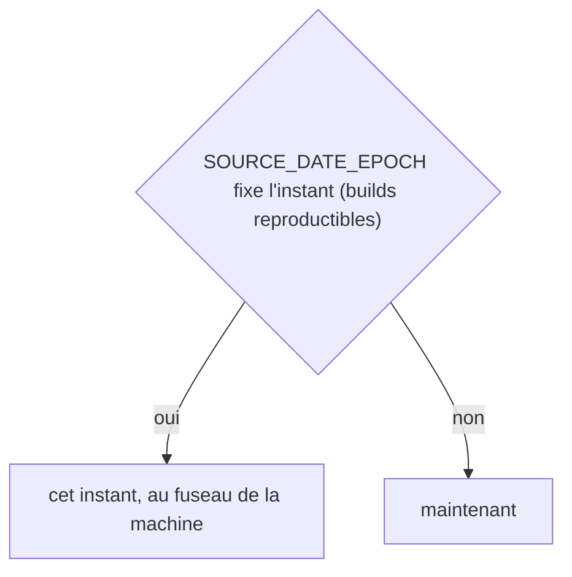
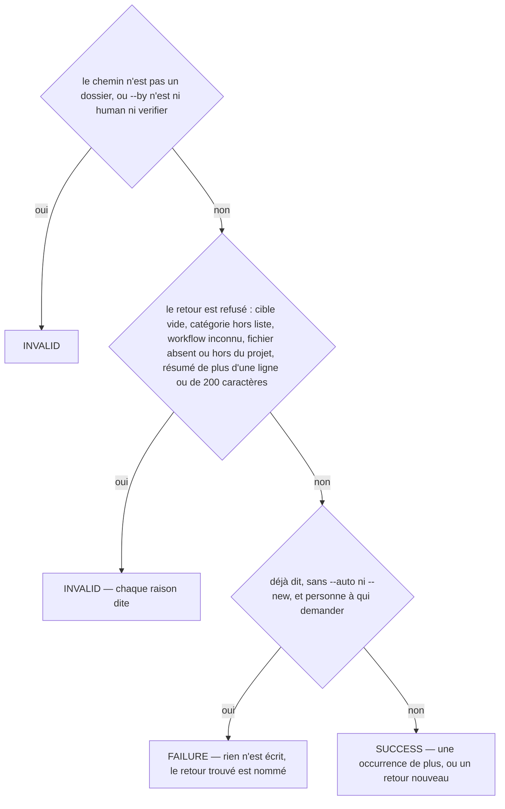
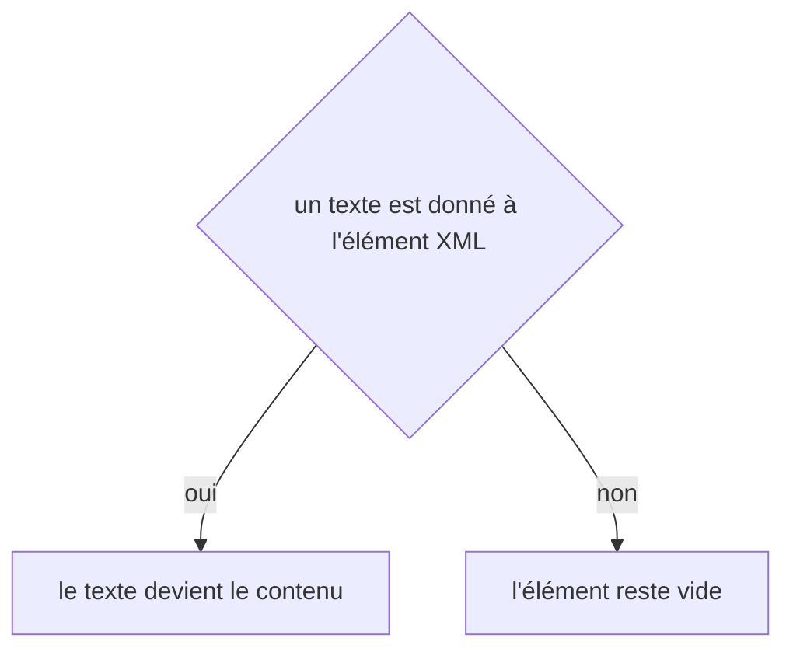

# feedback:add
`command.feedback.add` · type: commands · last updated: 2026-10-20 · commit: 58c02fb

## Summary

Enregistre un retour comme une donnée (ADR-0025) : ce qu'il vise — un workflow, un élément de sa page désigné par un sélecteur CSS, un fichier —, une catégorie de la liste fermée, une ligne de 200 caractères au plus. Ce que la ligne de commande ne dit pas est demandé, quand il y a quelqu'un à qui demander. Déjà dit — même catégorie, cible proche —, le retour devient une occurrence plutôt qu'un doublon ; vu deux fois, la commande propose d'en faire une règle.

## Trigger

| Element | Value |
|---|---|
| Entry point | `feedback:add` (command) |
| Security | — |
| Preconditions | Le projet a été inspecté ; le résumé, la catégorie et au moins une cible sont donnés, en options ou en réponses. |

## Journey

```mermaid
sequenceDiagram
  participant H as Humain
  participant C as feedback:add
  participant R as FeedbackRecorder
  participant D as RecurrenceDetector
  participant F as Retours
  H->>C: résumé, --workflow, --selector, --category
  C->>R: cible, catégorie, workflow, fichier vérifiés
  R->>D: un retour proche, de même catégorie ?
  D-->>R: trouvé, ou rien
  R->>F: une occurrence de plus, ou un retour nouveau, et l'index
  C-->>H: l'identifiant ; vu deux fois, rules:promote proposé
```

## Decisions

**`DateTimeImmutable::timezone`**



**`Jul6Art\DevTools\Command\FeedbackAddCommand::execute`**



**`element::textContent`**



## Data

Lit l'index des workflows, la configuration (les catégories que le projet ajoute), la carte fichiers → workflows et l'index des retours ; écrit le fichier du retour dans .devtools/feedback/AAAA/ et l'index, versionnés. Le commit courant est noté quand le projet est dans un dépôt git.

## Cross-cutting mechanisms

Aucun.

## Points of attention

La récurrence ne lit que l'index des retours et la carte, jamais les fichiers un à un : même sélecteur, même fichier, même workflow, ou deux workflows du même type qui rendent un même composant. Un retour corrigé revu est rouvert ; un retour écarté n'est plus cherché. Sans personne à qui demander, la commande s'arrête plutôt que de trancher à la place de l'humain. L'horloge suit SOURCE_DATE_EPOCH quand il est posé : deux exécutions sur un projet inchangé se comparent alors à l'octet. La décision sur `element::textContent` est celle de DomBuilder, sur le chemin de toute lecture ou écriture XML : elle n'est pas propre à ce workflow.

## Related workflows

—

## History

| Date | Commit | Change |
|---|---|---|
| 2026-10-20 | 58c02fb | rédaction initiale |
| 2026-10-20 | 58c02fb | Aucun changement de fond : le client git lit plus simplement les fichiers du projet et les commits d'une plage, sans rien changer de ce que fait la commande. La prose a été relue et tient. (files changed: src/Inspection/Freshness/GitClient.php) |
