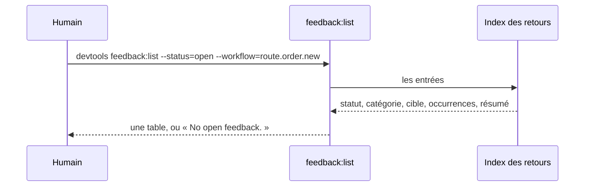
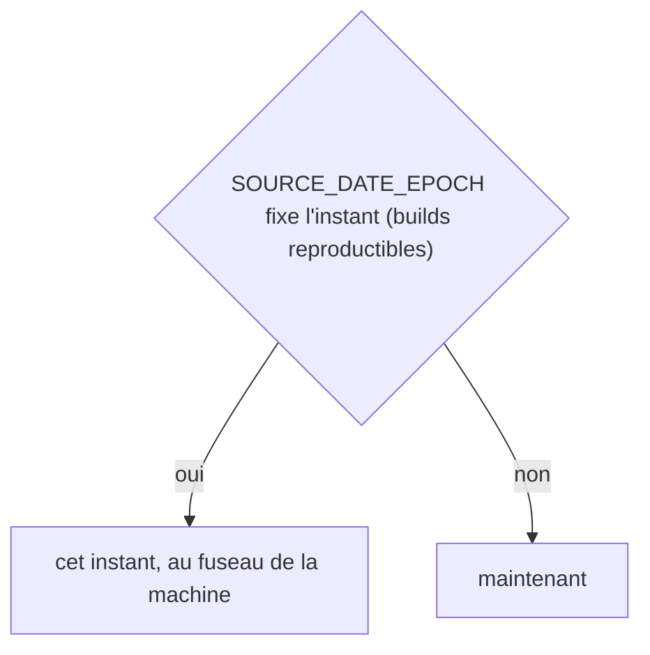
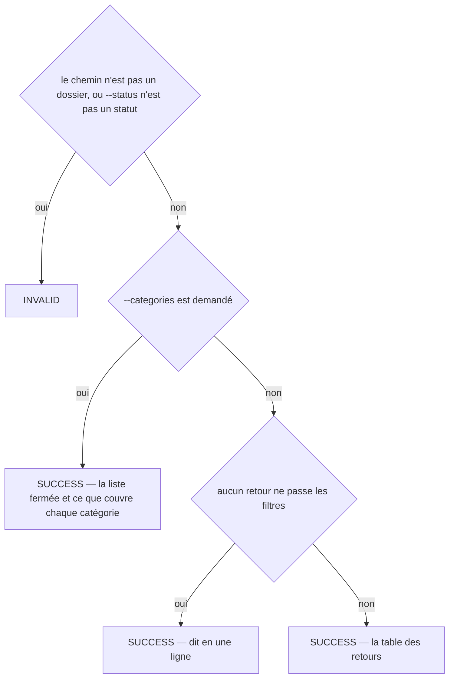
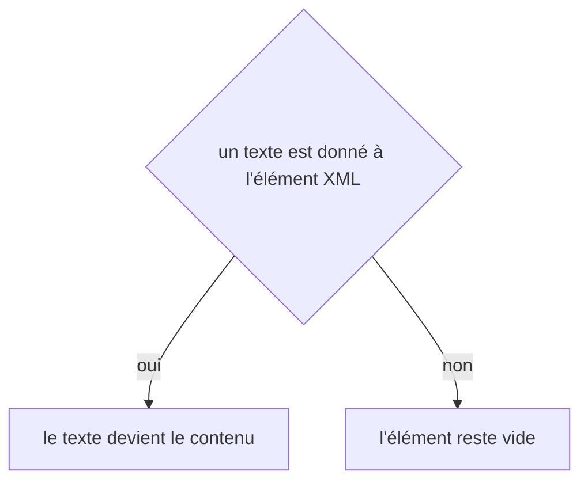

# feedback:list
`command.feedback.list` · type: commands · last updated: 2026-10-20 · commit: 58c02fb

## Summary

Liste les retours d'un projet (ADR-0025) : les ouverts par défaut, ou ceux d'un statut, d'une catégorie, d'un workflow — avec ce qu'ils visent, combien de fois ils ont été vus et leur ligne. --categories donne la liste fermée des catégories et ce que chacune couvre, celles du projet comprises.

## Trigger

| Element | Value |
|---|---|
| Entry point | `feedback:list` (command) |
| Security | — |
| Preconditions | Aucune : sans retour, la commande le dit. |

## Journey

## Decisions

**`DateTimeImmutable::timezone`**

**`Jul6Art\DevTools\Command\FeedbackListCommand::execute`**

**`element::textContent`**

## Data

Lit l'index des retours et la configuration du projet. N'écrit rien.

## Cross-cutting mechanisms

Aucun.

## Points of attention

La liste ne lit que l'index : un fichier de retour déposé à la main sans sa ligne d'index n'y figure pas. La décision d'horloge vient de l'enregistreur que la liste partage avec feedback:add : elle ne date rien. La décision sur `element::textContent` est celle de DomBuilder, sur le chemin de toute lecture ou écriture XML : elle n'est pas propre à ce workflow.

## Related workflows

—

## History

| Date | Commit | Change |
|---|---|---|
| 2026-10-20 | 58c02fb | rédaction initiale |
| 2026-10-20 | 58c02fb | Aucun changement de fond : le client git lit plus simplement les fichiers du projet et les commits d'une plage, sans rien changer de ce que fait la commande. La prose a été relue et tient. (files changed: src/Inspection/Freshness/GitClient.php) |
