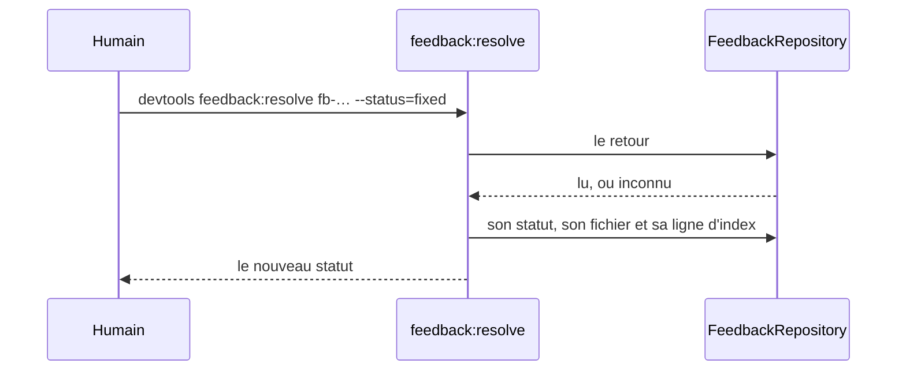
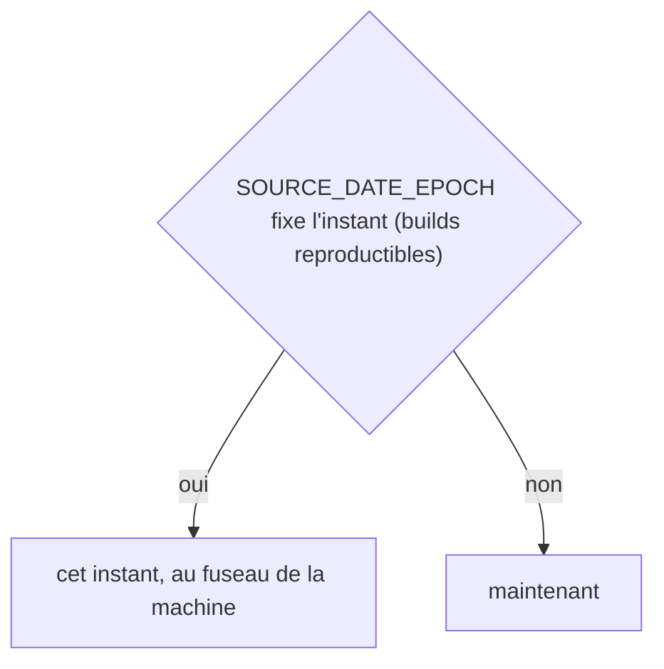
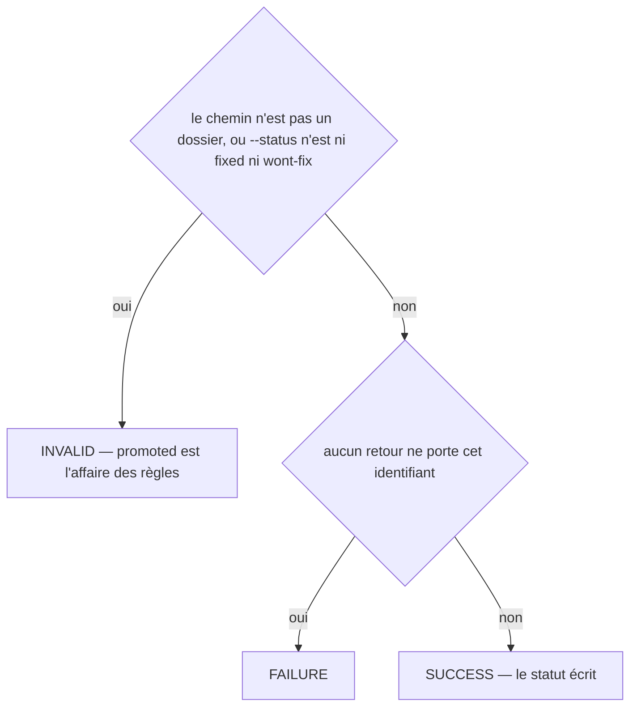
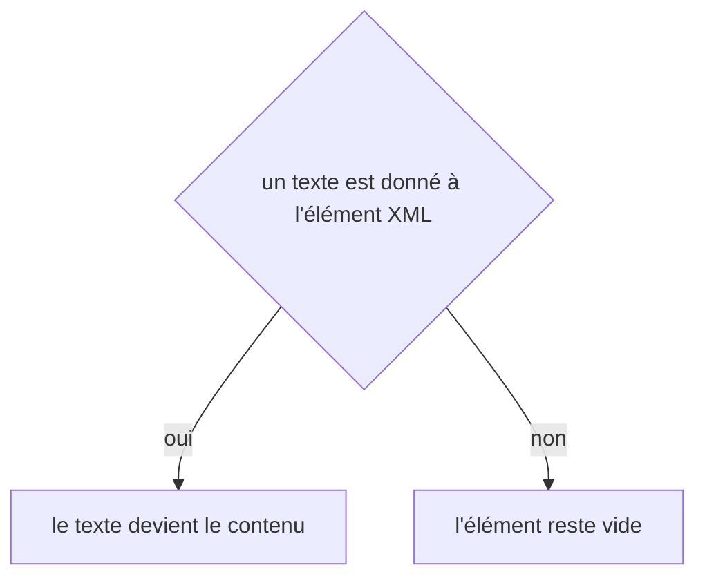

# feedback:resolve
`command.feedback.resolve` · type: commands · last updated: 2026-10-21 · commit: 240bcc3

## Summary

Clôt un retour (ADR-0025) : corrigé (fixed) ou écarté exprès (wont-fix). Un retour corrigé qui revient est rouvert à sa prochaine occurrence ; un retour écarté n'est plus cherché par la récurrence. Seule l'application d'une règle le passe à promoted.

## Trigger

| Element | Value |
|---|---|
| Entry point | `feedback:resolve` (command) |
| Security | — |
| Preconditions | Le retour existe, désigné par son identifiant. |

## Journey

## Decisions

**`DateTimeImmutable::timezone`**

**`Jul6Art\DevTools\Command\FeedbackResolveCommand::execute`**

**`element::textContent`**

## Data

Lit l'index et le fichier du retour ; réécrit les deux.

## Cross-cutting mechanisms

Aucun.

## Points of attention

Écarter n'efface rien : le retour reste, avec ses occurrences, et la rétrospective le compte. L'horloge suit SOURCE_DATE_EPOCH quand il est posé : deux exécutions sur un projet inchangé se comparent alors à l'octet. La décision sur `element::textContent` est celle de DomBuilder, sur le chemin de toute lecture ou écriture XML : elle n'est pas propre à ce workflow.

## Related workflows

—

## History

| Date | Commit | Change |
|---|---|---|
| 2026-10-20 | 58c02fb | rédaction initiale |
| 2026-10-20 | 58c02fb | Aucun changement de fond : le client git lit plus simplement les fichiers du projet et les commits d'une plage, sans rien changer de ce que fait la commande. La prose a été relue et tient. (files changed: src/Inspection/Freshness/GitClient.php) |
| 2026-10-21 | 240bcc3 | Aucun changement de fond : la configuration lit désormais les projets liés (ADR-0038) et le dossier .devtools/ connaît l'index de recherche (ADR-0039), sans rien changer de ce que fait la commande. La prose a été relue et tient. (added test tests/Ask/AskTest.php (+8)) |
| 2026-10-21 | 240bcc3 | Aucun changement de fond : le suivi d'un workflow sait s'allonger d'une révision, le renommage et l'initialisation ont été simplifiés (ADR-0036, ADR-0039), sans rien changer de ce que fait la commande. La prose a été relue et tient. (files changed: src/Tracking/TrackingDocument.php) |
