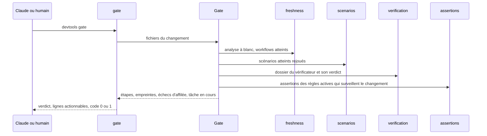
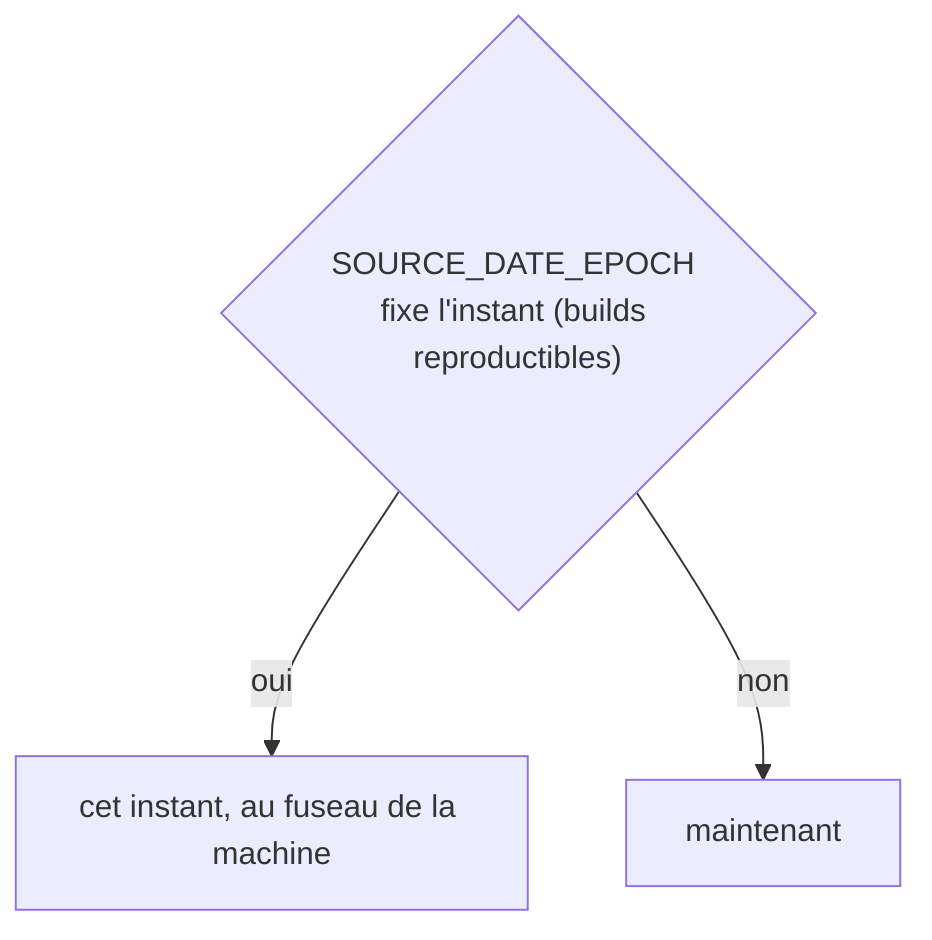
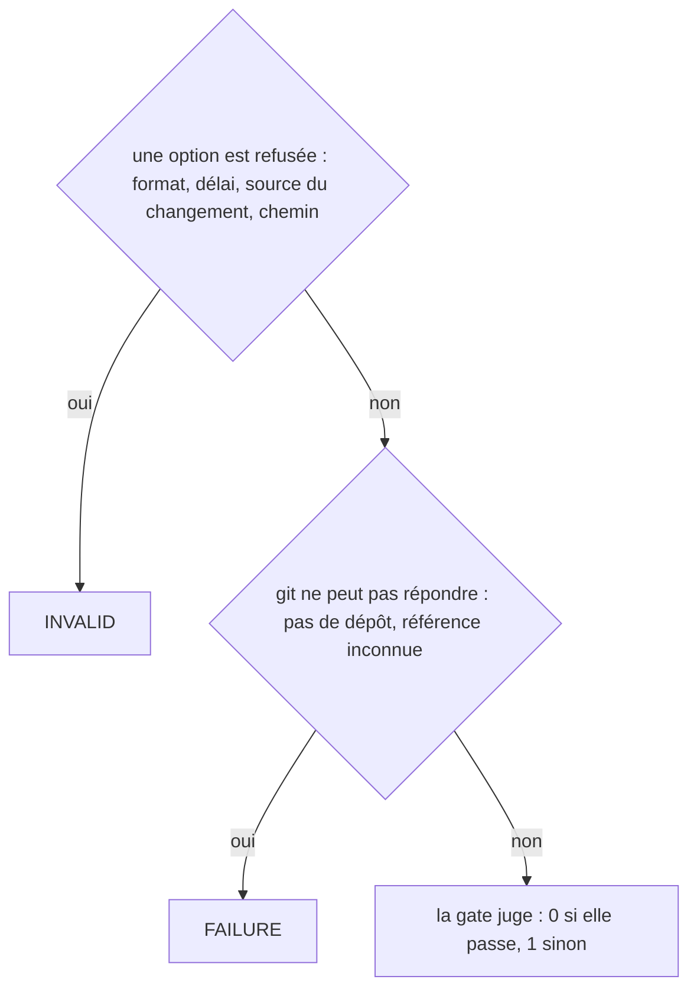
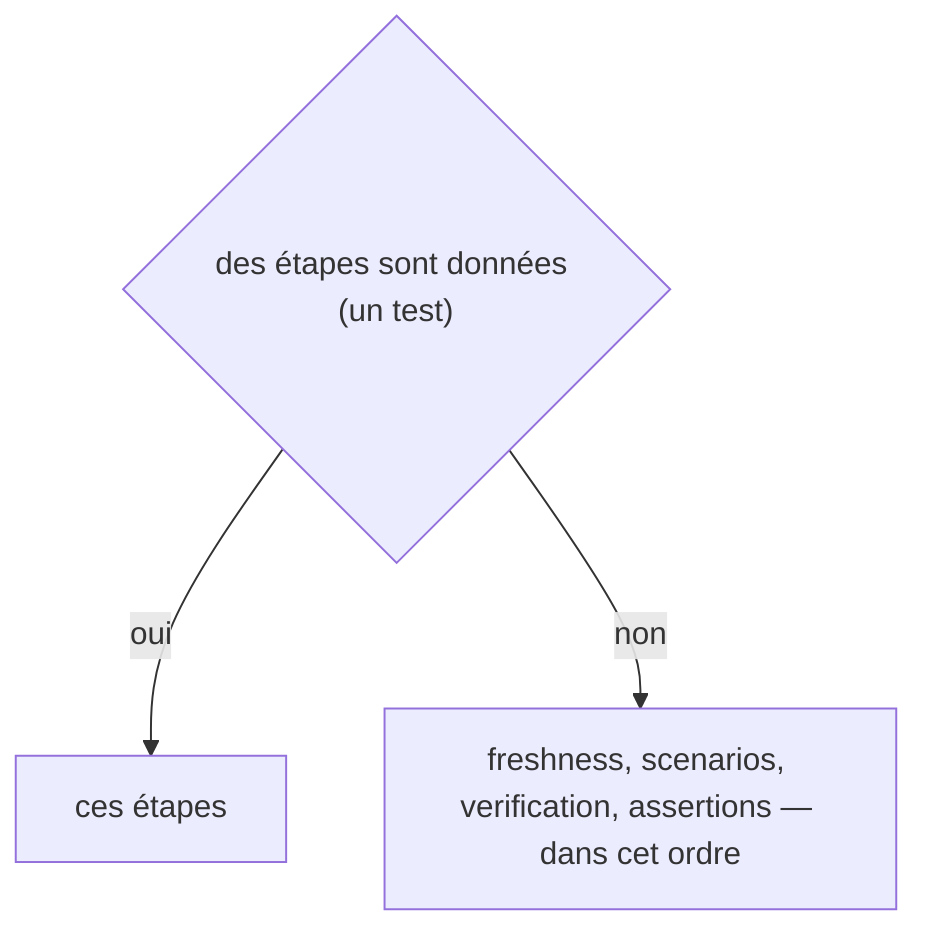
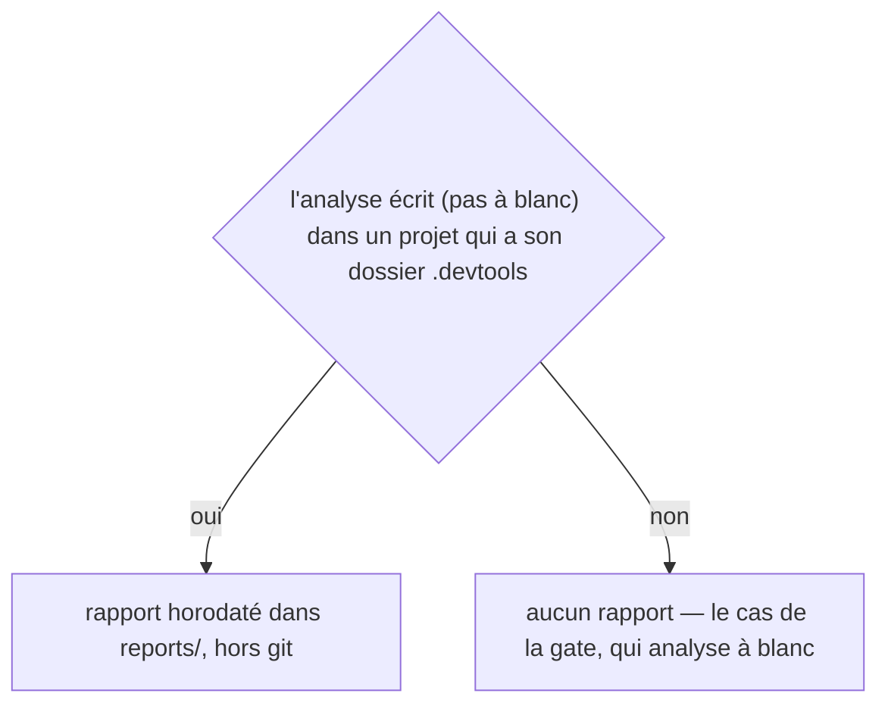
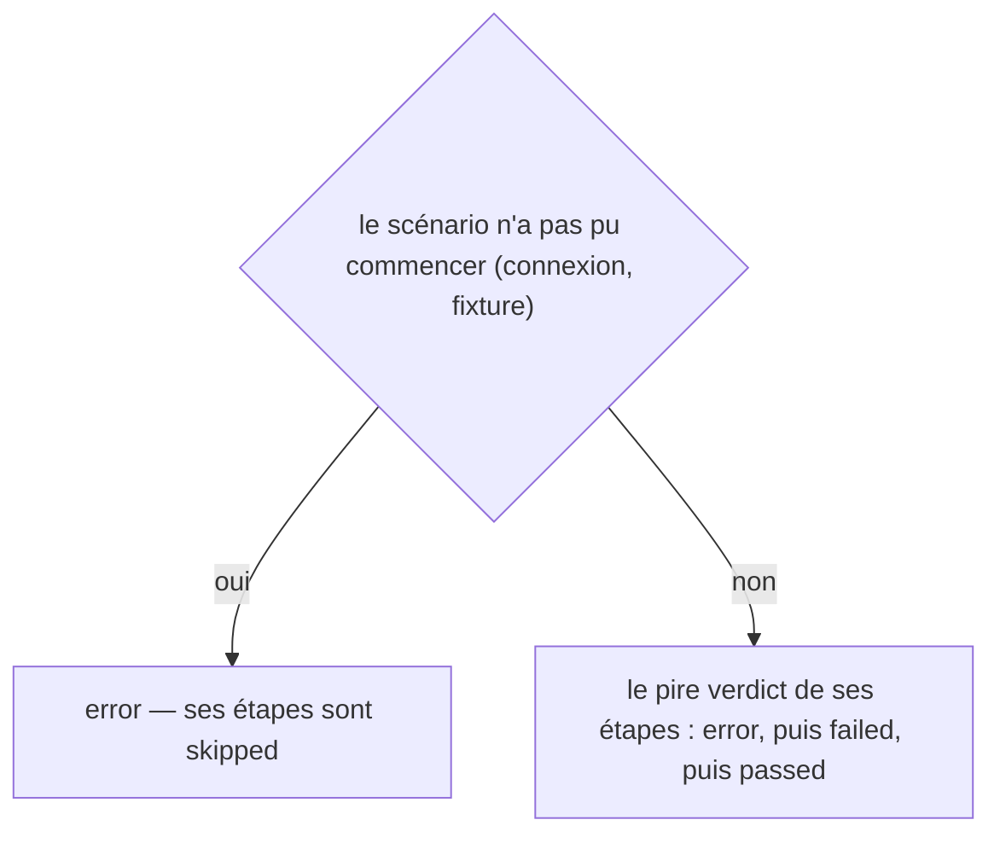
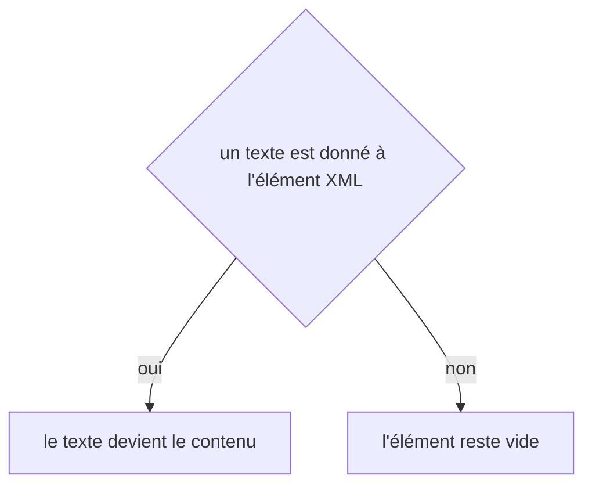

# gate
`command.gate` · type: commands · last updated: 2026-10-20 · commit: 58c02fb

## Summary

La gate (ADR-0023) : Claude ne peut pas déclarer une tâche finie tant qu'elle échoue. Elle juge un changement — l'arbre de travail par défaut — sur ce qu'il atteint, en quatre étapes toutes exécutées : freshness, scenarios, verification, et assertions — celles des règles actives qui surveillent un fichier du changement (ADR-0027). Chaque ligne d'échec nomme le workflow, le scénario, l'étape ou la capture à regarder ; le hook Stop la lance et bloque tant qu'elle est rouge. Chaque passage appartient à une tâche, suivie jusqu'au vert : ses échecs, ses étapes rouges, les règles qui l'ont bloquée (ADR-0029).

## Trigger

| Element | Value |
|---|---|
| Entry point | `gate` (command) |
| Security | — |
| Preconditions | Le projet a été inspecté et le changement se lit par git, ou par les fichiers nommés. |

## Journey

## Decisions

**`DateTimeImmutable::timezone`**

**`Jul6Art\DevTools\Command\GateCommand::execute`**

**`Jul6Art\DevTools\Gate\Gate::steps`**

**`Jul6Art\DevTools\Inspection\InspectionReport::path`**

**`Jul6Art\DevTools\Scenario\Run\ScenarioResult::verdict`**

**`element::textContent`**

## Data

Lit l'index, la carte, les fichiers de suivi, les scénarios, la configuration, les règles et leurs assertions ; exécute les outils que ces assertions appellent, une fois par commande, et compte leurs blocages dans .devtools/stats/rules.xml ; écrit une exécution dans .devtools/runs/, un dossier de vérification dans .devtools/pending/ et son dernier passage dans .devtools/gate/, ignorés par git.

## Cross-cutting mechanisms

Aucun.

## Points of attention

L'étape freshness coûte l'analyse d'un `workflows:check`, proportionnelle au projet et non au changement. Un workflow atteint sans scénario, des scénarios qui ne peuvent pas être rejoués ici — ni Panther ni URL de base — sont des avertissements, que --strict change en échecs : un projet qui démarre ne doit pas être rouge partout. Une assertion qui ne peut pas dire — pas de capture de ce passage, un outil illisible — est un avertissement, jamais un blocage. La décision sur `element::textContent` est celle de DomBuilder, sur le chemin de toute lecture ou écriture XML : elle n'est pas propre à ce workflow.

## Related workflows

—

## History

| Date | Commit | Change |
|---|---|---|
| 2026-10-20 | 4979790 | rédaction initiale |
| 2026-10-20 | 58c02fb | L'étape assertions exécute les assertions des règles actives (ADR-0027) ; le dernier passage suit la tâche en cours, ses échecs et les règles qui l'ont bloquée (ADR-0029). (added test tests/Assertion/AssertionProposalTest.php (+10)) |
| 2026-10-20 | 58c02fb | Aucun changement de fond : le code a été remis en forme (Rector, style), sans rien changer de ce que fait la commande. La prose a été relue et tient. (files changed: src/Gate/Gate.php, src/Gate/XmlGateStore.php) |
| 2026-10-20 | 58c02fb | Aucun changement de fond : le client git lit plus simplement les fichiers du projet et les commits d'une plage, sans rien changer de ce que fait la commande. La prose a été relue et tient. (files changed: src/Inspection/Freshness/GitClient.php) |
