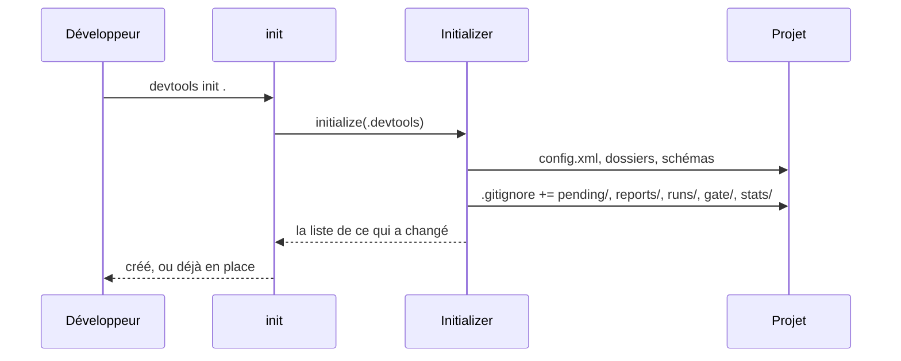
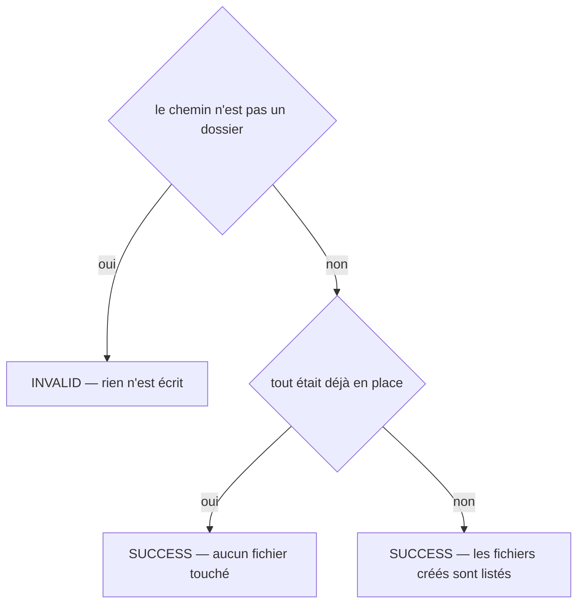
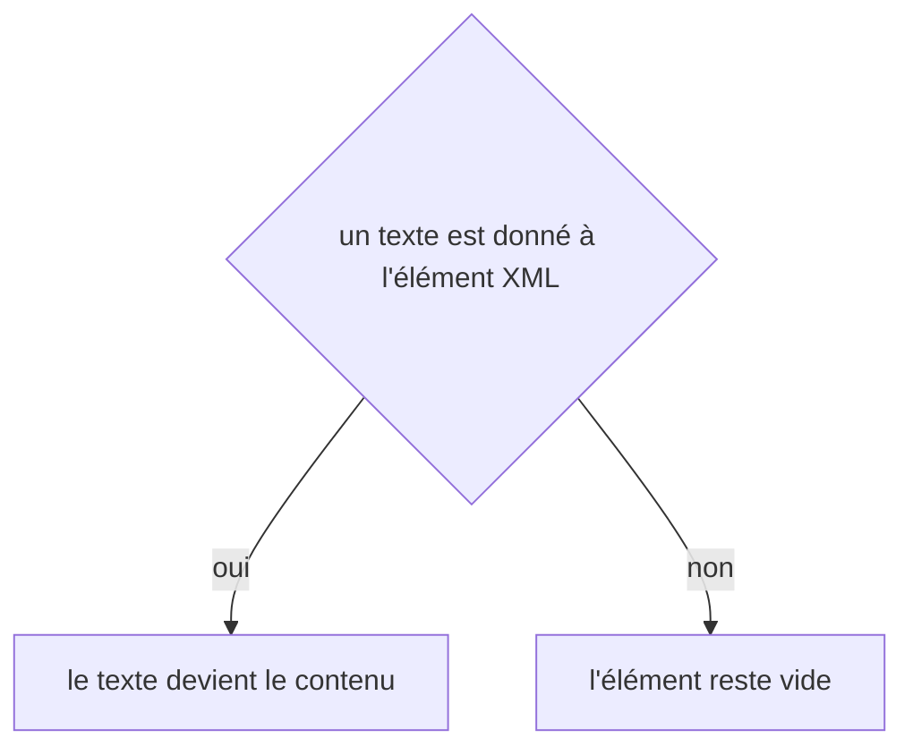

# init
`command.init` · type: commands · last updated: 2026-10-21 · commit: 240bcc3

## Summary

Crée le dossier `.devtools/` d'un projet et le prépare à être inspecté : la configuration commentée, les six sous-dossiers, la copie des XSD, et les lignes du `.gitignore` qui excluent les zones de travail — pending/, reports/, runs/, gate/ et stats/ — et l'index de recherche, search.idx. La commande est idempotente — elle n'écrase aucun fichier existant — et `workflows:inspect` l'appelle d'elle-même, si bien qu'on ne la lance à la main que pour lire la configuration avant le premier scan.

## Trigger

| Element | Value |
|---|---|
| Entry point | `init` (command) |
| Security | — |
| Preconditions | Le chemin donné est un dossier existant. |

## Journey

## Decisions

**`Jul6Art\DevTools\Command\InitCommand::execute`**

**`element::textContent`**

## Data

Écrit la configuration du projet, `.devtools/schemas/`, les dossiers du § 4.4 et le `.gitignore` du projet. Ne lit rien du code.

## Cross-cutting mechanisms

Aucun : la commande ne traverse pas le projet, elle le prépare.

## Points of attention

Le `.gitignore` appartient au projet : `init` y ajoute les lignes qui manquent, six au plus — un dossier avec sa barre finale, un fichier sans — et ne le réécrit jamais. Après la première inspection, le dépôt est donc « sale » pour git, et c'est exact.

## Related workflows

—

## History

| Date | Commit | Change |
|---|---|---|
| 2026-09-18 | b8049a4 | rédaction initiale |
| 2026-09-19 | d9d6b8f | added test tests/Project/GitHooksTest.php |
| 2026-09-20 | 9e40da9 | Aucun changement de fond : seul un test s'est ajouté au périmètre du workflow. La prose a été relue contre le code et tient. (added test tests/Inspection/Adapter/Symfony/DoctrineListenersTest.php) |
| 2026-10-20 | 2885138 | Aucun changement de fond : seuls des tests se sont ajoutés au périmètre du workflow. La prose a été relue contre le code et tient. (added test tests/Ai/MenuAfterApplyTest.php (+4)) |
| 2026-10-20 | 4979790 | Aucun changement de fond : le gabarit passe à neuf sections : la navigation et la machine à états ouvrent « Decisions » (ADR-0044), et des tests se sont ajoutés. La prose a été relue contre le code et tient. (added test tests/Stack/Knowledge/KnowledgeAmendTest.php) |
| 2026-10-20 | 4979790 | Deux zones de travail de plus sont ignorées — les exécutions de scénarios et le dernier passage de la gate — et la configuration commentée montre la section des scénarios. (added decision element::textContent: — → $text (+8)) |
| 2026-10-20 | 58c02fb | Une zone de travail de plus est ignorée, stats/ — les compteurs des règles —, et init copie les schémas des retours, des règles, des assertions et du journal. (added test tests/Assertion/AssertionProposalTest.php (+10)) |
| 2026-10-21 | 240bcc3 | Ajoute aussi l'index de recherche, un cache, au .gitignore du projet (ADR-0039). (added test tests/Ask/AskTest.php (+8)) |
| 2026-10-21 | 240bcc3 | Aucun changement de fond : le suivi d'un workflow sait s'allonger d'une révision, le renommage et l'initialisation ont été simplifiés (ADR-0036, ADR-0039), sans rien changer de ce que fait la commande. La prose a été relue et tient. (files changed: src/Tracking/Initializer.php) |
