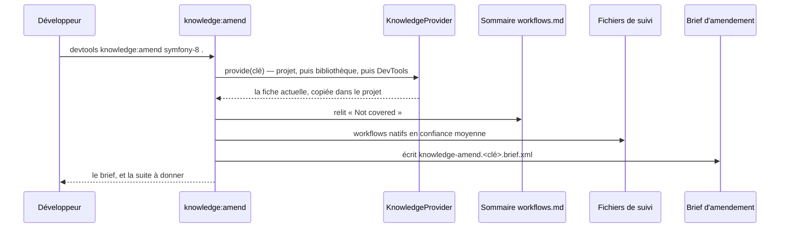
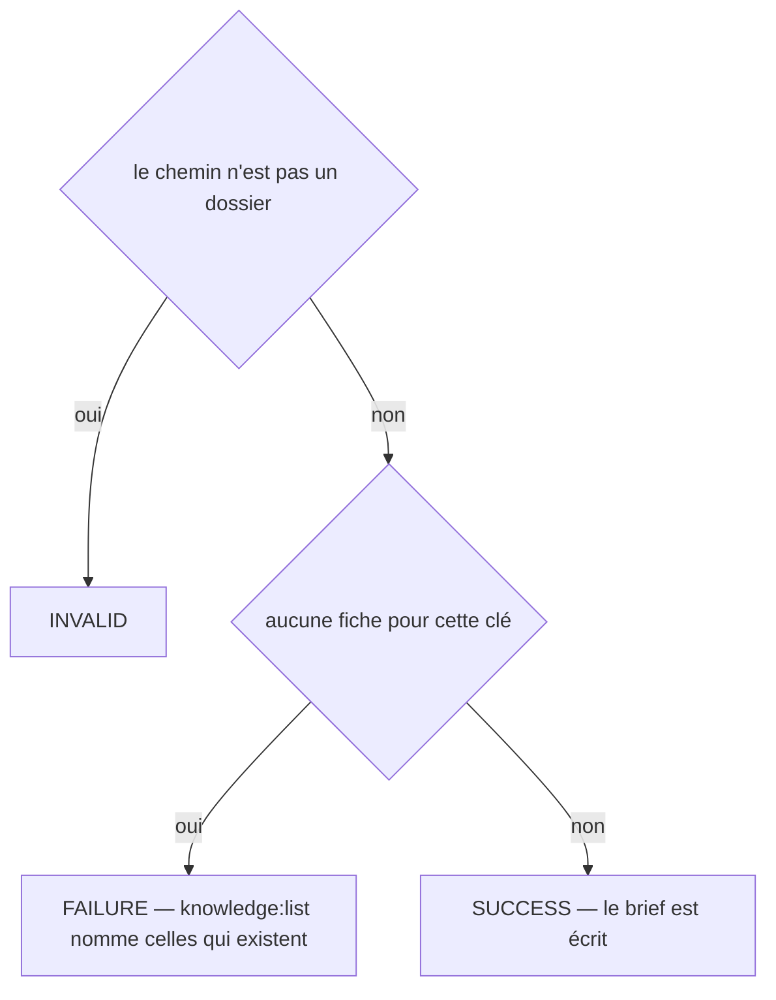
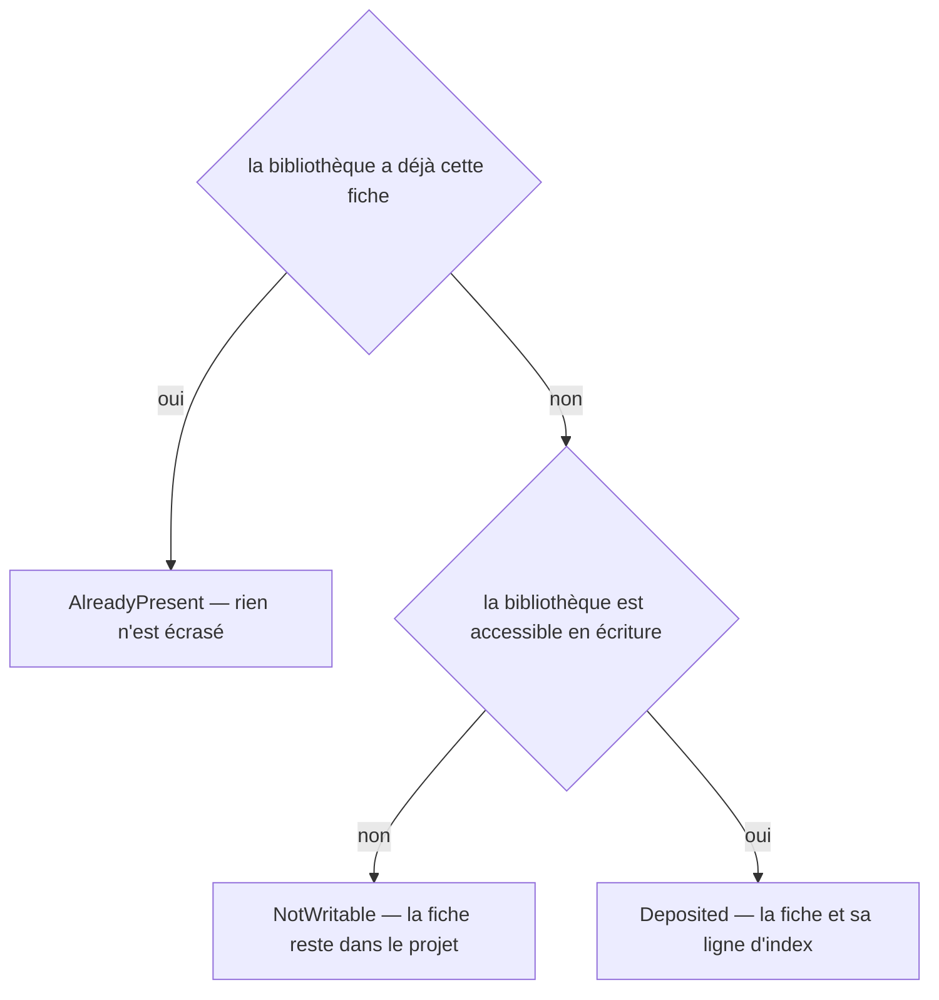
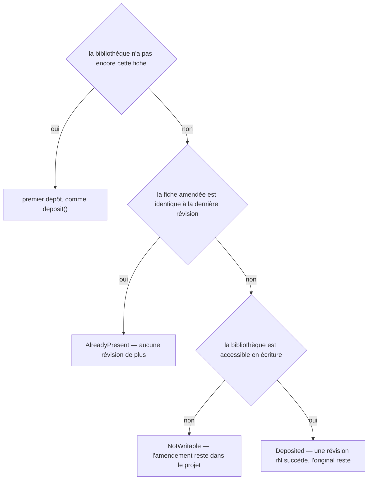
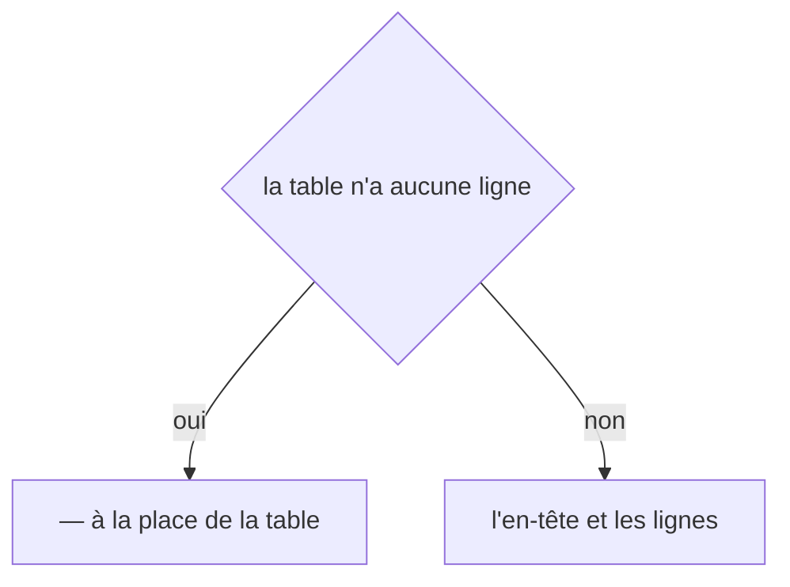

# knowledge:amend
`command.knowledge.amend` · type: commands · last updated: 2026-10-21 · commit: 240bcc3

## Summary

Demande à Claude de compléter une fiche de connaissance qu'un projet a montrée incomplète. La commande
écrit un brief d'amendement portant la fiche actuelle et ce que la dernière inspection n'a pas compris ;
le brouillon, la fiche entière réécrite, est appliqué par workflows:apply. Jamais déclenchée par une
inspection : une fiche ne change que sur demande.

## Trigger

| Element | Value |
|---|---|
| Entry point | `knowledge:amend` (command) |
| Security | — |
| Preconditions | Le chemin donné est un dossier ; une fiche existe pour cette clé dans le projet, la bibliothèque ou DevTools. |

## Journey

## Decisions

**`Jul6Art\DevTools\Command\KnowledgeAmendCommand::execute`**

**`Jul6Art\DevTools\Stack\Knowledge\KnowledgeLibrary::deposit`**

**`Jul6Art\DevTools\Stack\Knowledge\KnowledgeLibrary::depositRevision`**

**`Jul6Art\DevTools\Rendering\MarkdownWriter::table`**

## Data

Lit la configuration, le fichier de stack, le sommaire et les fichiers de suivi ; copie la fiche actuelle
dans le projet si elle n'y était pas ; écrit le brief d'amendement, validé par son XSD.

## Cross-cutting mechanisms

Aucun.

## Points of attention

Le brief est nommé à part de ceux de l'inspection, qui les efface à chaque passage : un amendement
demandé survit à une inspection lancée entre-temps. Les fichiers non couverts sont relus dans le
sommaire, seul endroit où ils sont écrits ; sans sommaire, le brief n'en porte aucun. Le repli statique
se déduit des workflows d'un adaptateur natif en confiance moyenne, pas du rapport d'inspection, qui
reste local.

## Related workflows

—

## History

| Date | Commit | Change |
|---|---|---|
| 2026-10-20 | 4979790 | rédaction initiale |
| 2026-10-20 | 4979790 | La fiche se lit là où l'inspection la trouverait, sans copie quand on ne fait que la lire ; des tests s'ajoutent au périmètre. La prose tient. (added test tests/Gate/GateBrowserTest.php (+8)) |
| 2026-10-20 | 58c02fb | Aucun changement de fond : la configuration apprend les catégories de retours du projet, le client git et les chemins de .devtools ce que demandent les retours, les règles et le journal, sans rien changer de ce que fait la commande ; des tests s'ajoutent. La prose tient. (added test tests/Assertion/AssertionProposalTest.php (+10)) |
| 2026-10-21 | 240bcc3 | Aucun changement de fond : la configuration lit désormais les projets liés (ADR-0038) et le dossier .devtools/ connaît l'index de recherche (ADR-0039), sans rien changer de ce que fait la commande. La prose a été relue et tient. (added test tests/Ask/AskTest.php (+10)) |
| 2026-10-21 | 240bcc3 | Aucun changement de fond : le suivi d'un workflow sait s'allonger d'une révision, le renommage et l'initialisation ont été simplifiés (ADR-0036, ADR-0039), sans rien changer de ce que fait la commande. La prose a été relue et tient. (files changed: src/Tracking/TrackingDocument.php) |
