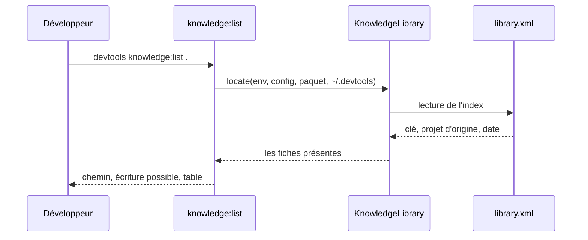
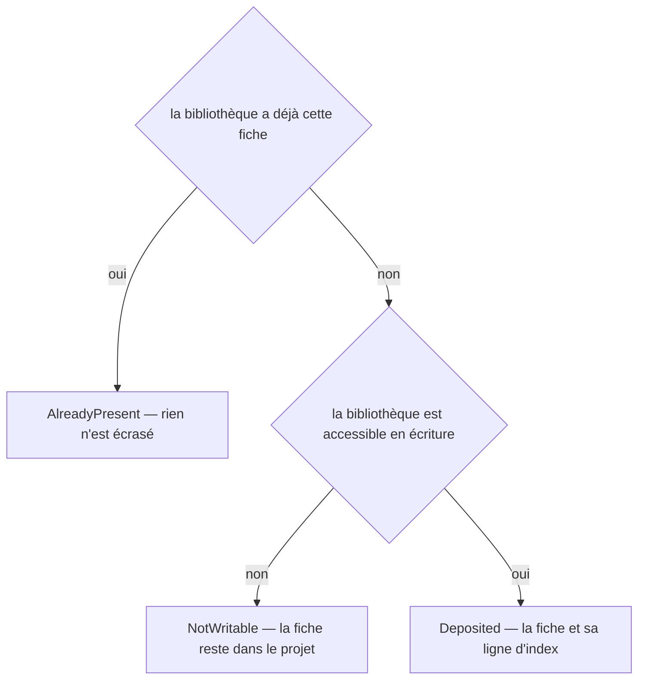
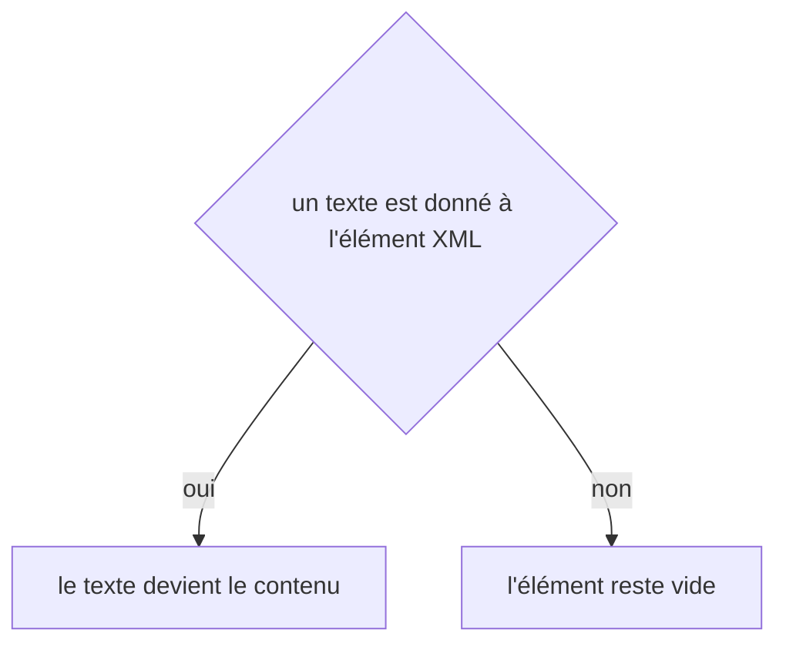
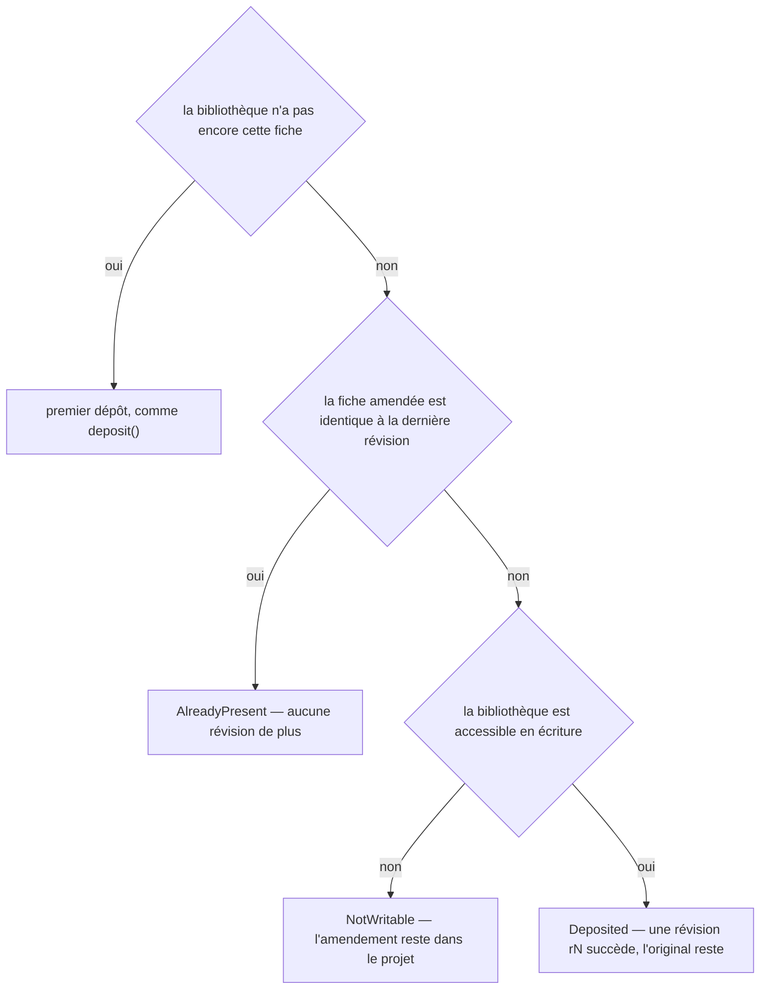

# knowledge:list
`command.knowledge.list` · type: commands · last updated: 2026-10-21 · commit: 240bcc3

## Summary

Dit où vit la bibliothèque de connaissances de stack partagée par tous les projets de la machine, si elle est accessible en écriture, ce qu'elle contient et d'où chaque fiche vient. Les fiches que DevTools embarque et que la bibliothèque ne couvre pas sont nommées à la suite : on voit d'un coup ce qui sera demandé à Claude au prochain projet.

## Trigger

| Element | Value |
|---|---|
| Entry point | `knowledge:list` (command) |
| Security | — |
| Preconditions | Aucune : sans projet ni configuration, la bibliothèque par défaut est listée. |

## Journey

## Decisions

**`Jul6Art\DevTools\Stack\Knowledge\KnowledgeLibrary::deposit`**

**`element::textContent`**

**`Jul6Art\DevTools\Stack\Knowledge\KnowledgeLibrary::depositRevision`**

## Data

Lit `library.xml` de la bibliothèque et les fiches présentes sur le disque ; lit la configuration du projet quand un chemin est donné. N'écrit rien.

## Cross-cutting mechanisms

Aucun.

## Points of attention

Une fiche déposée à la main dans le dossier est listée même si `library.xml` l'ignore : le disque fait foi sur ce qui existe, l'index sur ce qui vient d'où.

## Related workflows

—

## History

| Date | Commit | Change |
|---|---|---|
| 2026-09-18 | b8049a4 | rédaction initiale |
| 2026-09-19 | d9d6b8f | added test tests/Project/GitHooksTest.php |
| 2026-09-20 | 9e40da9 | Aucun changement de fond : seul un test s'est ajouté au périmètre du workflow. La prose a été relue contre le code et tient. (added test tests/Inspection/Adapter/Symfony/DoctrineListenersTest.php) |
| 2026-10-20 | 2885138 | Aucun changement de fond : seuls des tests se sont ajoutés au périmètre du workflow. La prose a été relue contre le code et tient. (added test tests/Ai/MenuAfterApplyTest.php (+4)) |
| 2026-10-20 | 4979790 | la bibliothèque garde les révisions d'une fiche amendée, et la liste affiche celle qu'un projet lit ; le gabarit passe à neuf sections : la navigation et la machine à états ouvrent « Decisions » (ADR-0044) (added decision Jul6Art\DevTools\Stack\Knowledge\KnowledgeLibrary::depositRevision: — → \Jul6Art\DevTools\Stack\Knowledge\DepositOutcome::AlreadyPresent (+3)) |
| 2026-10-20 | 4979790 | Aucun changement de fond : des tests s'ajoutent au périmètre du workflow. La prose a été relue contre le code et tient. (added test tests/Gate/GateBrowserTest.php (+8)) |
| 2026-10-20 | 58c02fb | Aucun changement de fond : la configuration apprend les catégories de retours du projet, le client git et les chemins de .devtools ce que demandent les retours, les règles et le journal, sans rien changer de ce que fait la commande ; des tests s'ajoutent. La prose tient. (added test tests/Assertion/AssertionProposalTest.php (+10)) |
| 2026-10-21 | 240bcc3 | Aucun changement de fond : la configuration lit désormais les projets liés (ADR-0038) et le dossier .devtools/ connaît l'index de recherche (ADR-0039), sans rien changer de ce que fait la commande. La prose a été relue et tient. (added test tests/Ask/AskTest.php (+8)) |
