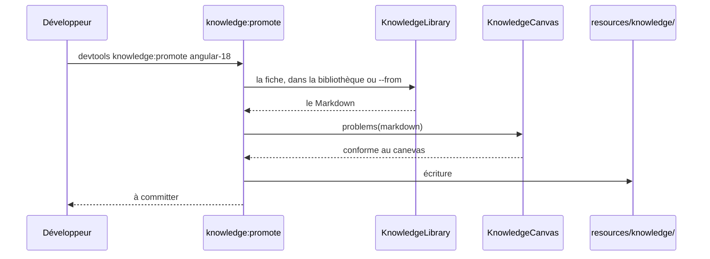
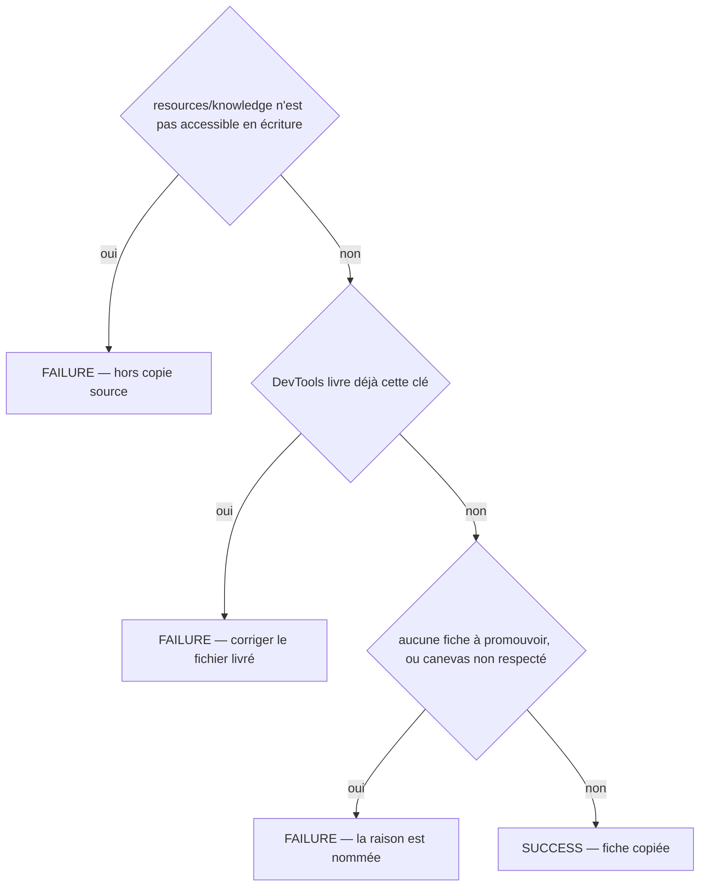
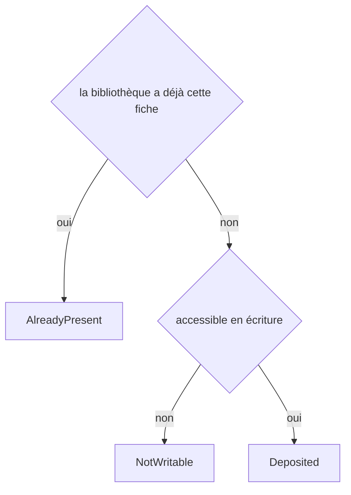
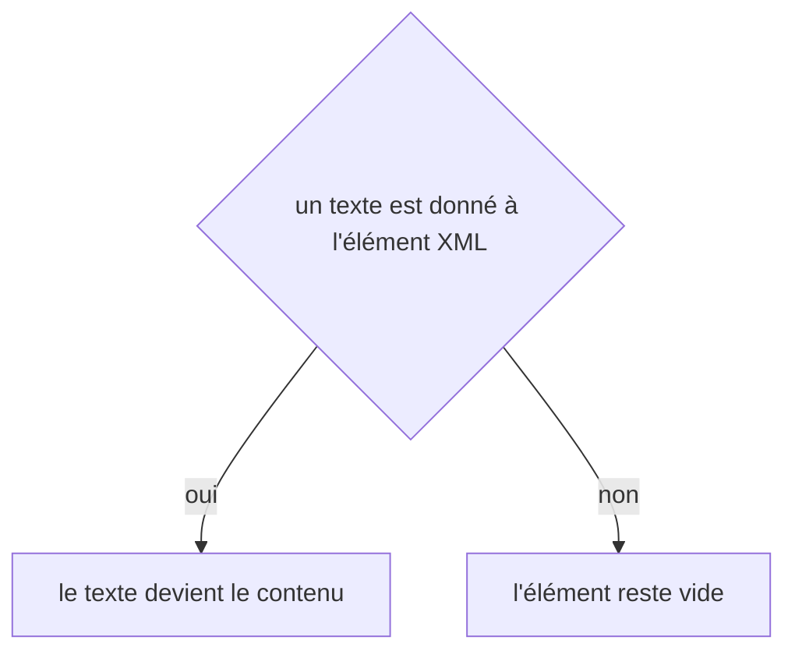
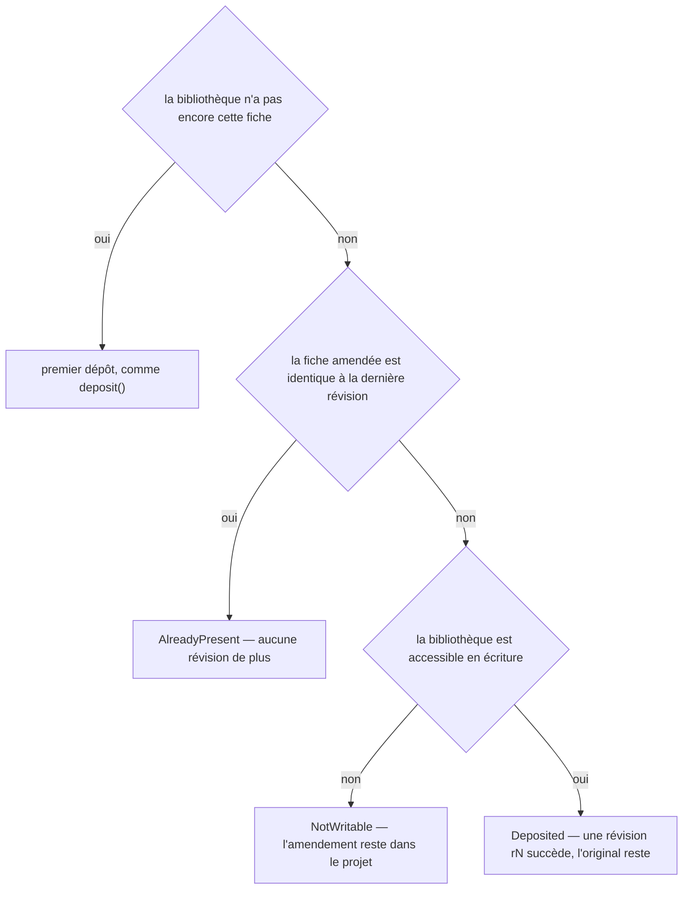

# knowledge:promote
`command.knowledge.promote` · type: commands · last updated: 2026-10-21 · commit: 240bcc3

## Summary

Copie une fiche de connaissance — de la bibliothèque partagée, ou du `.devtools/knowledge/` d'un projet avec `--from` — dans `resources/knowledge/` de DevTools, pour qu'elle parte avec le paquet publié. Le dépôt dans la bibliothèque est automatique ; l'embarquer dans le paquet ne l'est pas : cette commande prépare la pull request, un humain la relit.

## Trigger

| Element | Value |
|---|---|
| Entry point | `knowledge:promote` (command) |
| Security | — |
| Preconditions | DevTools tourne depuis une copie source, et la fiche existe quelque part. |

## Journey

## Decisions

**`Jul6Art\DevTools\Command\KnowledgePromoteCommand::execute`**

**`Jul6Art\DevTools\Stack\Knowledge\KnowledgeLibrary::deposit`**

**`element::textContent`**

**`Jul6Art\DevTools\Stack\Knowledge\KnowledgeLibrary::depositRevision`**

## Data

Lit une fiche Markdown et la configuration du projet ; écrit dans `resources/knowledge/` du paquet.

## Cross-cutting mechanisms

Aucun.

## Points of attention

La promotion ne vérifie que le canevas, pas la justesse : une fiche fausse promue fausse toutes les rédactions de la stack. C'est la relecture de la pull request qui tranche.

## Related workflows

—

## History

| Date | Commit | Change |
|---|---|---|
| 2026-09-18 | b8049a4 | rédaction initiale |
| 2026-09-19 | d9d6b8f | added test tests/Project/GitHooksTest.php |
| 2026-09-20 | 9e40da9 | Aucun changement de fond : seul un test s'est ajouté au périmètre du workflow. La prose a été relue contre le code et tient. (added test tests/Inspection/Adapter/Symfony/DoctrineListenersTest.php) |
| 2026-09-21 | e5a6438 | l'outil passe en anglais : ce que la commande écrit, et les titres des pages qu'elle produit (files changed: src/Stack/Knowledge/KnowledgeCanvas.php) |
| 2026-10-20 | 2885138 | Aucun changement de fond : seuls des tests se sont ajoutés au périmètre du workflow. La prose a été relue contre le code et tient. (added test tests/Ai/MenuAfterApplyTest.php (+4)) |
| 2026-10-20 | 4979790 | la bibliothèque sait recevoir une fiche amendée en révision ; le gabarit passe à neuf sections : la navigation et la machine à états ouvrent « Decisions » (ADR-0044) (added decision Jul6Art\DevTools\Stack\Knowledge\KnowledgeLibrary::depositRevision: — → \Jul6Art\DevTools\Stack\Knowledge\DepositOutcome::AlreadyPresent (+3)) |
| 2026-10-20 | 4979790 | Aucun changement de fond : des tests s'ajoutent au périmètre du workflow. La prose a été relue contre le code et tient. (added test tests/Gate/GateBrowserTest.php (+8)) |
| 2026-10-20 | 58c02fb | Aucun changement de fond : la configuration apprend les catégories de retours du projet, le client git et les chemins de .devtools ce que demandent les retours, les règles et le journal, sans rien changer de ce que fait la commande ; des tests s'ajoutent. La prose tient. (added test tests/Assertion/AssertionProposalTest.php (+10)) |
| 2026-10-21 | 240bcc3 | Aucun changement de fond : la configuration lit désormais les projets liés (ADR-0038) et le dossier .devtools/ connaît l'index de recherche (ADR-0039), sans rien changer de ce que fait la commande. La prose a été relue et tient. (added test tests/Ask/AskTest.php (+8)) |
