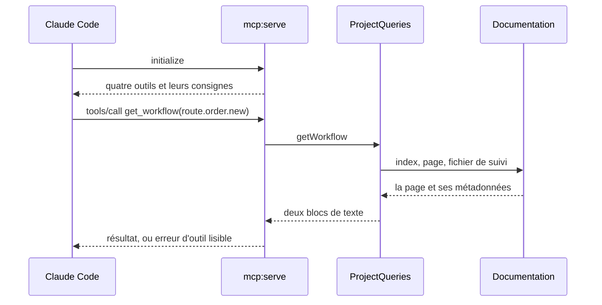
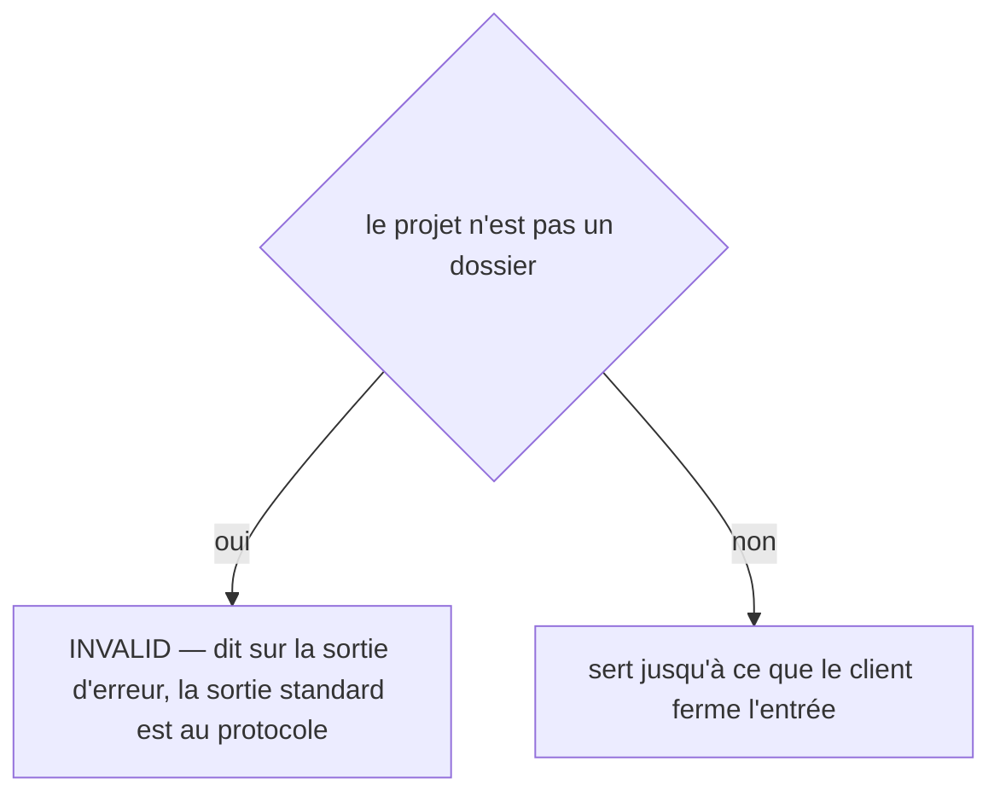
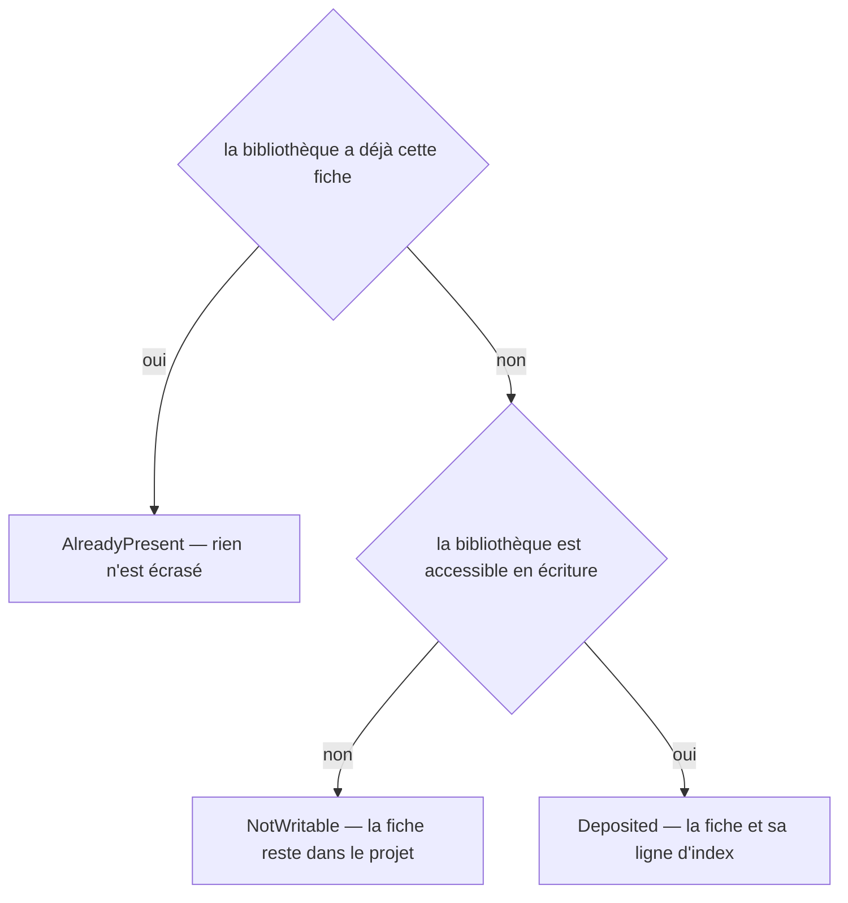
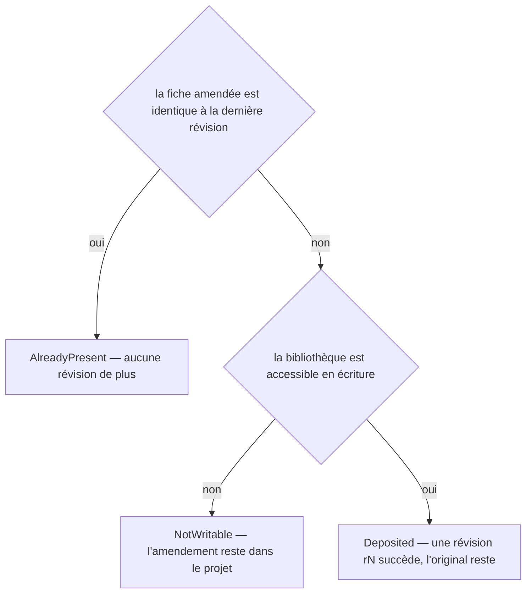

# mcp:serve
`command.mcp.serve` · type: commands · last updated: 2026-10-20 · commit: 58c02fb

## Summary

Le serveur MCP du projet (ADR-0018), lancé par Claude Code depuis .mcp.json sur l'entrée et la sortie standard : quatre outils en lecture seule — list_workflows, get_workflow, impact, get_knowledge — qui rendent une page plutôt qu'un dossier à lire. Rien n'écrit, rien ne lance d'inspection ; un projet jamais inspecté reçoit la commande à lancer. La commande n'existe que si le SDK MCP est installé.

## Trigger

| Element | Value |
|---|---|
| Entry point | `mcp:serve` (command) |
| Security | — |
| Preconditions | Le SDK MCP est installé, et le projet se trouve par --path, CLAUDE_PROJECT_DIR ou le répertoire courant. |

## Journey

## Decisions

**`Jul6Art\DevTools\Command\McpServeCommand::execute`**

**`Jul6Art\DevTools\Stack\Knowledge\KnowledgeLibrary::deposit`**

**`Jul6Art\DevTools\Stack\Knowledge\KnowledgeLibrary::depositRevision`**

## Data

Lit l'index, les pages, les fichiers de suivi, la carte fichiers → workflows, le fichier de stack et les fiches de connaissance. N'écrit rien : la sortie standard appartient au protocole.

## Cross-cutting mechanisms

Aucun.

## Points of attention

Les décisions de dépôt de la bibliothèque apparaissent parce que le serveur localise la bibliothèque partagée pour y lire une fiche : il n'y dépose jamais rien, aucun outil n'écrit. Une erreur d'un outil — identifiant inconnu, chemin hors du projet, XML illisible — revient comme une erreur que Claude lit, jamais comme un arrêt du serveur.

## Related workflows

—

## History

| Date | Commit | Change |
|---|---|---|
| 2026-10-20 | 4979790 | rédaction initiale |
| 2026-10-20 | 58c02fb | Aucun changement de fond : la configuration apprend les catégories de retours du projet, le client git et les chemins de .devtools ce que demandent les retours, les règles et le journal, sans rien changer de ce que fait la commande ; des tests s'ajoutent. La prose tient. (added test tests/Assertion/AssertionProposalTest.php (+10)) |
| 2026-10-20 | 58c02fb | Aucun changement de fond : le client git lit plus simplement les fichiers du projet et les commits d'une plage, sans rien changer de ce que fait la commande. La prose a été relue et tient. (files changed: src/Inspection/Freshness/GitClient.php) |
