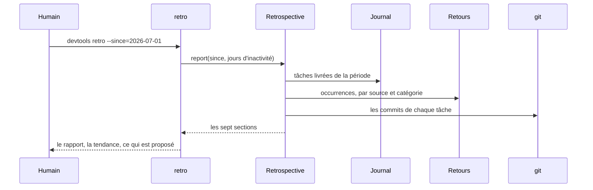
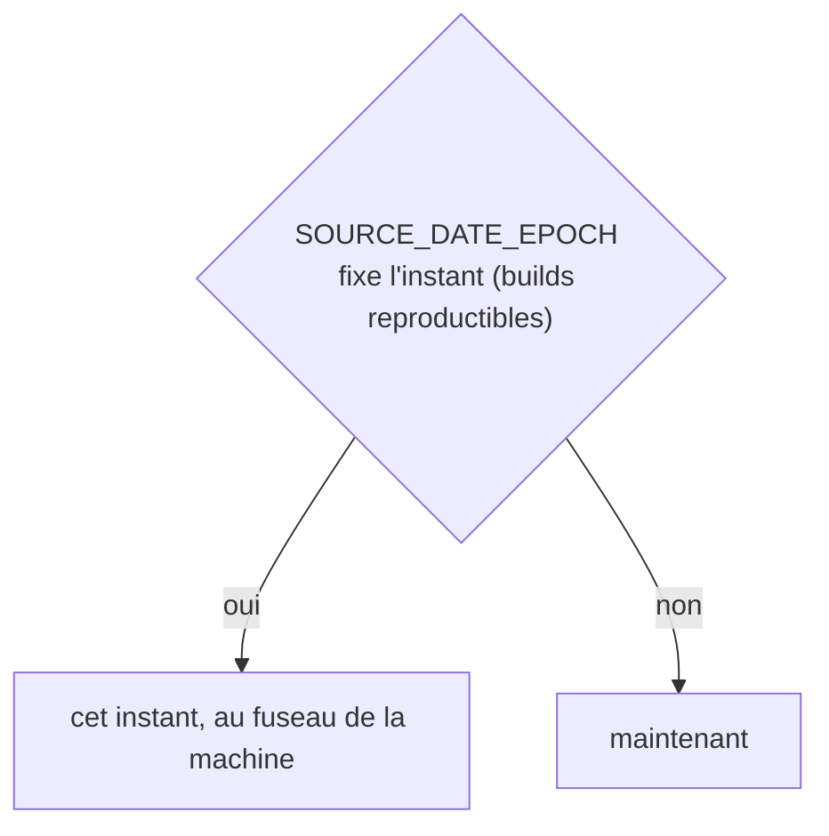
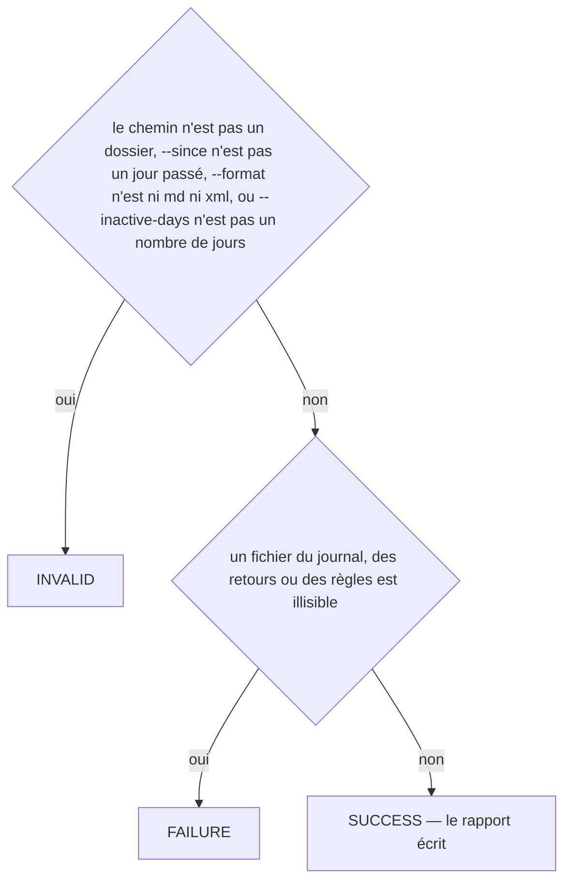
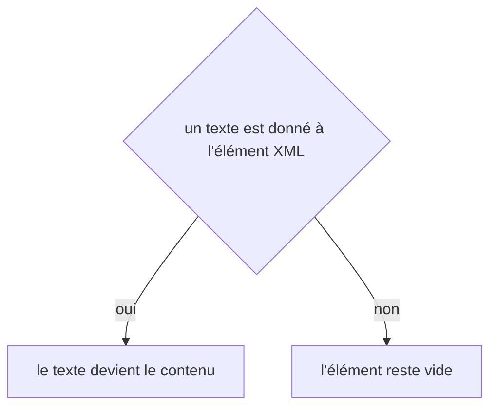

# retro
`command.retro` · type: commands · last updated: 2026-10-20 · commit: 58c02fb

## Summary

La rétrospective (ADR-0029) : si les retours diminuent. Remarques humaines par tâche livrée, mois par mois, et le dernier mois contre les trois précédents ; catégories en hausse ou en baisse ; règles qui ont bloqué la gate ; règles inactives, proposées à l'archivage ; retours vus deux fois et non promus ; passages de gate avant le vert ; ce que trouve le vérificateur et ce que disent encore les humains. Un rapport Markdown ou XML dans .devtools/reports/.

## Trigger

| Element | Value |
|---|---|
| Entry point | `retro` (command) |
| Security | — |
| Preconditions | La période commence dans le passé ; les tâches livrées viennent du journal, que le hook Stop écrit quand la gate passe. |

## Journey

## Decisions

**`DateTimeImmutable::timezone`**

**`Jul6Art\DevTools\Command\RetroCommand::execute`**

**`element::textContent`**

## Data

Lit le journal (.devtools/journal/), les retours et leurs occurrences, l'index des règles et leurs statistiques ; git seulement pour savoir quels commits une tâche contient. Écrit le rapport dans .devtools/reports/, ignoré par git.

## Cross-cutting mechanisms

Aucun.

## Points of attention

Une tâche dont tout a été commité avant la fin ne laisse aucun changement à la gate, donc aucune livraison au journal. La tendance demande quatre mois. Rien n'est archivé : la commande propose, rules:archive dispose. L'horloge suit SOURCE_DATE_EPOCH quand il est posé : deux exécutions sur un projet inchangé se comparent alors à l'octet. La décision sur `element::textContent` est celle de DomBuilder, sur le chemin de toute lecture ou écriture XML : elle n'est pas propre à ce workflow.

## Related workflows

—

## History

| Date | Commit | Change |
|---|---|---|
| 2026-10-20 | 58c02fb | rédaction initiale |
| 2026-10-20 | 58c02fb | Aucun changement de fond : le code a été remis en forme (Rector, style), sans rien changer de ce que fait la commande. La prose a été relue et tient. (files changed: src/Command/RetroCommand.php, src/Retro/RetroReport.php, src/Retro/Retrospective.php, src/Retro/XmlJournalStore.php; files added: src/Rule/RuleStat.php) |
| 2026-10-20 | 58c02fb | Aucun changement de fond : le client git lit plus simplement les fichiers du projet et les commits d'une plage, sans rien changer de ce que fait la commande. La prose a été relue et tient. (files changed: src/Inspection/Freshness/GitClient.php) |
