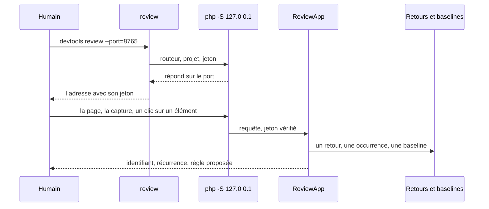
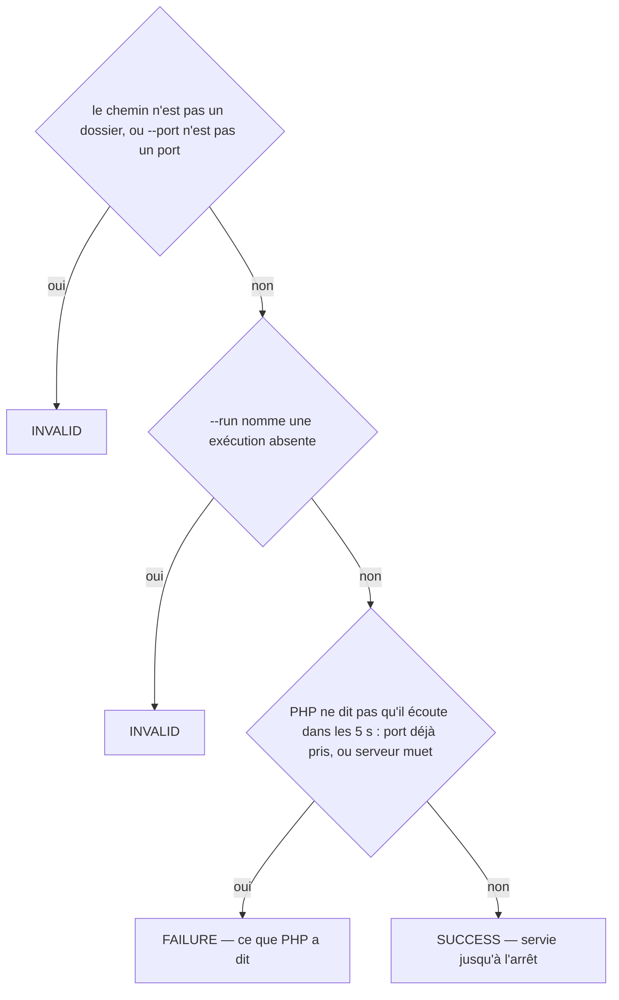
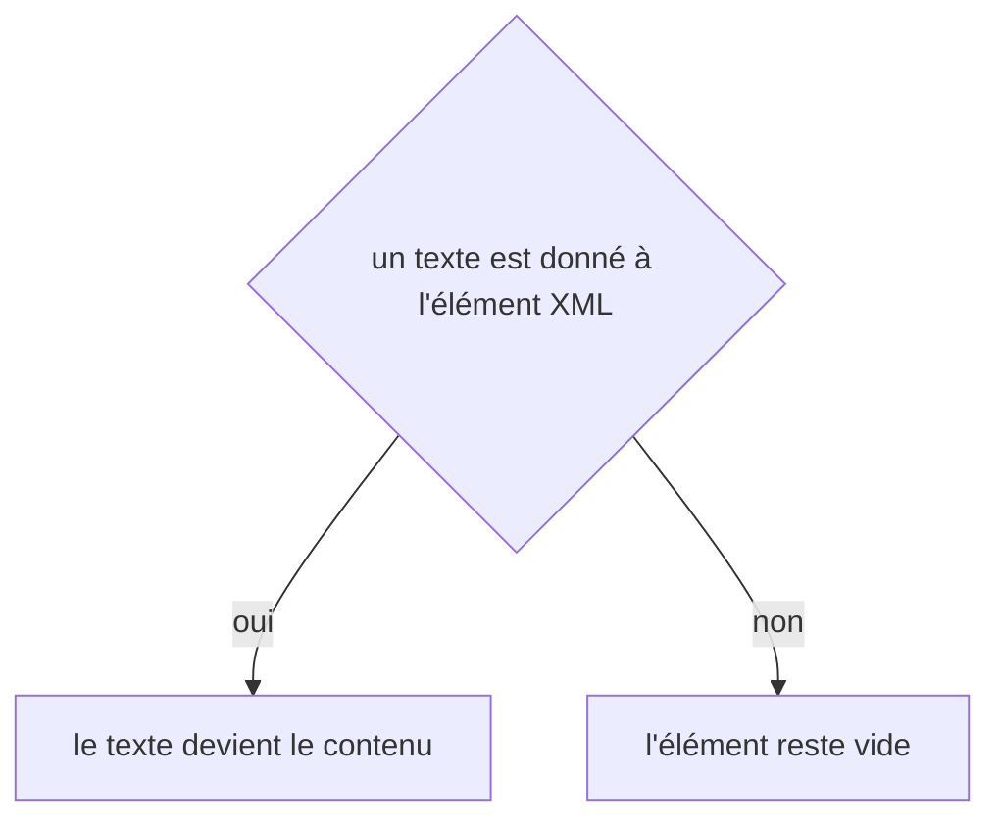

# review
`command.review` · type: commands · last updated: 2026-10-20 · commit: 58c02fb

## Summary

La page de revue (ADR-0028) : les captures d'une exécution à côté de leurs baselines et de leurs différences, et la capture d'un échec ; la page capturée montrée sans jamais être exécutée, où l'on désigne un élément dont le sélecteur est calculé et vérifié unique ; un retour en une ligne, enregistré comme feedback:add l'enregistrerait ; une capture acceptée comme baseline. Servie par le serveur intégré de PHP sur 127.0.0.1 seulement, derrière un jeton aléatoire, jusqu'à Ctrl+C.

## Trigger

| Element | Value |
|---|---|
| Entry point | `review` (command) |
| Security | — |
| Preconditions | Le port est libre et --run, s'il est donné, nomme une exécution existante ; sans exécution, la page le dit. |

## Journey

## Decisions

**`Jul6Art\DevTools\Command\ReviewCommand::execute`**

**`element::textContent`**

## Data

Lit les exécutions de .devtools/runs/, les baselines, l'index, la carte et l'arbre de travail git (le filtre des workflows impactés), les retours ; n'écrit que dans .devtools/feedback/ et .devtools/baselines/.

## Cross-cutting mechanisms

Aucun.

## Points of attention

La page capturée s'affiche sans les feuilles de style de l'application : la capture d'écran montre l'apparence, la page sert à désigner. Toute requête, sauf la feuille de style et le script de la page, porte le jeton. La commande ne rend la main qu'à l'arrêt du serveur. Elle attend que PHP annonce qu'il écoute, sans jamais sonder le port : DevTools n'ouvre aucune connexion (ADR-0002). La décision sur `element::textContent` est celle de DomBuilder, sur le chemin de toute lecture ou écriture XML : elle n'est pas propre à ce workflow.

## Related workflows

—

## History

| Date | Commit | Change |
|---|---|---|
| 2026-10-20 | 58c02fb | rédaction initiale |
| 2026-10-20 | 58c02fb | Le serveur est tenu pour prêt quand PHP annonce qu'il écoute, sans sonder le port (ADR-0002) ; un port déjà pris se dit par ce que PHP en dit. (modified decision Jul6Art\DevTools\Command\ReviewCommand::execute: \Jul6Art\DevTools\Review\Web\ReviewServer::listening($port) → null !== $failure (+1)) |
