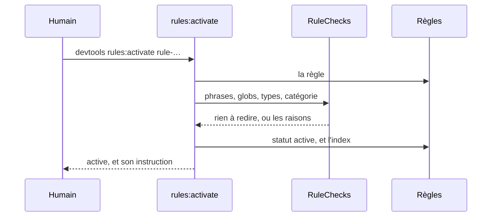
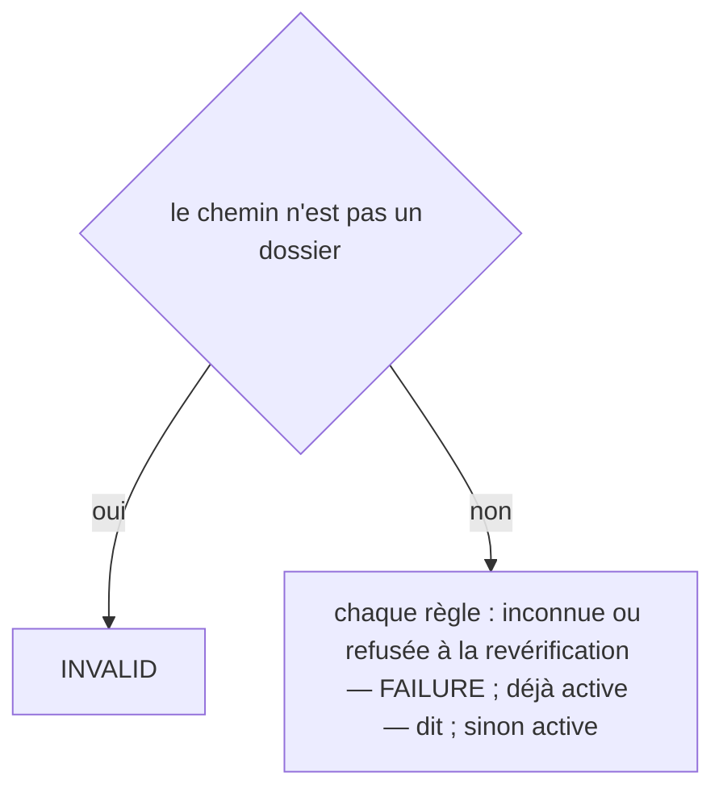
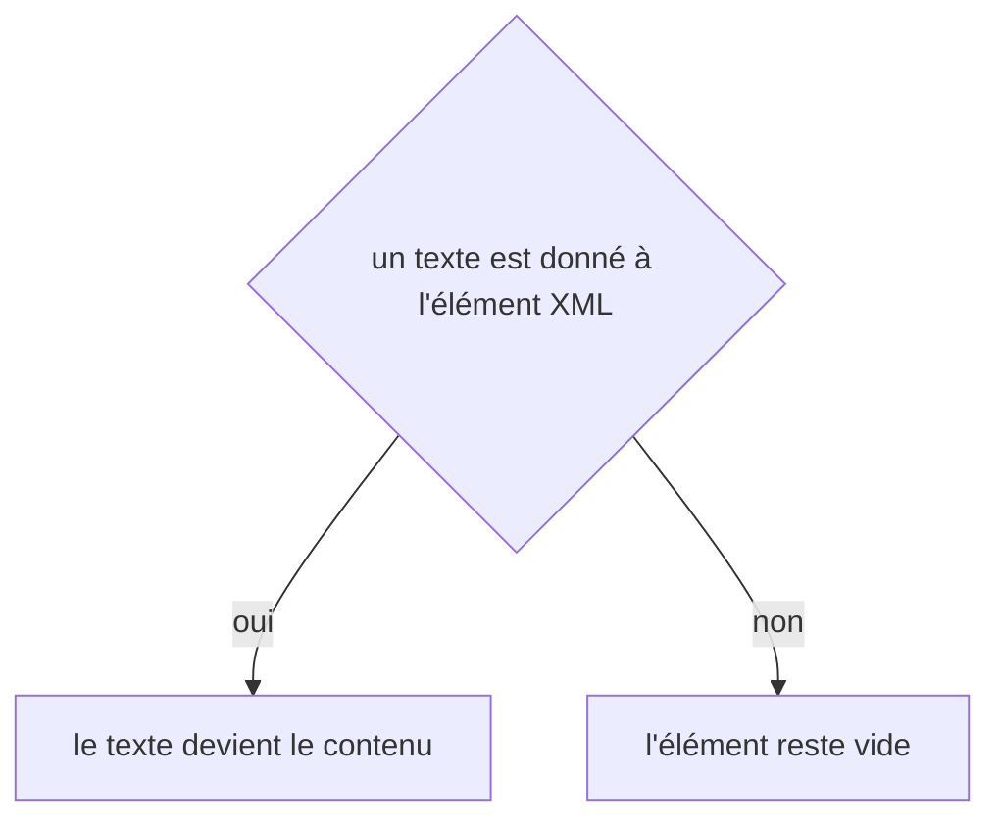

# rules:activate
`command.rules.activate` · type: commands · last updated: 2026-10-20 · commit: 58c02fb

## Summary

Un humain approuve une règle proposée (ADR-0026) : désormais, le hook PreToolUse la donne à Claude avant qu'il modifie un fichier auquel elle s'applique. La règle est revérifiée d'abord — un glob qui ne correspond plus à aucun fichier, un type de workflow ou une catégorie disparus refusent l'activation. Une règle archivée se réactive de la même façon.

## Trigger

| Element | Value |
|---|---|
| Entry point | `rules:activate` (command) |
| Security | — |
| Preconditions | Les règles nommées existent. |

## Journey

## Decisions

**`Jul6Art\DevTools\Command\RulesActivateCommand::execute`**

**`element::textContent`**

## Data

Lit l'index et le fichier de chaque règle, la configuration et les fichiers du projet — ceux que git connaît, sinon le disque ; réécrit la règle et l'index.

## Cross-cutting mechanisms

Aucun.

## Points of attention

Une règle refusée reste proposée : la commande dit pourquoi, et continue avec les suivantes. La décision sur `element::textContent` est celle de DomBuilder, sur le chemin de toute lecture ou écriture XML : elle n'est pas propre à ce workflow.

## Related workflows

—

## History

| Date | Commit | Change |
|---|---|---|
| 2026-10-20 | 58c02fb | rédaction initiale |
| 2026-10-20 | 58c02fb | Aucun changement de fond : le client git lit plus simplement les fichiers du projet et les commits d'une plage, sans rien changer de ce que fait la commande. La prose a été relue et tient. (files changed: src/Inspection/Freshness/GitClient.php) |
