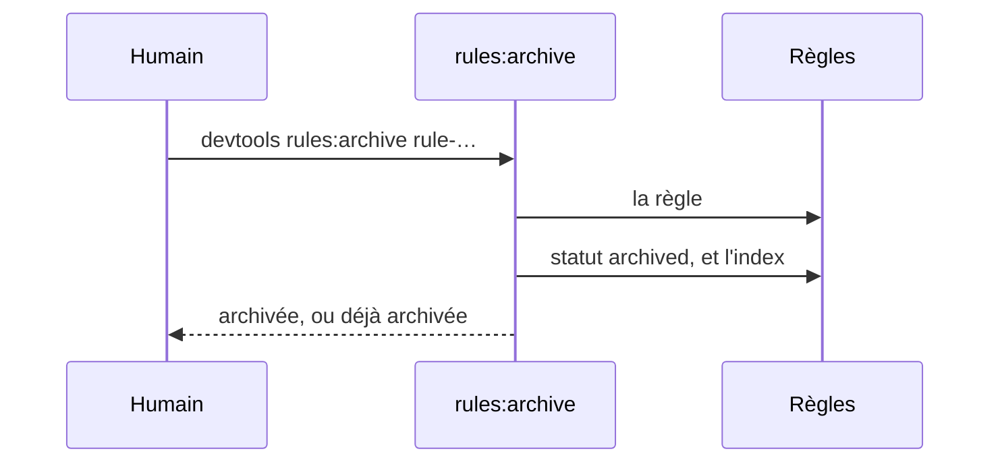
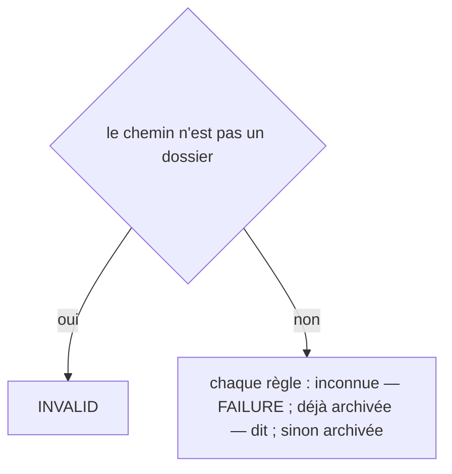
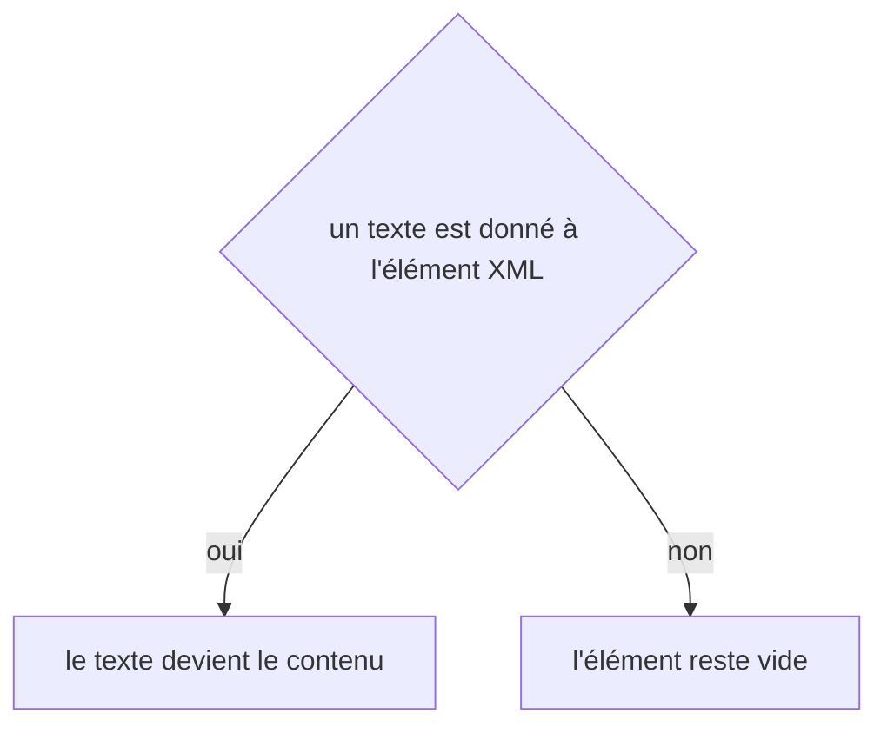

# rules:archive
`command.rules.archive` · type: commands · last updated: 2026-10-21 · commit: 240bcc3

## Summary

Archive une règle qui ne sert plus (ADR-0029) : elle n'est plus donnée à Claude, son assertion n'est plus exécutée par la gate ; elle reste, avec son histoire, et rules:activate la ramène. Seul un humain archive : la rétrospective propose.

## Trigger

| Element | Value |
|---|---|
| Entry point | `rules:archive` (command) |
| Security | — |
| Preconditions | Les règles nommées existent. |

## Journey

## Decisions

**`Jul6Art\DevTools\Command\RulesArchiveCommand::execute`**

**`element::textContent`**

## Data

Lit l'index et le fichier de chaque règle ; réécrit la règle et l'index.

## Cross-cutting mechanisms

Aucun.

## Points of attention

Archiver ne retire pas l'assertion du dépôt : son fichier reste, la gate cesse seulement de l'exécuter. La décision sur `element::textContent` est celle de DomBuilder, sur le chemin de toute lecture ou écriture XML : elle n'est pas propre à ce workflow.

## Related workflows

—

## History

| Date | Commit | Change |
|---|---|---|
| 2026-10-20 | 58c02fb | rédaction initiale |
| 2026-10-21 | 240bcc3 | Aucun changement de fond : la configuration lit désormais les projets liés (ADR-0038) et le dossier .devtools/ connaît l'index de recherche (ADR-0039), sans rien changer de ce que fait la commande. La prose a été relue et tient. (added test tests/Ask/AskTest.php (+8)) |
