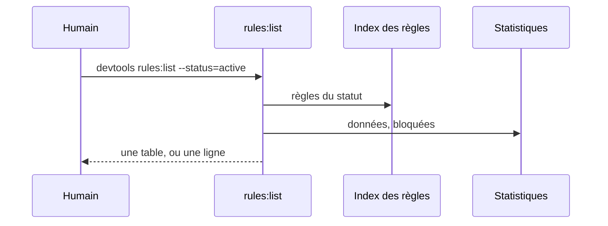
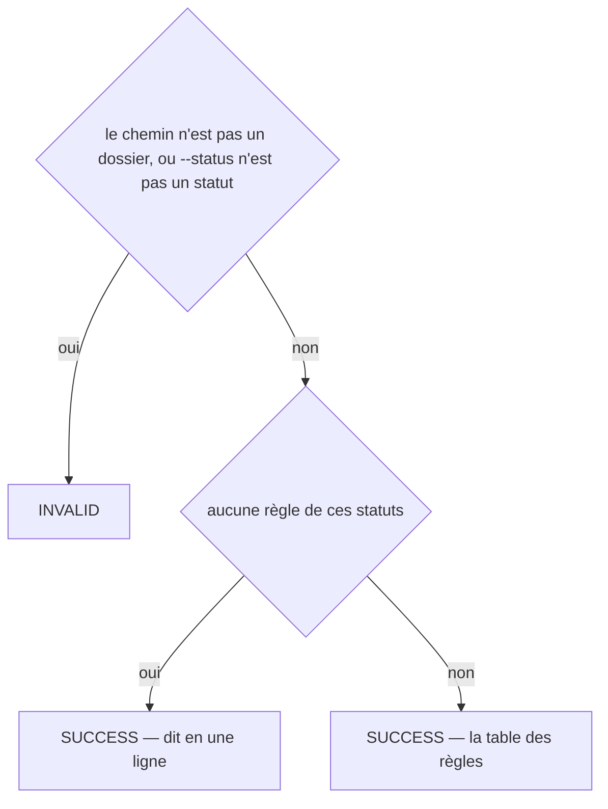
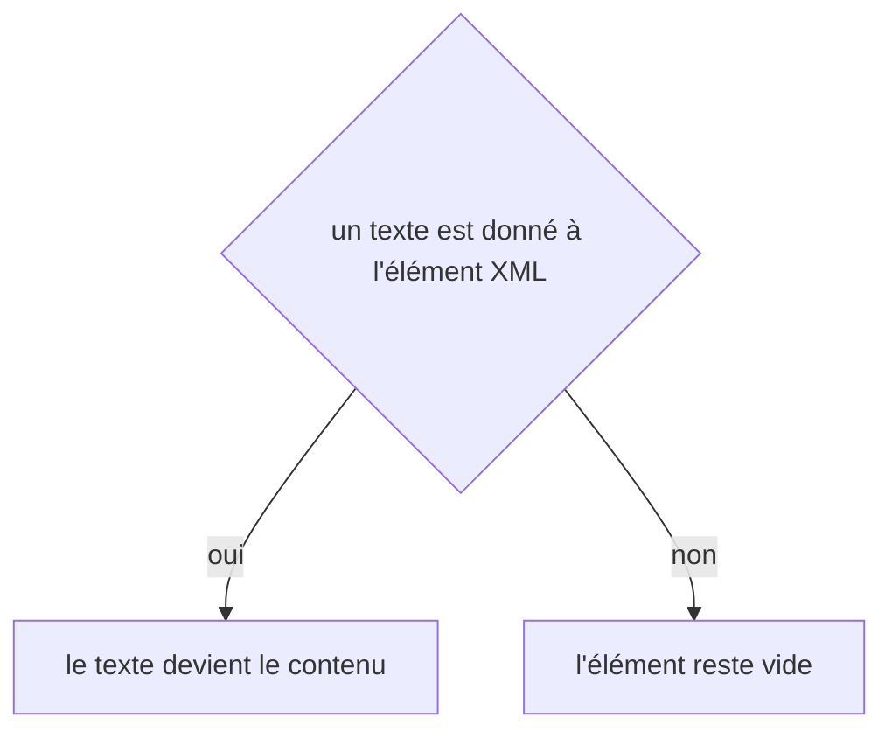

# rules:list
`command.rules.list` · type: commands · last updated: 2026-10-21 · commit: 240bcc3

## Summary

Liste les règles d'un projet (ADR-0026) : proposées et actives par défaut, ou celles d'un statut — où chacune s'applique, ce qu'elle dit, combien de fois elle a été donnée à Claude et combien de fois elle a bloqué la gate.

## Trigger

| Element | Value |
|---|---|
| Entry point | `rules:list` (command) |
| Security | — |
| Preconditions | Aucune : sans règle, la commande le dit. |

## Journey

## Decisions

**`Jul6Art\DevTools\Command\RulesListCommand::execute`**

**`element::textContent`**

## Data

Lit l'index des règles et leurs statistiques, .devtools/stats/rules.xml. N'écrit rien.

## Cross-cutting mechanisms

Aucun.

## Points of attention

Les compteurs vivent dans une zone ignorée par git : ils sont propres à la machine, et repartent de zéro sur un clone. La décision sur `element::textContent` est celle de DomBuilder, sur le chemin de toute lecture ou écriture XML : elle n'est pas propre à ce workflow.

## Related workflows

—

## History

| Date | Commit | Change |
|---|---|---|
| 2026-10-20 | 58c02fb | rédaction initiale |
| 2026-10-21 | 240bcc3 | Aucun changement de fond : la configuration lit désormais les projets liés (ADR-0038) et le dossier .devtools/ connaît l'index de recherche (ADR-0039), sans rien changer de ce que fait la commande. La prose a été relue et tient. (added test tests/Ask/AskTest.php (+8)) |
