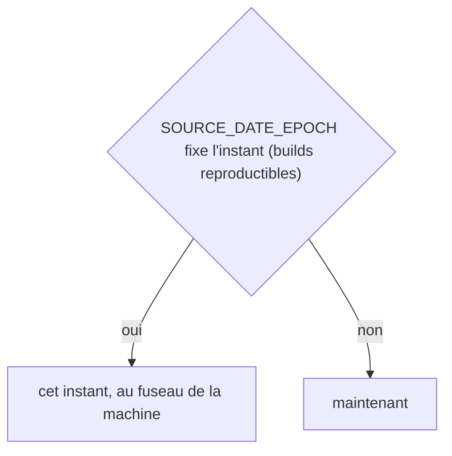
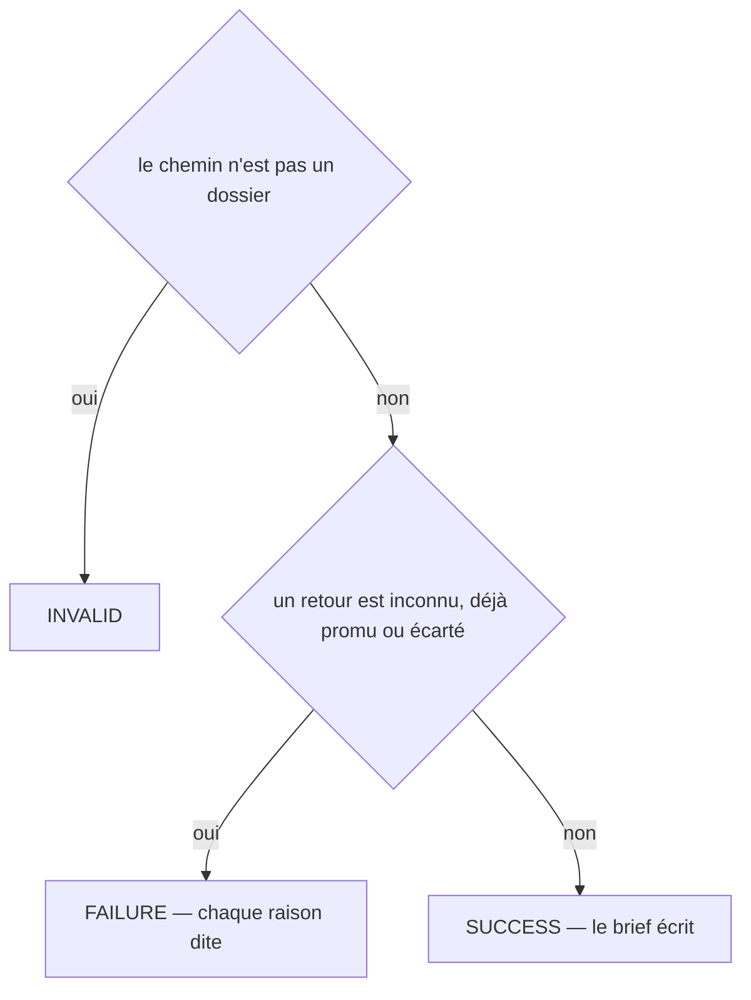
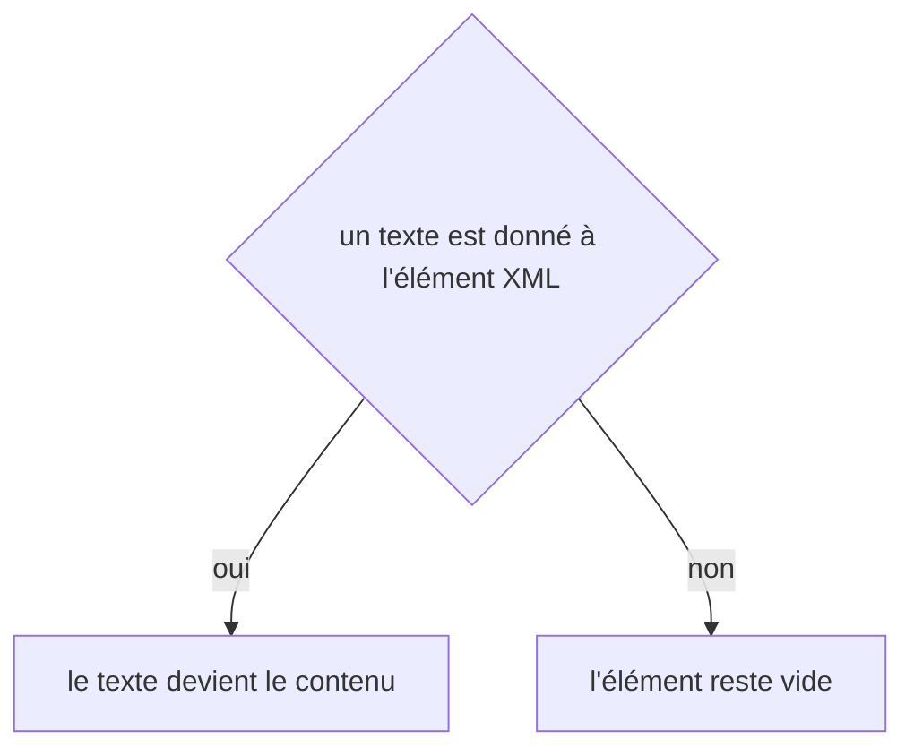

# rules:promote
`command.rules.promote` · type: commands · last updated: 2026-10-21 · commit: 240bcc3

## Summary

Demande à Claude la règle qu'un ou plusieurs retours doivent devenir (ADR-0026) : un brief dans .devtools/pending/ — les retours et leurs occurrences, les fichiers qu'ils visent et ceux de leurs workflows, les types de workflow et les catégories qu'une règle peut nommer, les règles existantes. workflows:apply vérifie le brouillon : il devient une règle proposée, que seul un humain active.

## Trigger

| Element | Value |
|---|---|
| Entry point | `rules:promote` (command) |
| Security | — |
| Preconditions | Les retours nommés existent, ni promus ni écartés ; le brouillon passe ensuite par le skill devtools-inspect et workflows:apply. |

## Journey

```mermaid
sequenceDiagram
  participant H as Humain
  participant C as rules:promote
  participant P as RulePromotion
  participant F as Retours
  participant B as Brief
  H->>C: devtools rules:promote fb-…
  C->>P: refus éventuels
  P->>F: retours, occurrences, fichiers et workflows visés
  P->>B: le brief du premier retour, dans pending/
  C-->>H: brief écrit ; Claude rédige, workflows:apply vérifie
```

## Decisions

**`DateTimeImmutable::timezone`**



**`Jul6Art\DevTools\Command\RulesPromoteCommand::execute`**



**`element::textContent`**



## Data

Lit les retours, la carte fichiers → workflows, la configuration et l'index des règles ; écrit le brief dans .devtools/pending/, ignoré par git.

## Cross-cutting mechanisms

Aucun.

## Points of attention

La commande n'écrit pas la règle, elle la demande. Les retours ne passent promus qu'à l'application du brouillon, pour qu'une demande laissée sans suite ne ferme rien. L'horloge suit SOURCE_DATE_EPOCH quand il est posé : deux exécutions sur un projet inchangé se comparent alors à l'octet. La décision sur `element::textContent` est celle de DomBuilder, sur le chemin de toute lecture ou écriture XML : elle n'est pas propre à ce workflow.

## Related workflows

—

## History

| Date | Commit | Change |
|---|---|---|
| 2026-10-20 | 58c02fb | rédaction initiale |
| 2026-10-21 | 240bcc3 | Aucun changement de fond : la configuration lit désormais les projets liés (ADR-0038) et le dossier .devtools/ connaît l'index de recherche (ADR-0039), sans rien changer de ce que fait la commande. La prose a été relue et tient. (added test tests/Ask/AskTest.php (+8)) |
