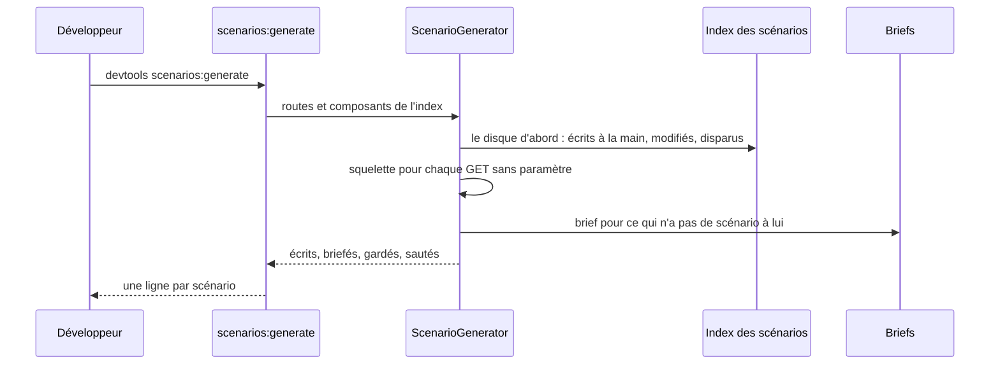
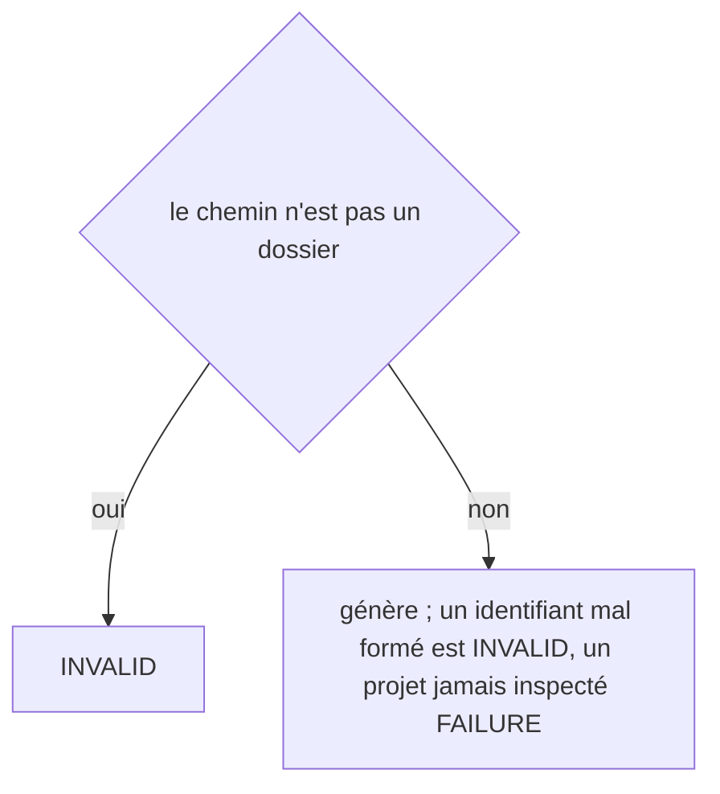

# scenarios:generate
`command.scenarios.generate` · type: commands · last updated: 2026-10-20 · commit: 58c02fb

## Summary

Écrit les scénarios des routes et des composants d'un projet (ADR-0020) : un squelette tiré des faits pour chaque route GET sans paramètre — visiter, vérifier la route, capturer —, connecté avec le rôle que sa sécurité demande, et un brief pour Claude pour le reste. Un scénario écrit ou modifié à la main n'est jamais régénéré ; un workflow réécrit met ses scénarios à revoir.

## Trigger

| Element | Value |
|---|---|
| Entry point | `scenarios:generate` (command) |
| Security | — |
| Preconditions | Le projet a été inspecté. |

## Journey

## Decisions

**`Jul6Art\DevTools\Command\ScenariosGenerateCommand::execute`**

## Data

Lit l'index, les fichiers de suivi, le fichier de stack et les scénarios existants ; écrit les scénarios dans .devtools/scenarios/, leur index, et les briefs de .devtools/pending/.

## Cross-cutting mechanisms

Aucun.

## Points of attention

Un squelette n'existe que pour une route sans paramètre : une valeur d'identifiant ne se devine pas, et un squelette doit se rejouer tel quel. --reviewed enregistre la relecture d'un scénario mis à revoir ; il devient alors celui de l'équipe, que plus rien ne régénère.

## Related workflows

—

## History

| Date | Commit | Change |
|---|---|---|
| 2026-10-20 | 4979790 | rédaction initiale |
| 2026-10-20 | 58c02fb | Aucun changement de fond : la configuration apprend les catégories de retours du projet, le client git et les chemins de .devtools ce que demandent les retours, les règles et le journal, sans rien changer de ce que fait la commande ; des tests s'ajoutent. La prose tient. (added test tests/Assertion/AssertionProposalTest.php (+10)) |
