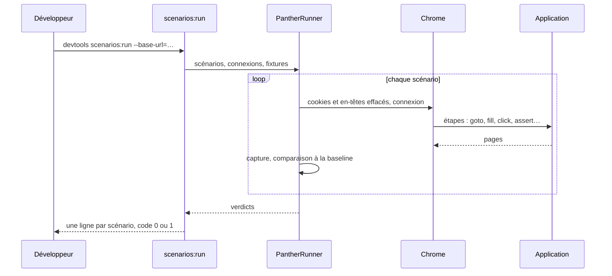
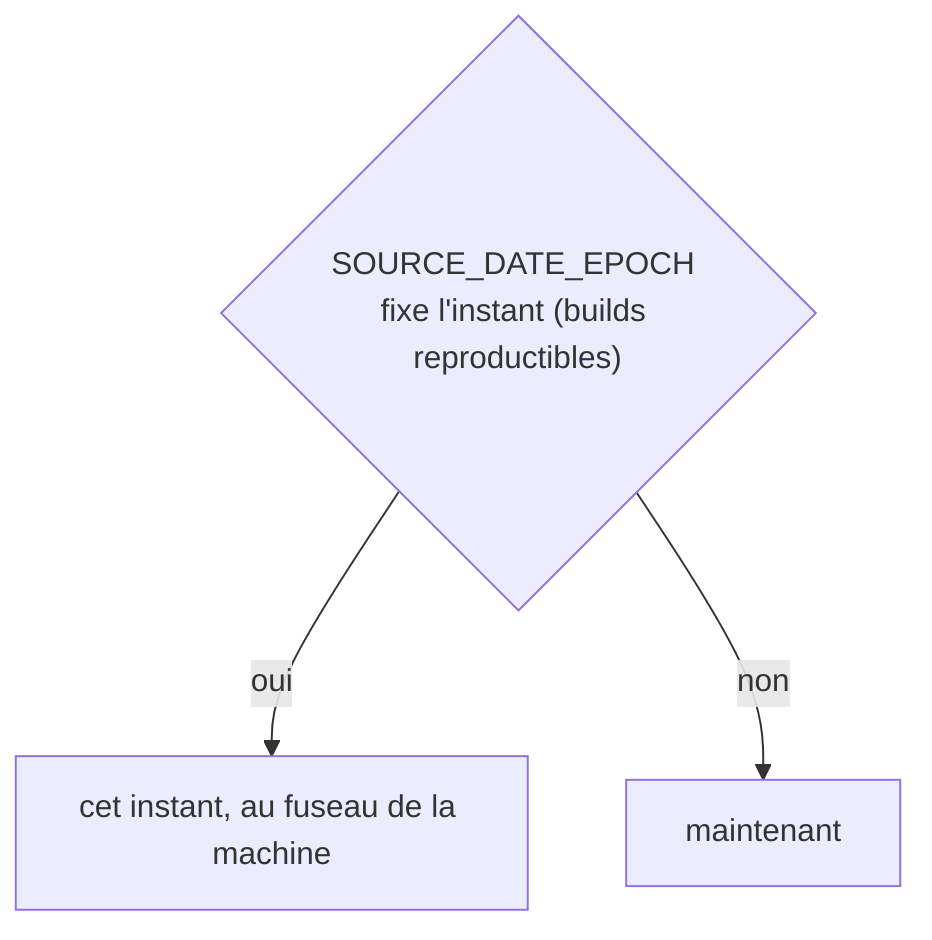
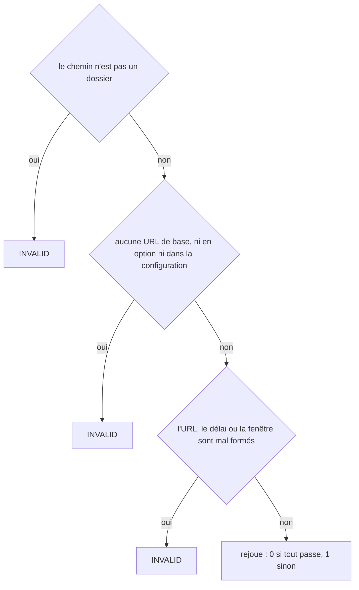
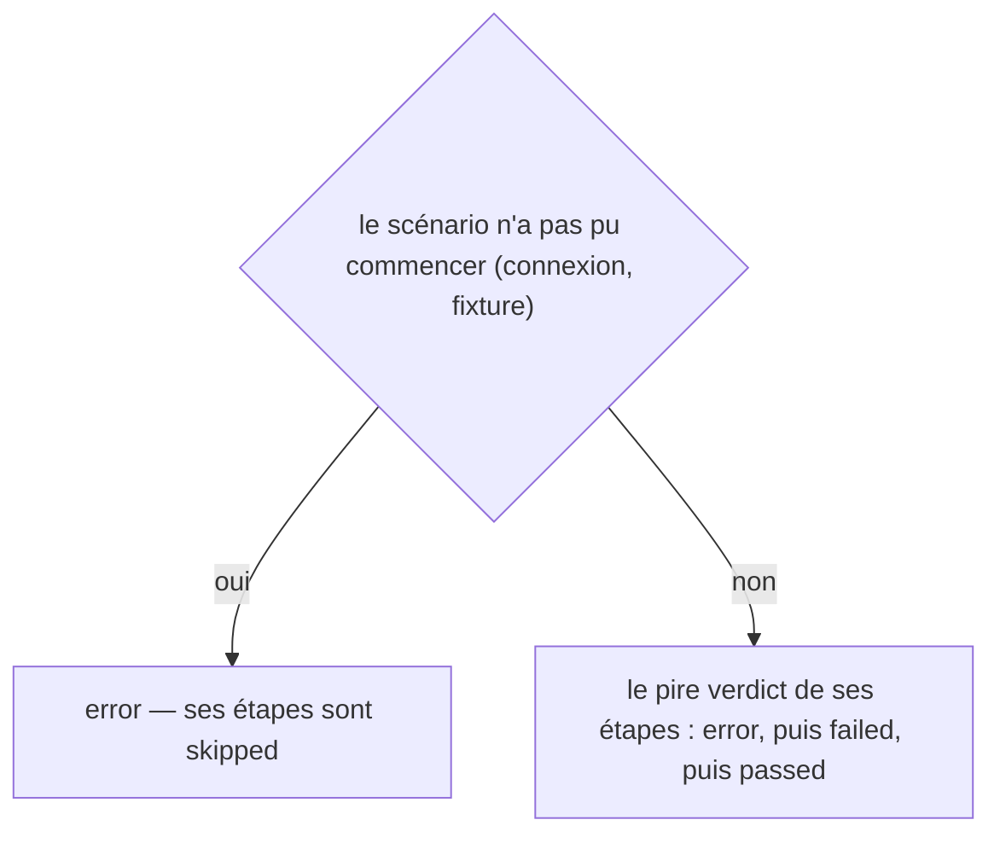
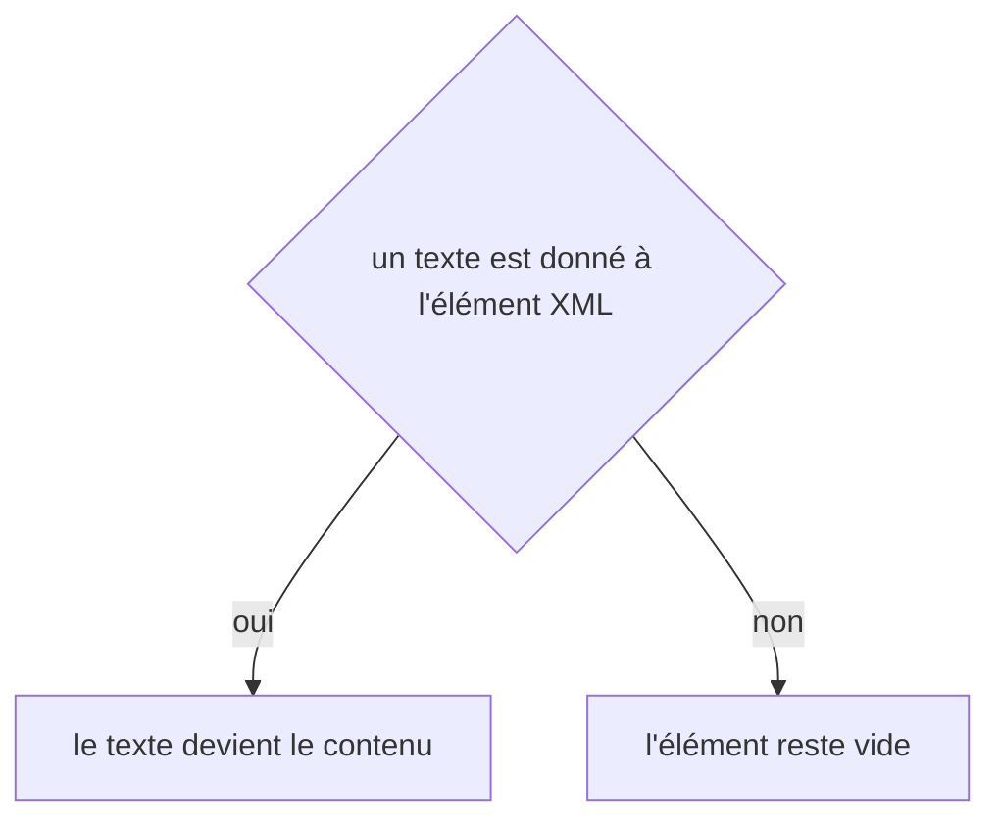

# scenarios:run
`command.scenarios.run` · type: commands · last updated: 2026-10-20 · commit: 58c02fb

## Summary

Rejoue les scénarios dans Chrome contre l'application là où elle est servie (ADR-0021), et écrit leurs verdicts dans un résultat par exécution. Un seul navigateur pour l'exécution, nettoyé entre deux scénarios ; chaque étape attend ce qu'elle cherche, jamais une pause fixe ; la première étape qui échoue arrête son scénario et garde l'écran et le DOM. Chaque capture est comparée à sa baseline (ADR-0022) ; la commande n'existe que si Panther est installé.

## Trigger

| Element | Value |
|---|---|
| Entry point | `scenarios:run` (command) |
| Security | — |
| Preconditions | Panther et un ChromeDriver de la version de Chrome sont installés, et l'application répond à l'URL de base. |

## Journey

## Decisions

**`DateTimeImmutable::timezone`**

**`Jul6Art\DevTools\Command\ScenariosRunCommand::execute`**

**`Jul6Art\DevTools\Scenario\Run\ScenarioResult::verdict`**

**`element::textContent`**

## Data

Lit les scénarios, les fichiers de suivi des routes, la configuration et ses variables d'environnement ; écrit dans .devtools/runs/ le résultat, les captures, les DOM et les diffs. Les identifiants de connexion ne sont jamais écrits.

## Cross-cutting mechanisms

Aucun.

## Points of attention

ChromeDriver doit être de la version majeure de Chrome : celui de drivers/ passe d'abord. Une connexion HTTP basic passe par un en-tête posé par le protocole DevTools de Chrome, jamais par des identifiants dans l'URL. La décision sur `element::textContent` est celle de DomBuilder, sur le chemin de toute lecture ou écriture XML : elle n'est pas propre à ce workflow.

## Related workflows

—

## History

| Date | Commit | Change |
|---|---|---|
| 2026-10-20 | 4979790 | rédaction initiale |
| 2026-10-20 | 58c02fb | Aucun changement de fond : la configuration apprend les catégories de retours du projet, le client git et les chemins de .devtools ce que demandent les retours, les règles et le journal, sans rien changer de ce que fait la commande ; des tests s'ajoutent. La prose tient. (added test tests/Assertion/AssertionProposalTest.php (+10)) |
