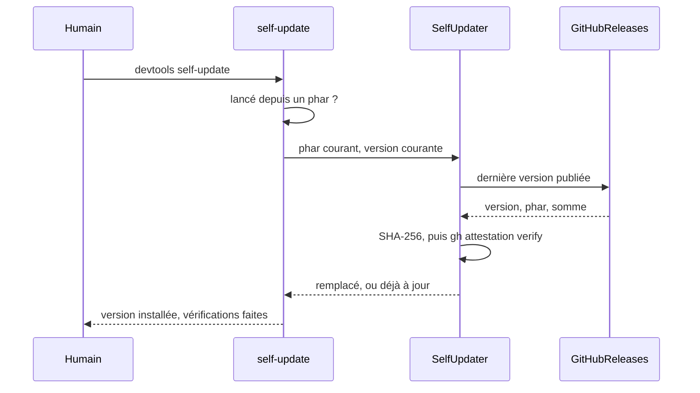
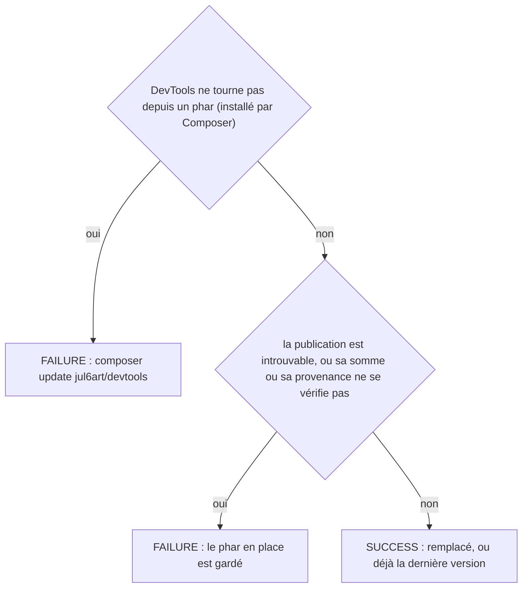

# self-update
`command.self-update` · type: commands · last updated: 2026-10-21 · commit: 240bcc3

## Summary

Remplace le phar de DevTools par la dernière version publiée (ADR-0034), après avoir vérifié sa somme SHA-256 et sa provenance — l'attestation de build GitHub, par gh attestation verify. Un phar dont l'une ou l'autre ne se vérifie pas n'est jamais installé. Une installation par Composer est renvoyée à composer update : la commande ne remplace qu'un phar.

## Trigger

| Element | Value |
|---|---|
| Entry point | `self-update` (command) |
| Security | — |
| Preconditions | DevTools tourne depuis son phar, et gh est installé pour vérifier la provenance. |

## Journey

## Decisions

**`Jul6Art\DevTools\Command\SelfUpdateCommand::execute`**

## Data

Lit la dernière publication sur GitHub — l'une des deux classes de DevTools autorisées à ouvrir une connexion —, télécharge le phar et sa somme, appelle gh pour la provenance ; remplace le phar en place, atomiquement.

## Cross-cutting mechanisms

Aucun.

## Points of attention

Sans gh, la provenance ne se vérifie pas et rien n'est remplacé : c'est voulu, une somme seule venant du même endroit que le phar. Le remplacement suppose le droit d'écrire le fichier du phar.

## Related workflows

—

## History

| Date | Commit | Change |
|---|---|---|
| 2026-10-21 | 240bcc3 | rédaction initiale |
