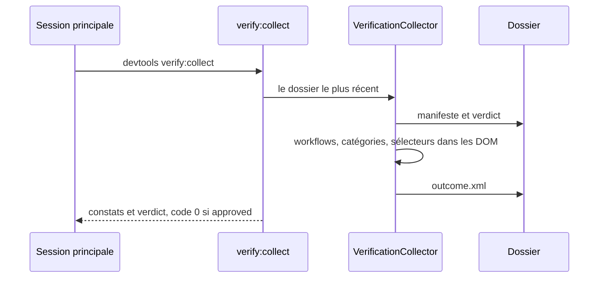
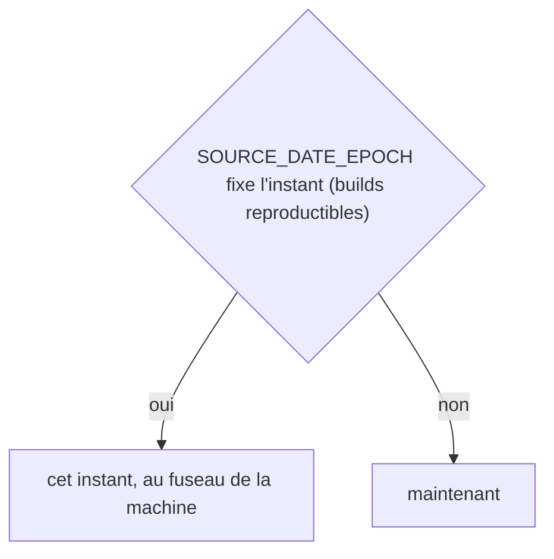
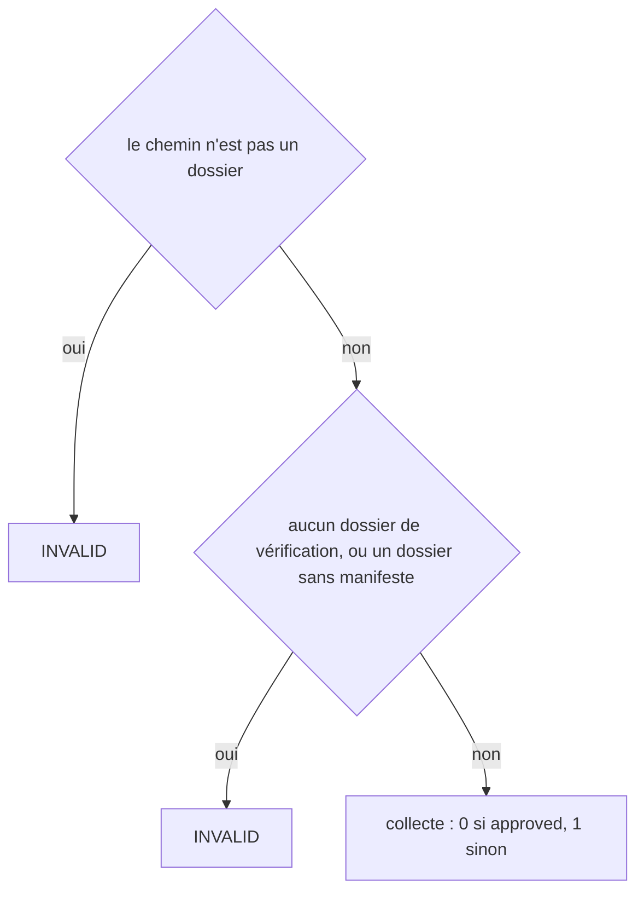
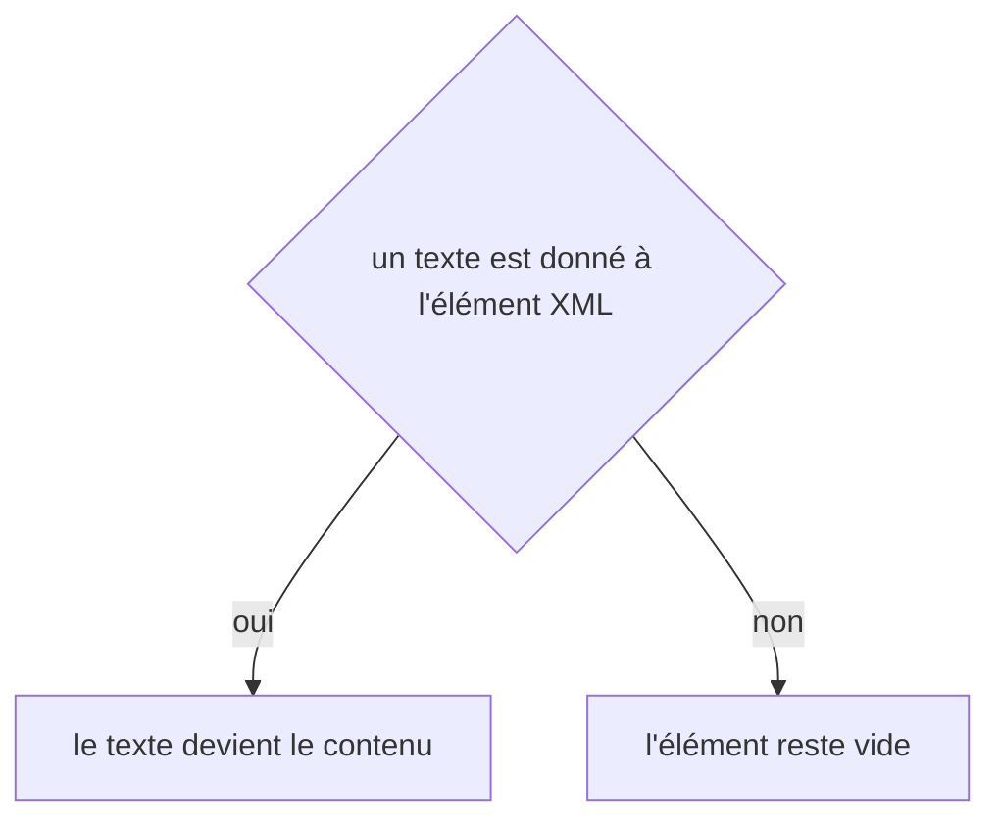

# verify:collect
`command.verify.collect` · type: commands · last updated: 2026-10-21 · commit: 240bcc3

## Summary

Vérifie le verdict que le vérificateur a rendu et enregistre celui qui compte (ADR-0024). Un constat doit porter sur un workflow du dossier, une catégorie de la liste fermée, un sélecteur que le DOM capturé contient ; un rejet doit dire ce qui bloque. Ce qui ne se vérifie pas compte comme inconclusive, jamais comme approuvé.

## Trigger

| Element | Value |
|---|---|
| Entry point | `verify:collect` (command) |
| Security | — |
| Preconditions | Un dossier de vérification existe — le plus récent par défaut — et la session qui a appelé le vérificateur y a écrit sa réponse. |

## Journey

## Decisions

**`DateTimeImmutable::timezone`**

**`Jul6Art\DevTools\Command\VerifyCollectCommand::execute`**

**`element::textContent`**

## Data

Lit le manifeste, le verdict et les DOM capturés du dossier ; y écrit le verdict retenu, que la gate lit.

## Cross-cutting mechanisms

Aucun.

## Points of attention

Un approuvé qui porte un constat bloquant, un rejet sans constat bloquant : l'un des deux est faux, et le verdict devient inconclusive. La décision sur `element::textContent` est celle de DomBuilder, sur le chemin de toute lecture ou écriture XML : elle n'est pas propre à ce workflow.

## Related workflows

—

## History

| Date | Commit | Change |
|---|---|---|
| 2026-10-20 | 4979790 | rédaction initiale |
| 2026-10-20 | 58c02fb | La liste fermée des catégories se relit dans le manifeste : celle des retours, celles du projet comprises ; des tests s'ajoutent. (added test tests/Assertion/AssertionProposalTest.php (+10)) |
| 2026-10-21 | 240bcc3 | Aucun changement de fond : la configuration lit désormais les projets liés (ADR-0038) et le dossier .devtools/ connaît l'index de recherche (ADR-0039), sans rien changer de ce que fait la commande. La prose a été relue et tient. (added test tests/Ask/AskTest.php (+8)) |
