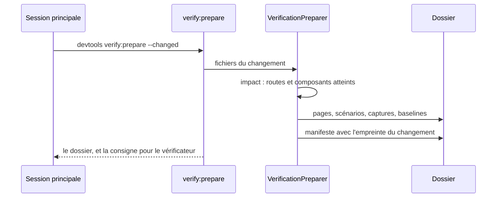
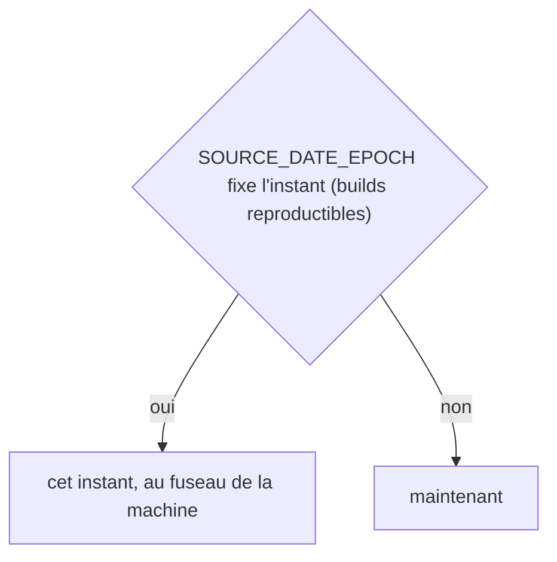
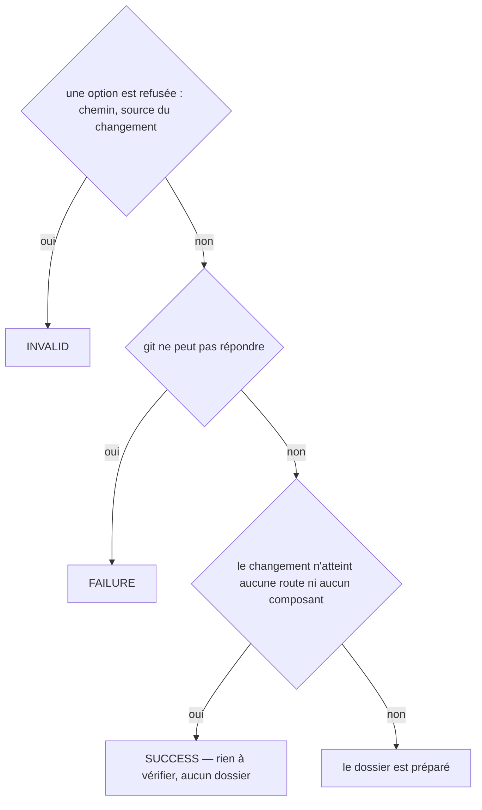

# verify:prepare
`command.verify.prepare` · type: commands · last updated: 2026-10-20 · commit: 58c02fb

## Summary

Prépare le dossier sur lequel un vérificateur juge un changement, dans un contexte vierge (ADR-0024) : les routes et composants qu'il atteint, leurs pages, leurs scénarios, les captures de la dernière exécution avec leurs baselines et leurs diffs — en copies — et le chemin du code dont ils sont faits. Rien de la conversation qui a écrit le changement, aucun message de commit. La sortie dit à la session quoi faire du dossier.

## Trigger

| Element | Value |
|---|---|
| Entry point | `verify:prepare` (command) |
| Security | — |
| Preconditions | Le projet a été inspecté, et le changement se lit par git ou par les fichiers nommés. |

## Journey

## Decisions

**`DateTimeImmutable::timezone`**

**`Jul6Art\DevTools\Command\VerifyPrepareCommand::execute`**

## Data

Lit la carte, l'index, les fichiers de suivi, les scénarios, la dernière exécution et les baselines ; écrit un dossier dans .devtools/pending/, ignoré par git.

## Cross-cutting mechanisms

Aucun.

## Points of attention

Les catégories du manifeste sont la liste fermée des retours (ADR-0025) — les dix de DevTools et celles que le projet ajoute dans sa configuration : DevTools les vérifie à la collecte, pas le schéma. Le vérificateur ne peut pas écrire : c'est la session qui l'a appelé qui écrit sa réponse dans le dossier.

## Related workflows

—

## History

| Date | Commit | Change |
|---|---|---|
| 2026-10-20 | 4979790 | rédaction initiale |
| 2026-10-20 | 58c02fb | Les catégories du manifeste viennent de la liste des retours, celles du projet comprises ; des tests s'ajoutent. (added test tests/Assertion/AssertionProposalTest.php (+10)) |
| 2026-10-20 | 58c02fb | Aucun changement de fond : le client git lit plus simplement les fichiers du projet et les commits d'une plage, sans rien changer de ce que fait la commande. La prose a été relue et tient. (files changed: src/Inspection/Freshness/GitClient.php) |
