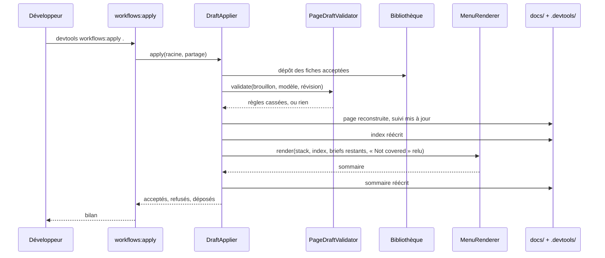
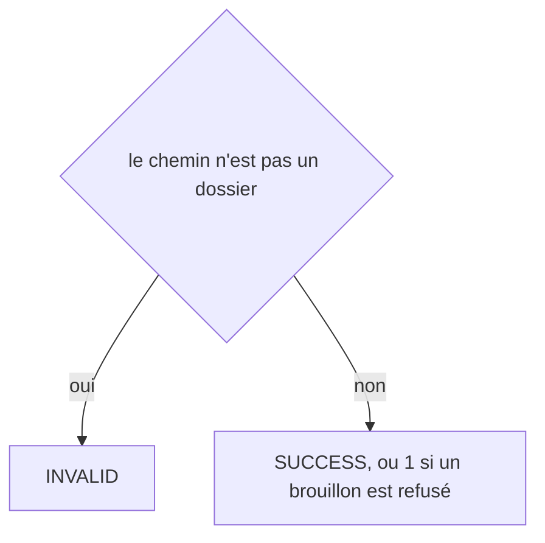
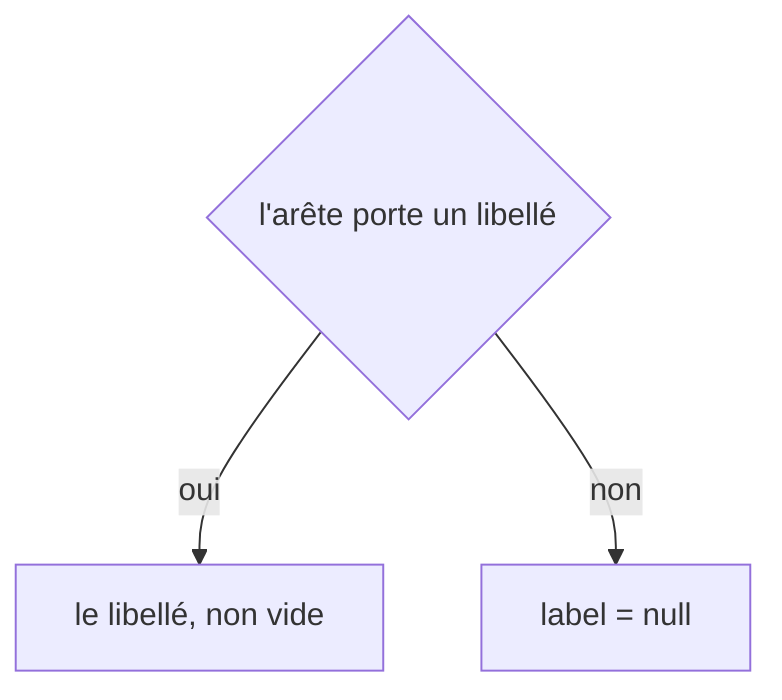
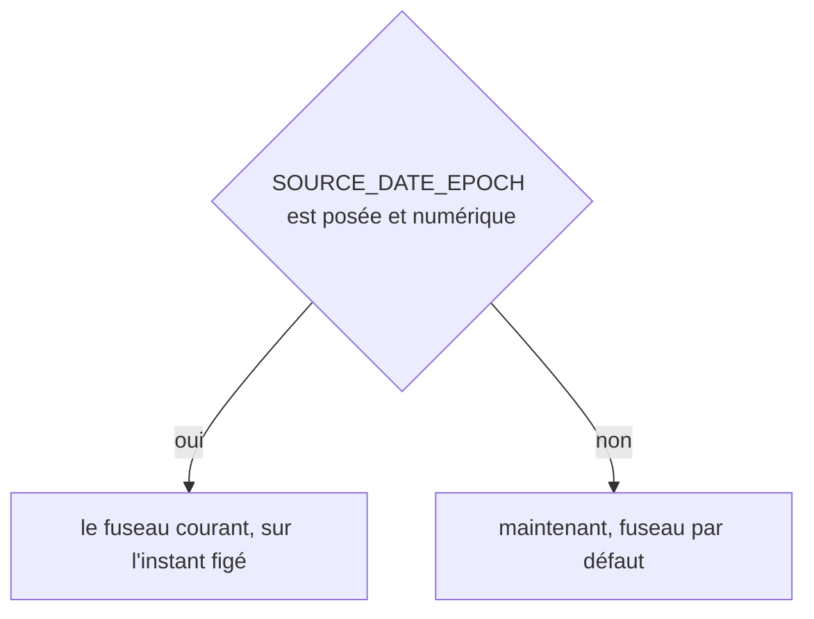
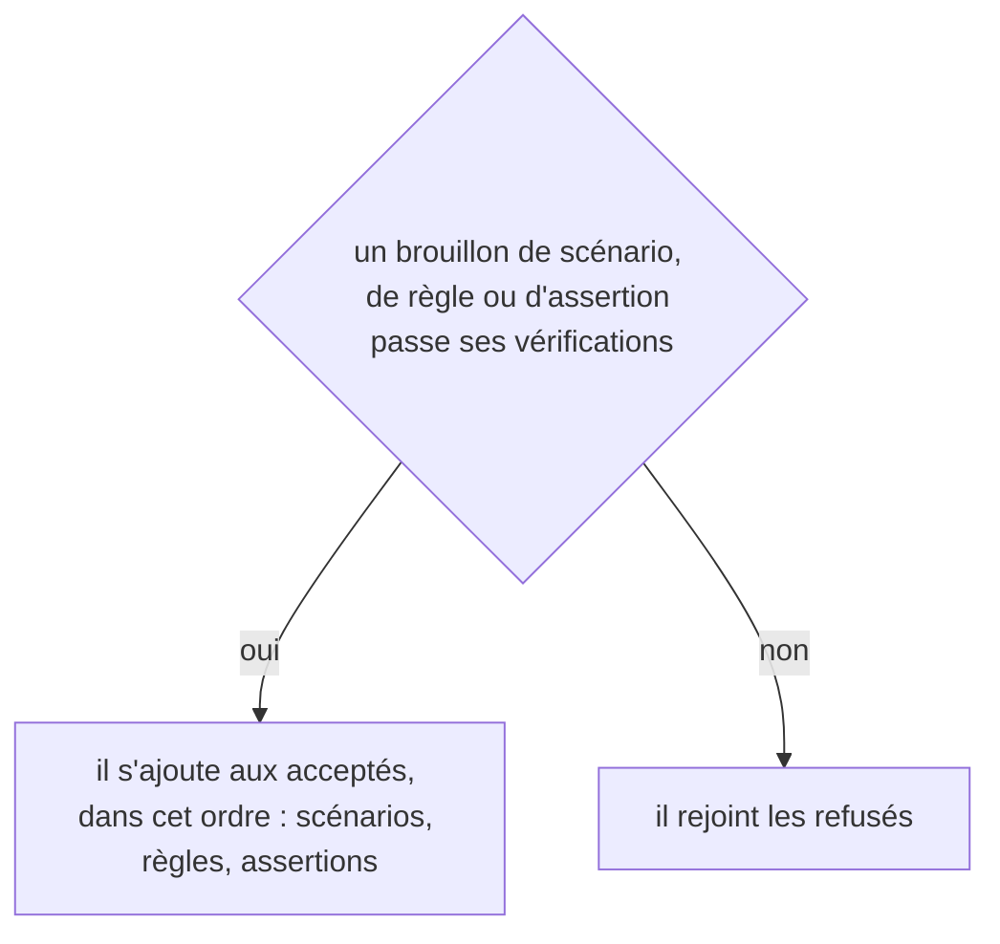
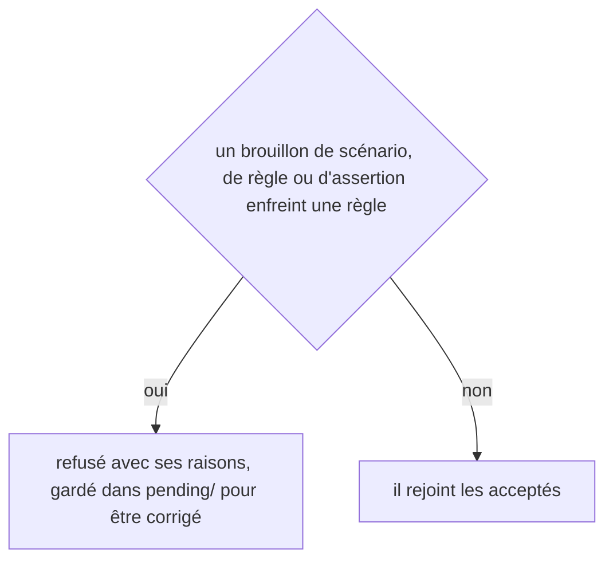

# workflows:apply
`command.workflows.apply` · type: commands · last updated: 2026-10-20 · commit: 58c02fb

## Summary

Relit les brouillons que Claude a écrits dans `.devtools/pending/`, les refuse ou les applique, et reconstruit la page : les faits viennent du modèle, la prose du brouillon. Les connaissances passent d'abord — une page ne se rédige pas sans savoir comment la stack fonctionne — puis les découvertes, les scénarios que Claude a écrits (ADR-0020), les règles (ADR-0026) et les assertions (ADR-0027), puis les pages. Une assertion est exécutée avant d'être écrite : elle doit passer sur le projet tel qu'il est, et échouer là où son retour a été signalé. Une fiche de connaissance acceptée est déposée dans la bibliothèque partagée. Dès qu'une page est acceptée, l'index et le sommaire workflows.md sont réécrits depuis ce qui est sur disque, sans nouvelle inspection : un workflow rédigé quitte aussitôt la liste « To check » (ADR-0049).

## Trigger

| Element | Value |
|---|---|
| Entry point | `workflows:apply` (command) |
| Security | — |
| Preconditions | Une inspection a écrit des briefs, et Claude a répondu à au moins un. |

## Journey

## Decisions

**`Jul6Art\DevTools\Command\WorkflowsApplyCommand::execute`**

**`Jul6Art\DevTools\Inspection\Model\Edge::label`**

**`DateTimeImmutable::timezone`**

**`Jul6Art\DevTools\Ai\ApplyResult::accepted`**

**`Jul6Art\DevTools\Ai\ApplyResult::refused`**

## Data

Lit les briefs, les modèles et les brouillons de `.devtools/pending/`, le fichier de stack et le sommaire existant ; écrit les pages, les fichiers de suivi, l'index et le sommaire, les règles proposées et les assertions — et passe à promus les retours d'une règle —, et dépose les fiches de connaissance. Applique aussi l'amendement d'une fiche demandé par knowledge:amend : la fiche du projet est remplacée, et la bibliothèque en reçoit une révision.

## Cross-cutting mechanisms

Aucun listener. Un brouillon est une donnée non fiable : chaque chemin qu'il cite doit être un fichier du modèle, et la révision doit être celle du brief.

## Points of attention

Un brouillon refusé ne change rien et reste dans `pending/` pour être corrigé. Une page rédigée survit aux réécritures factuelles ultérieures : seuls les faits sont régénérés. Un apply qui n'accepte rien ne touche ni l'index ni le sommaire, et sans sommaire — avant la première inspection — il n'en crée pas. ⚠️ La section « Not covered » du sommaire est recopiée telle quelle, pas recalculée : la couverture n'est persistée nulle part, et appliquer une page ne change pas les fichiers d'un workflow. Le jour où apply toucherait aux fichiers d'un workflow, il faudrait persister la couverture. Le sommaire a désormais deux auteurs, l'inspection et apply : un test vérifie qu'une inspection lancée juste après un apply rend le même.

## Related workflows

—

## History

| Date | Commit | Change |
|---|---|---|
| 2026-09-18 | b8049a4 | rédaction initiale |
| 2026-09-19 | d9d6b8f | added test tests/Project/GitHooksTest.php |
| 2026-09-20 | 9e40da9 | Aucun changement de fond : seul un test s'est ajouté au périmètre du workflow. La prose a été relue contre le code et tient. (added test tests/Inspection/Adapter/Symfony/DoctrineListenersTest.php) |
| 2026-09-21 | e5a6438 | l'outil passe en anglais : ce que la commande écrit, et les titres des pages qu'elle produit (files changed: src/Ai/DraftApplier.php, src/Ai/PageDraft.php, src/Ai/PageDraftValidator.php, src/Console/SummaryRenderer.php, src/Rendering/GroupPageRenderer.php, src/Rendering/GroupPageSection.php, src/Rendering/PageRenderer.php, src/Rendering/PageSection.php, src/Rendering/ParsedPage.php, src/Stack/Knowledge/KnowledgeCanvas.php, src/Stack/Knowledge/XmlKnowledgeBriefStore.php, src/Tracking/TrackingStatus.php) |
| 2026-09-21 | e5a6438 | l'en-tête de l'historique passe en anglais, et une page restée sous un gabarit antérieur est remise à jour (files changed: src/Rendering/PageRenderer.php) |
| 2026-10-20 | 2885138 | apply réécrit le sommaire depuis le disque : un workflow rédigé quitte « To check » sans attendre la prochaine inspection (ADR-0049) (added test tests/Ai/MenuAfterApplyTest.php (+4)) |
| 2026-10-20 | 4979790 | apply applique aussi l'amendement d'une fiche, déposé en révision dans la bibliothèque ; le gabarit passe à neuf sections : la navigation et la machine à états ouvrent « Decisions » (ADR-0044) (added decision Jul6Art\DevTools\Stack\Knowledge\KnowledgeLibrary::depositRevision: — → \Jul6Art\DevTools\Stack\Knowledge\DepositOutcome::AlreadyPresent (+3)) |
| 2026-10-20 | 4979790 | Applique aussi les brouillons de scénarios, et le sommaire liste les scénarios à revoir ; le dépôt d'une fiche dans la bibliothèque sort du graphe de ce workflow, sans changer de comportement. (removed decision Jul6Art\DevTools\Stack\Knowledge\KnowledgeLibrary::deposit: \Jul6Art\DevTools\Stack\Knowledge\DepositOutcome::AlreadyPresent → — (+13)) |
| 2026-10-20 | 58c02fb | Applique aussi les brouillons de règles et d'assertions — une assertion exécutée avant d'être écrite ; deux décisions de rendu sortent du graphe de ce workflow, sans changer de comportement. (added decision Jul6Art\DevTools\Ai\ApplyResult::accepted: — → [...$result->accepted, ...$scenarios['accepted']] (+18)) |
| 2026-10-20 | 58c02fb | Aucun changement de fond : le client git lit plus simplement les fichiers du projet et les commits d'une plage, sans rien changer de ce que fait la commande. La prose a été relue et tient. (files changed: src/Inspection/Freshness/GitClient.php) |
