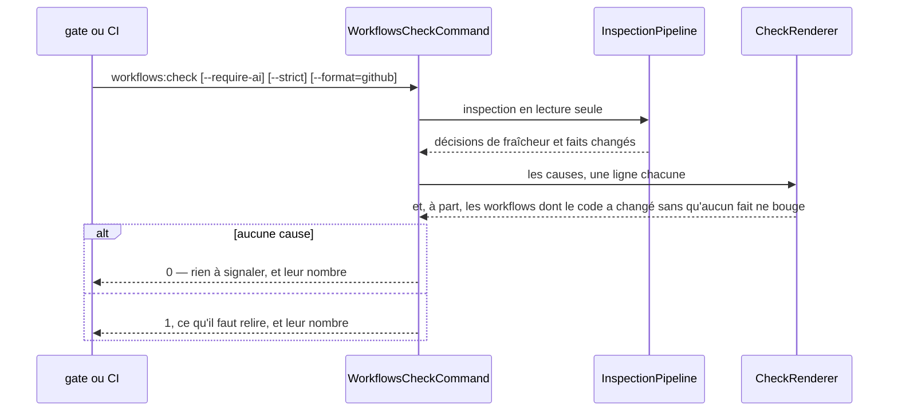
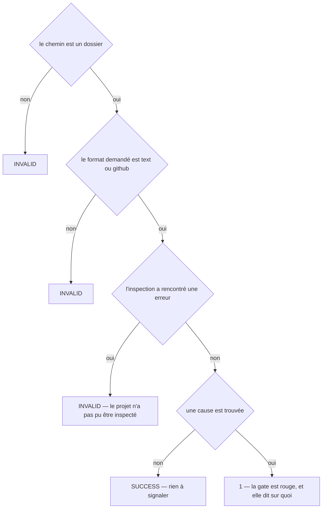
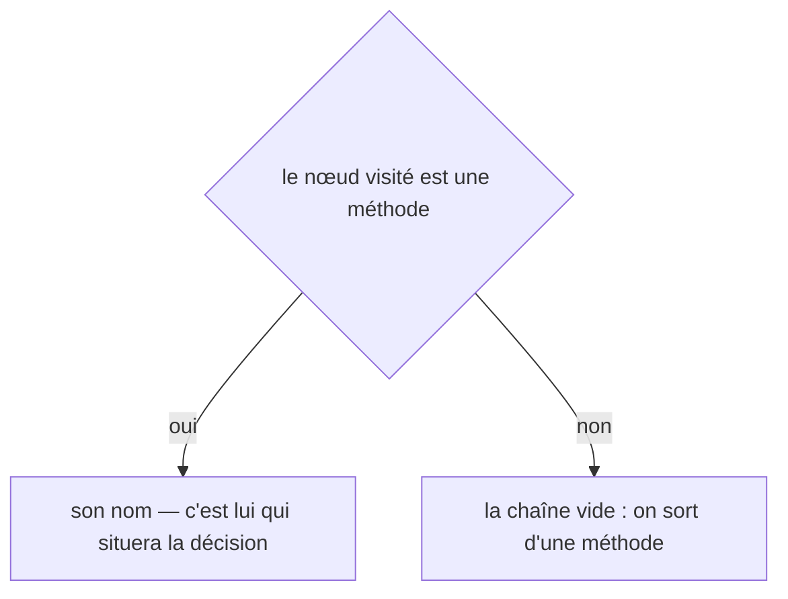
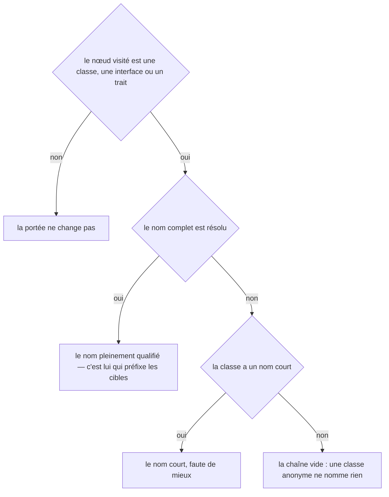
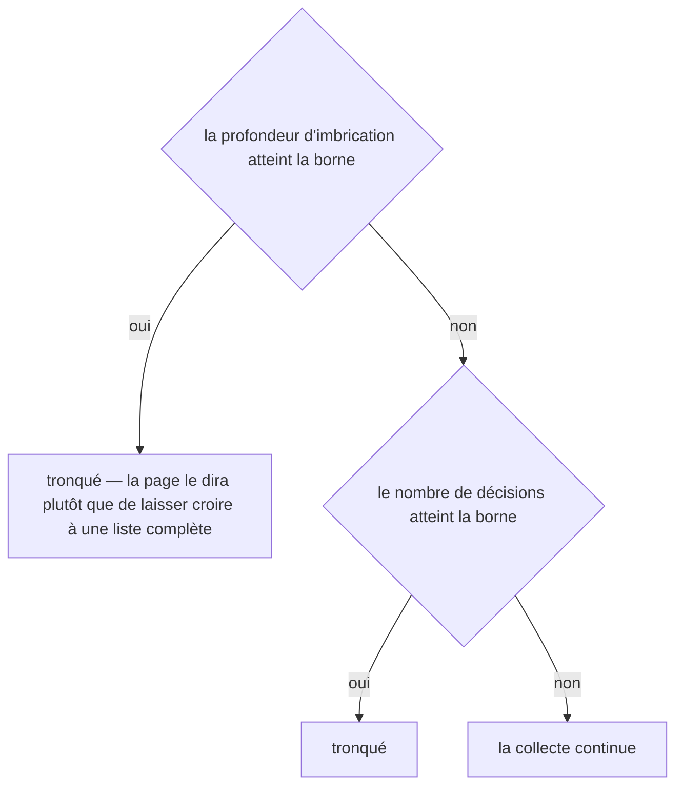
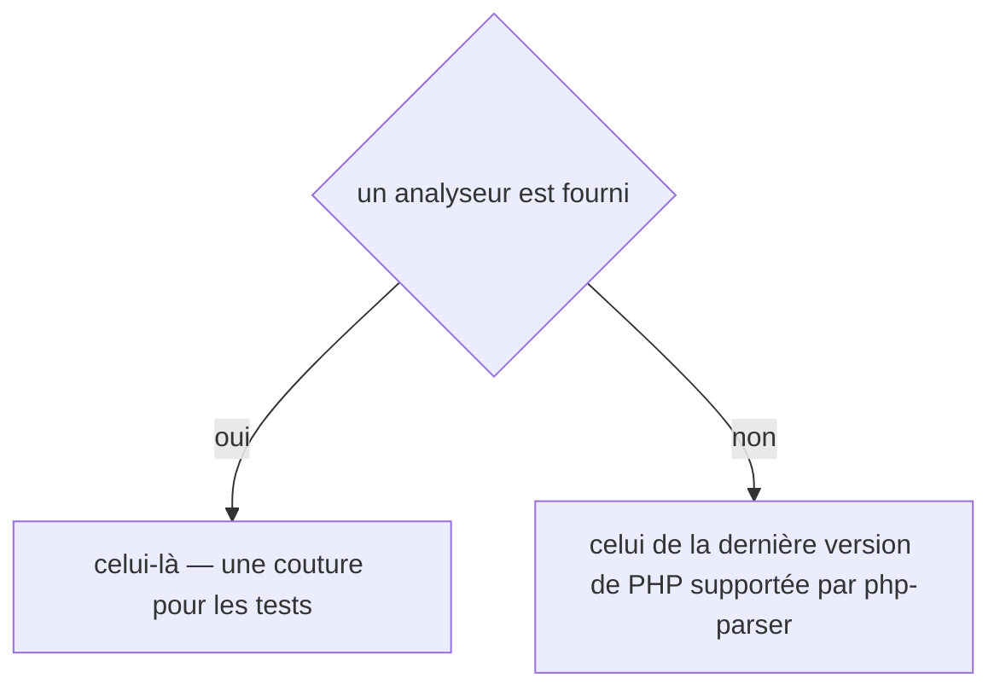
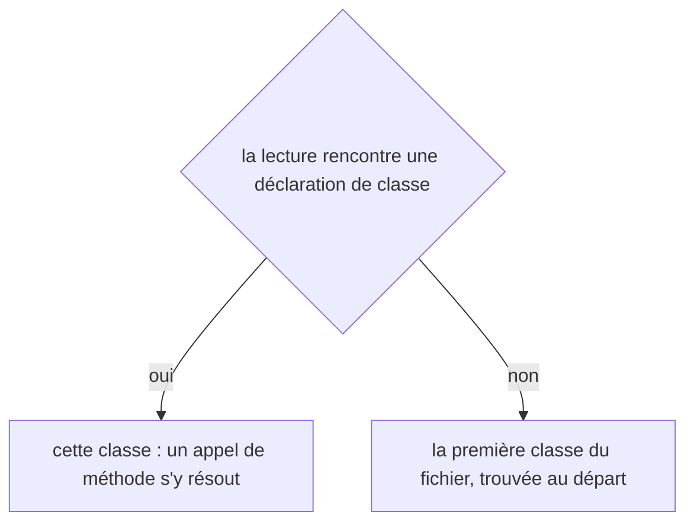
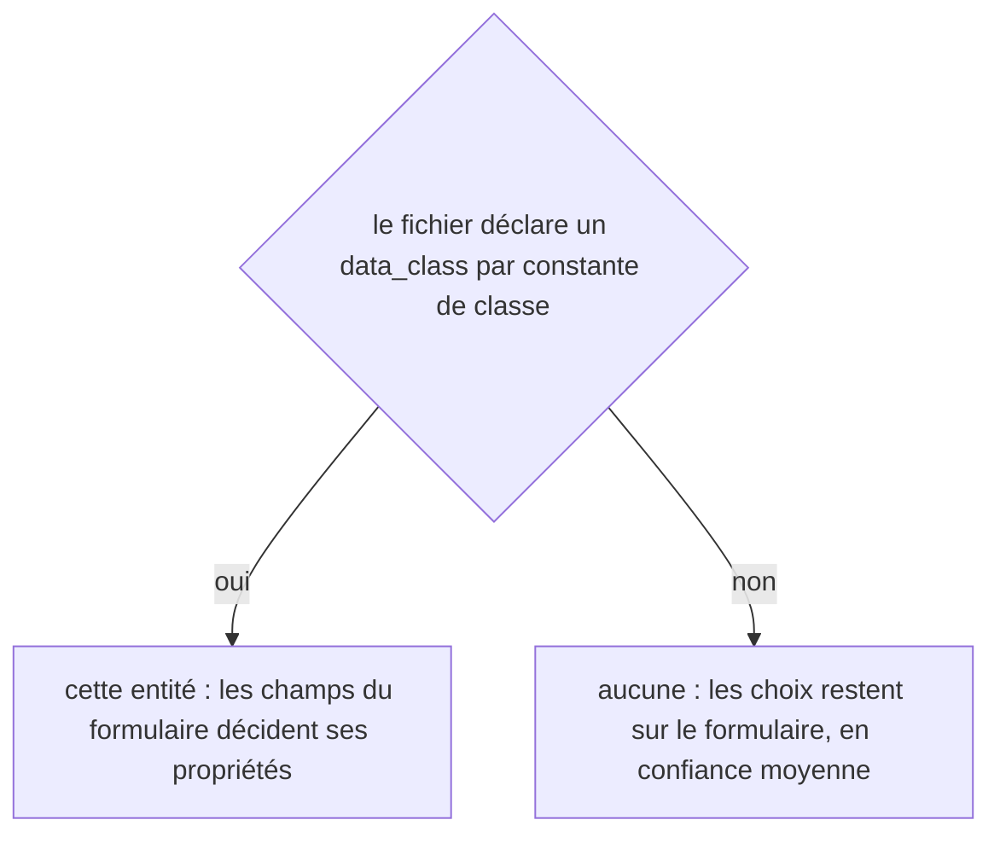
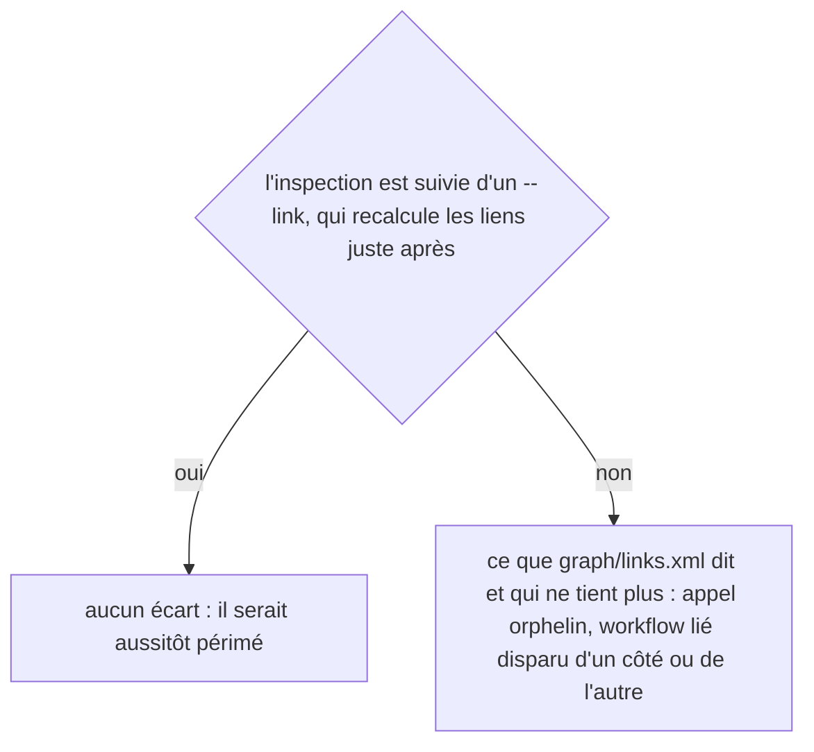

# workflows:check
`command.workflows.check` · type: commands · last updated: 2026-10-21 · commit: 240bcc3

## Summary

La gate. Elle échoue quand la documentation ne correspond plus au code — un fait changé, un workflow sans page, une page sans workflow — ou quand les liens avec un projet voisin ne tiennent plus : un écran appelle une route que l'API n'a plus, un workflow lié a disparu (ADR-0038). Et **elle n'écrit rien du tout**. La version qu'elle remplace régénérait les pages avant de prévenir : au moment où on lisait l'avertissement, il n'y avait plus rien à comparer.

## Trigger

| Element | Value |
|---|---|
| Entry point | `workflows:check` (command) |
| Security | — |
| Preconditions | Le projet porte un `.devtools/` déjà inspecté. |

## Journey

## Decisions

**`Jul6Art\DevTools\Command\WorkflowsCheckCommand::execute`**

**`Jul6Art\DevTools\Inspection\Graph\DecisionExtractor::method`**

**`Jul6Art\DevTools\Inspection\Graph\DecisionExtractor::scope`**

**`Jul6Art\DevTools\Inspection\Graph\DecisionExtractor::truncated`**

**`Jul6Art\DevTools\Inspection\Graph\PhpReferenceExtractor::parser`**

**`Jul6Art\DevTools\Inspection\Graph\DecisionExtractor::class`**

**`Jul6Art\DevTools\Inspection\Graph\DecisionExtractor::dataClass`**

**`Jul6Art\DevTools\Inspection\InspectionReport::linkProblems`**

## Data

Lecture : les suivis, le code, graph/links.xml et, quand il est sur disque, l'index du projet voisin. Aucune écriture.

## Cross-cutting mechanisms

—

## Points of attention

- **Un fichier modifié sans fait changé n'est pas une cause** : c'est toute la différence avec la fraîcheur, et elle est délibérée — une gate qui réveille pour un commentaire ajouté est une gate qu'on désactive.
- **`--require-ai` est une exigence distincte** : une page qui ne porte que des faits est juste, mais elle n'explique rien ; les projets qui veulent la prose l'exigent explicitement.
- **Le format GitHub annote le fichier et la ligne**, pour que la pull request montre l'endroit plutôt qu'un résumé.
- **Un code changé sans fait changé est COMPTÉ, pas bloquant** : la gate dit combien de workflows sont dans ce cas, parce que leur prose peut être fausse — une condition réécrite dans une méthode, une constante renommée, une valeur par défaut inversée. `--strict` en fait une cause d'échec, pour les projets qui veulent relire à chaque fois.
- **Un appel orphelin est une cause, des deux côtés** : l'API et le mobile échouent tous deux tant qu'un écran appelle une route disparue. Un voisin absent du disque — une CI qui n'a cloné qu'un dépôt — n'est pas vérifié, sans faire échouer.

## Related workflows

—

## History

| Date | Commit | Change |
|---|---|---|
| 2026-09-19 | d9d6b8f | Rédaction initiale. |
| 2026-09-20 | 9e40da9 | La commande gagne `--strict` et une ligne de compte. Ce qui était tu — un fichier modifié sans fait changé — est maintenant dit, sans faire échouer : la gate annonce le nombre, et `--strict` le transforme en cause. Le format GitHub porte la même annotation. (files changed: src/Command/WorkflowsCheckCommand.php, src/Console/CheckRenderer.php, src/Inspection/Adapter/Symfony/SymfonyAdapter.php, src/Inspection/InspectionPipeline.php) |
| 2026-09-21 | e5a6438 | l'outil passe en anglais : ce que la commande écrit, et les titres des pages qu'elle produit (files changed: src/Ai/PageDraft.php, src/Command/WorkflowsCheckCommand.php, src/Console/ChangeRenderer.php, src/Console/CheckRenderer.php, src/Inspection/InspectionPipeline.php, src/Rendering/GroupPageRenderer.php, src/Rendering/GroupPageSection.php, src/Rendering/Labels.php, src/Rendering/MenuRenderer.php, src/Rendering/PageRenderer.php, src/Rendering/PageSection.php, src/Rendering/ParsedPage.php, src/Stack/Knowledge/KnowledgeCanvas.php, src/Stack/Knowledge/XmlKnowledgeBriefStore.php, src/Tracking/TrackingStatus.php) |
| 2026-09-21 | e5a6438 | l'en-tête de l'historique passe en anglais, et une page restée sous un gabarit antérieur est remise à jour (files changed: src/Inspection/InspectionPipeline.php, src/Rendering/PageRenderer.php) |
| 2026-10-20 | 2885138 | Aucun changement de fond : la détection reconnaît désormais une application Node sans framework (ADR-0050) et le rendu du menu a gagné la relecture de sa section « Not covered », sans rien changer à ce que fait cette commande. La prose a été relue contre le code et tient. (added test tests/Ai/MenuAfterApplyTest.php) |
| 2026-10-20 | 4979790 | l'extraction lit plus loin — contraintes, formulaires, voters, un saut d'appel — et deux de ses champs entrent dans les huit dessinés quand deux en sortent ; le gabarit passe à neuf sections : la navigation et la machine à états ouvrent « Decisions » (ADR-0044) (added decision Jul6Art\DevTools\Inspection\Graph\DecisionExtractor::class: — → (new \PhpParser\NodeFinder())->findFirstInstanceOf($statements, \PhpParser\Node\Stmt\ClassLike::class) (+10)) |
| 2026-10-20 | 4979790 | files changed: src/Inspection/Freshness/GitClient.php, src/Tracking/FileRelation.php, src/Tracking/FilesToWorkflows.php |
| 2026-10-20 | 4979790 | L'analyse relève désormais la limite mémoire de PHP à 1 Go, comme l'inspection ; des tests s'ajoutent au périmètre et symfony/process passe en 8.1.9. La prose a été relue et tient. (added test tests/Claude/ClaudeHookTest.php (+7)) |
| 2026-10-20 | 58c02fb | Aucun changement de fond : la configuration apprend les catégories de retours du projet, le client git et les chemins de .devtools ce que demandent les retours, les règles et le journal, sans rien changer de ce que fait la commande ; des tests s'ajoutent. La prose tient. (added test tests/Assertion/AssertionProposalTest.php (+8)) |
| 2026-10-20 | 58c02fb | Aucun changement de fond : le client git lit plus simplement les fichiers du projet et les commits d'une plage, sans rien changer de ce que fait la commande. La prose a été relue et tient. (files changed: src/Inspection/Freshness/GitClient.php) |
| 2026-10-21 | 240bcc3 | Les liens avec les projets voisins sont une cause d'échec quand ils ne tiennent plus : appel orphelin, workflow lié disparu (ADR-0038). (added decision Jul6Art\DevTools\Inspection\InspectionReport::linkProblems: — → (new \Jul6Art\DevTools\Link\LinkCheck())->problems($directory, $links, array_map(static fn(\Jul6Art\DevTools\Inspection\Model\Workflow $workflow): string => $workflow->id->value, $workflows)) (+6)) |
| 2026-10-21 | 240bcc3 | Aucun changement de fond : le suivi d'un workflow sait s'allonger d'une révision, le renommage et l'initialisation ont été simplifiés (ADR-0036, ADR-0039), sans rien changer de ce que fait la commande. La prose a été relue et tient. (files changed: src/Ask/SearchIndexBuilder.php, src/Glossary/GlossaryCollector.php, src/Tracking/Initializer.php, src/Tracking/Rename/RenameDetector.php, src/Tracking/Rename/RenamePlan.php, src/Tracking/Rename/WorkflowRenamer.php, src/Tracking/TrackingDocument.php) |
