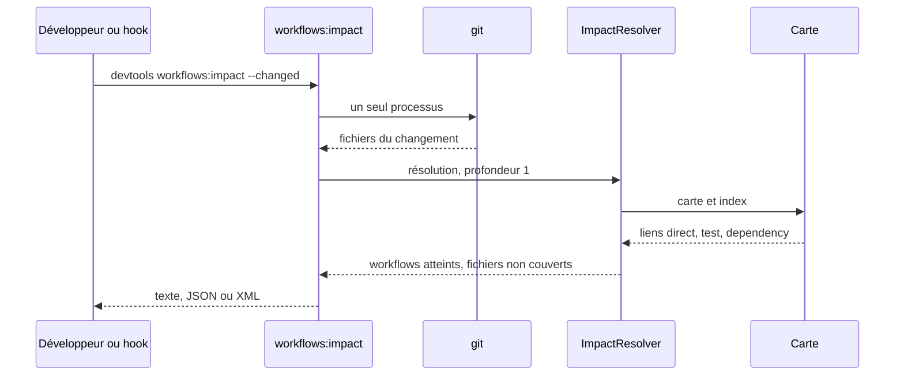
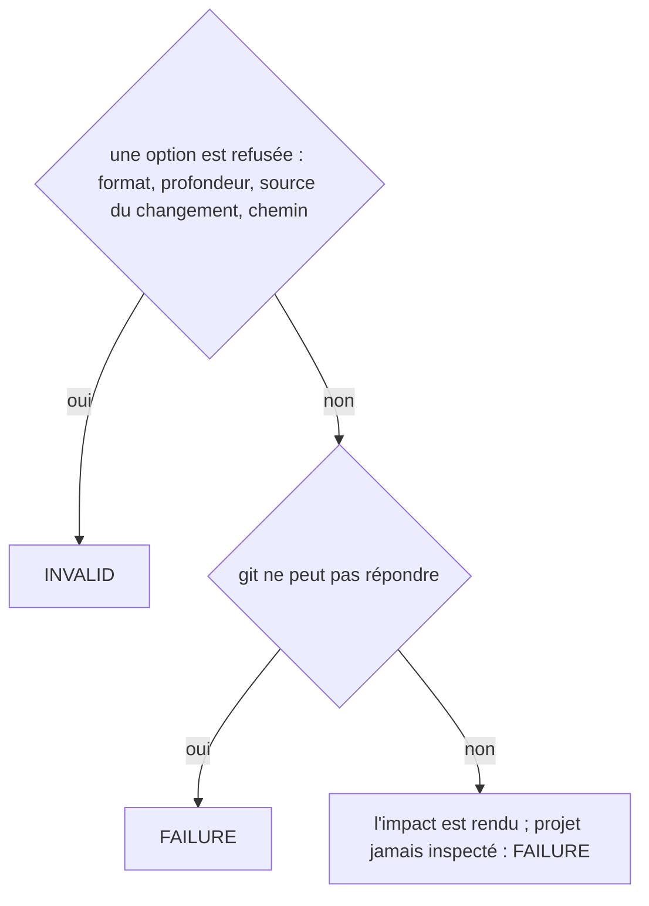
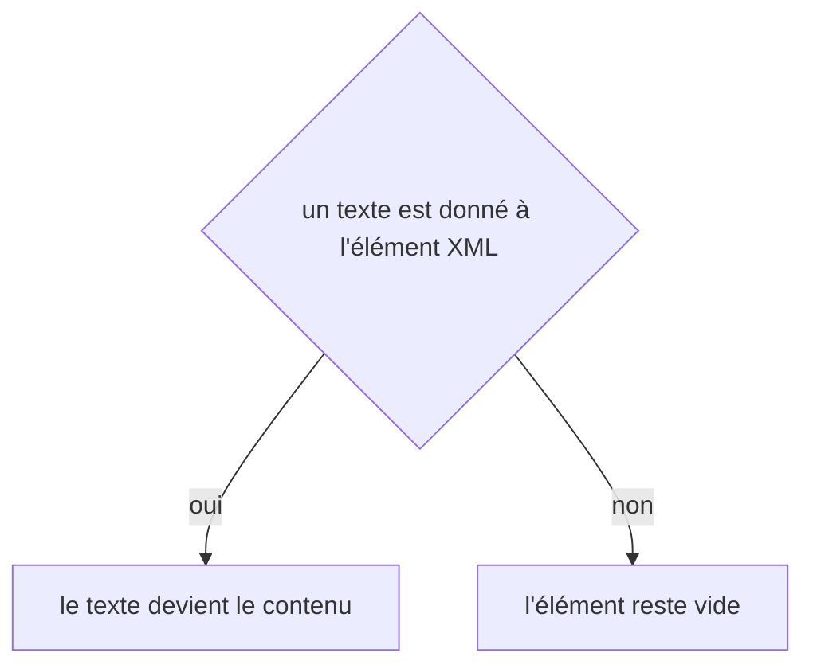

# workflows:impact
`command.workflows.impact` · type: commands · last updated: 2026-10-21 · commit: 240bcc3

## Summary

Dit quels workflows un changement atteint (ADR-0016) : des fichiers nommés, ceux d'un commit, d'une plage ou de l'arbre de travail, lus sur la carte que la dernière inspection a écrite — jamais dans le code. Chaque workflow vient avec la façon dont le changement l'atteint — direct, par un test, par une dépendance —, ses fichiers, sa page et sa fraîcheur ; un fichier qu'aucun workflow ne référence est listé à part. Avec `--linked`, la réponse passe dans les projets voisins : les intégrations d'un mobile qui appellent une route atteinte, puis ses écrans qui passent par elles (ADR-0038). La sortie existe en texte, en JSON pour les outils et en XML.

## Trigger

| Element | Value |
|---|---|
| Entry point | `workflows:impact` (command) |
| Security | — |
| Preconditions | Le projet a été inspecté : la carte fichiers → workflows et l'index existent. |

## Journey

## Decisions

**`Jul6Art\DevTools\Command\WorkflowsImpactCommand::execute`**

**`element::textContent`**

## Data

Lit la carte fichiers → workflows et l'index, et les dates des fichiers interrogés pour dire si la carte est périmée ; avec `--linked`, graph/links.xml, puis la carte et l'index du voisin quand il est sur disque. N'écrit rien.

## Cross-cutting mechanisms

Aucun.

## Points of attention

La carte n'est aussi fraîche que la dernière inspection : un fichier modifié après elle ouvre la sortie sur un avertissement. --commit, --range et --changed coûtent un seul processus git. La clé `linked` du JSON et les éléments `<linked>` du XML n'apparaissent que sur demande : les outils qui lisent la sortie d'avant n'y voient rien changer. La décision sur `element::textContent` est celle de DomBuilder, sur le chemin de toute lecture ou écriture XML : elle n'est pas propre à ce workflow.

## Related workflows

—

## History

| Date | Commit | Change |
|---|---|---|
| 2026-10-20 | 4979790 | initial |
| 2026-10-20 | 4979790 | rédaction initiale (added test tests/Gate/GateBrowserTest.php (+9)) |
| 2026-10-20 | 58c02fb | Aucun changement de fond : la configuration apprend les catégories de retours du projet, le client git et les chemins de .devtools ce que demandent les retours, les règles et le journal, sans rien changer de ce que fait la commande ; des tests s'ajoutent. La prose tient. (added test tests/Assertion/AssertionProposalTest.php (+10)) |
| 2026-10-20 | 58c02fb | Aucun changement de fond : le client git lit plus simplement les fichiers du projet et les commits d'une plage, sans rien changer de ce que fait la commande. La prose a été relue et tient. (files changed: src/Inspection/Freshness/GitClient.php) |
| 2026-10-21 | 240bcc3 | --linked ajoute les workflows des projets voisins qu'un changement atteint : les intégrations qui appellent ses routes, puis les écrans qui passent par elles (ADR-0038). (added test tests/Ask/AskTest.php (+8)) |
| 2026-10-21 | 240bcc3 | Aucun changement de fond : le suivi d'un workflow sait s'allonger d'une révision, le renommage et l'initialisation ont été simplifiés (ADR-0036, ADR-0039), sans rien changer de ce que fait la commande. La prose a été relue et tient. (files changed: src/Link/LinkedImpactResolver.php, src/Tracking/TrackingDocument.php) |
