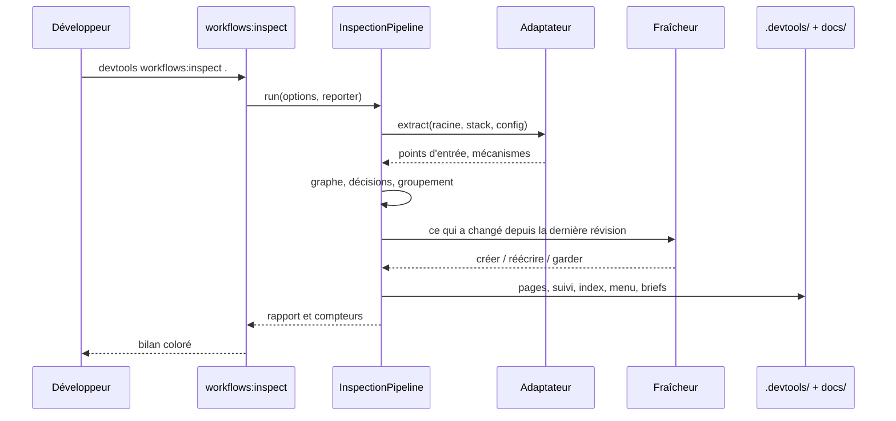
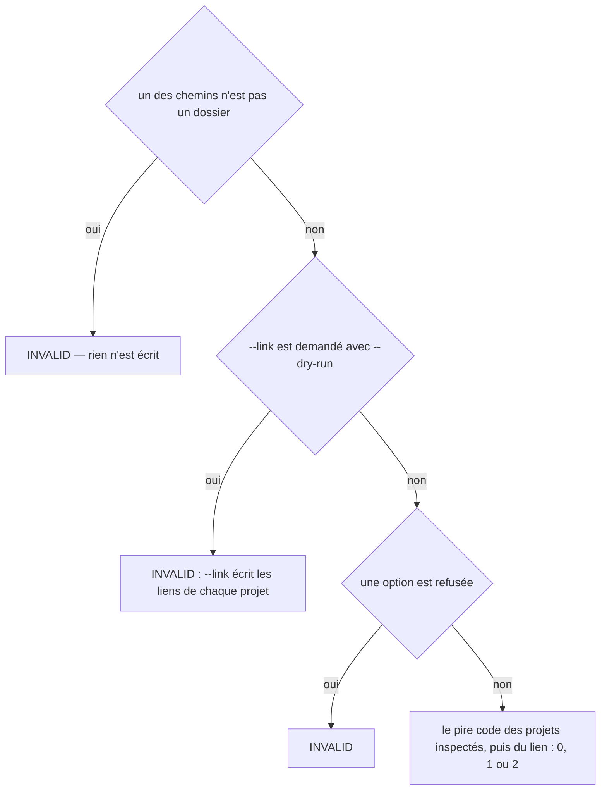
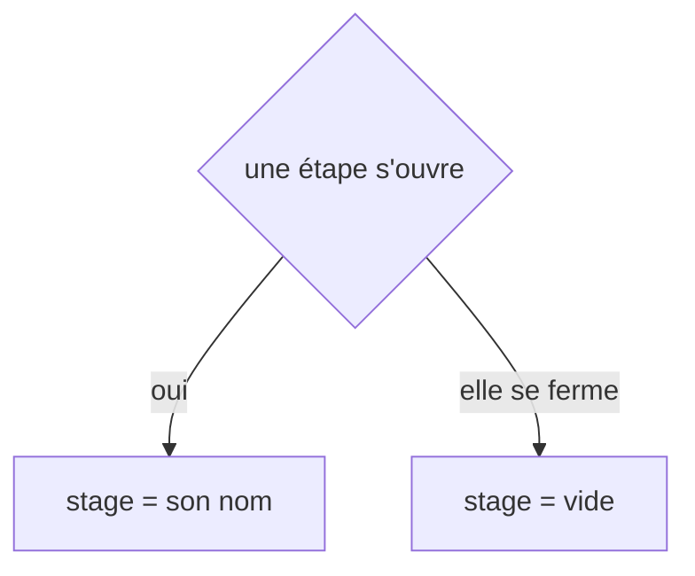
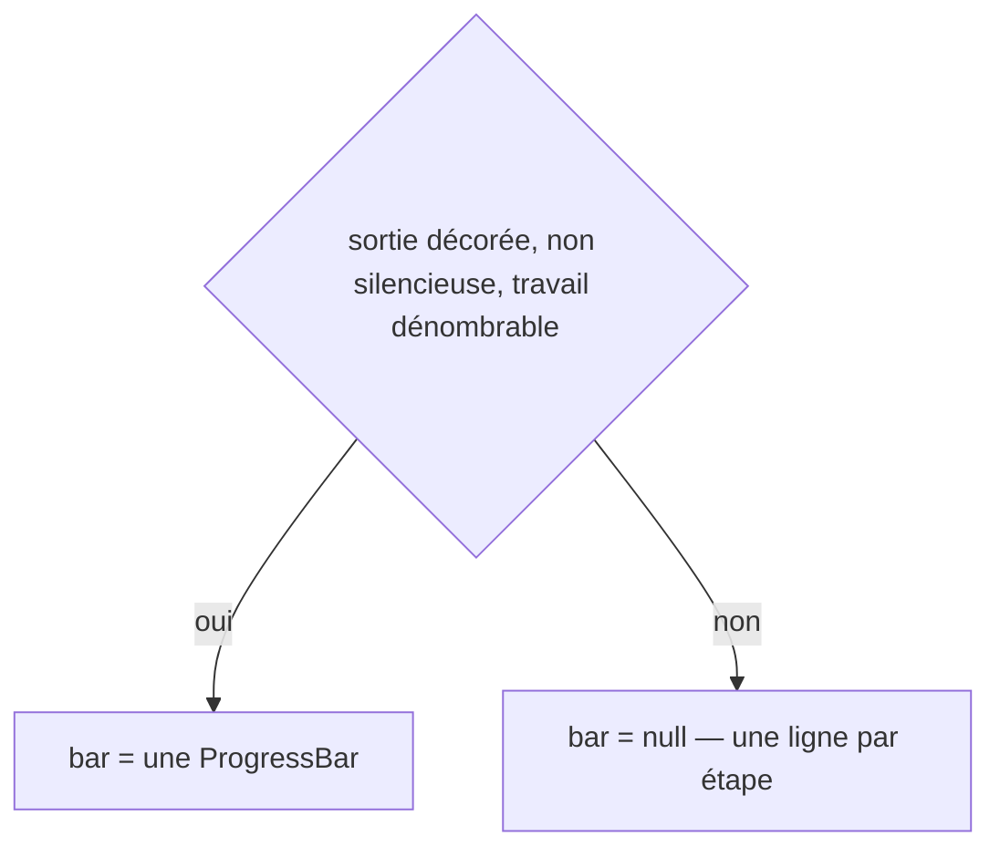
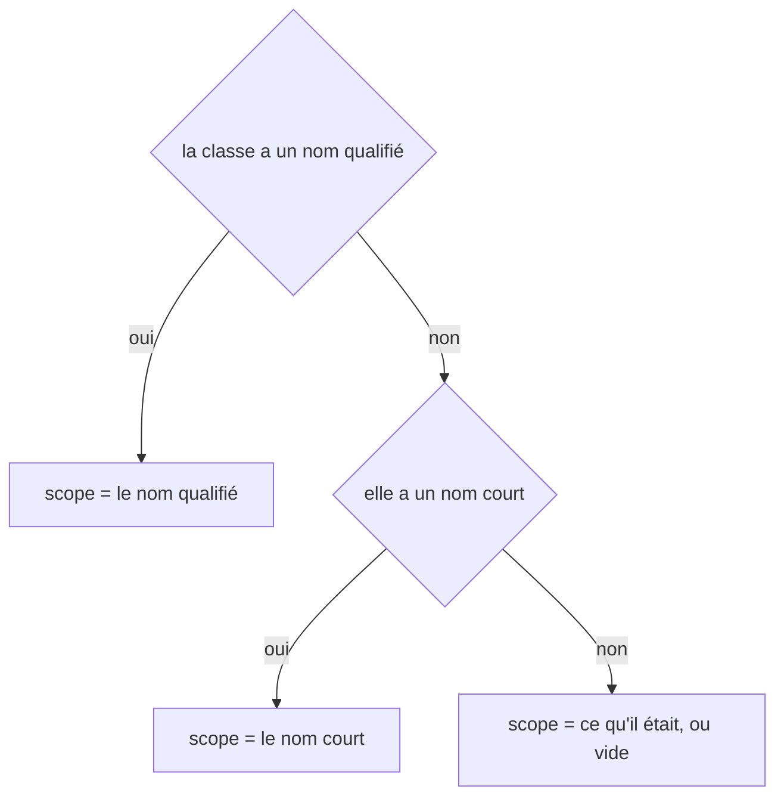
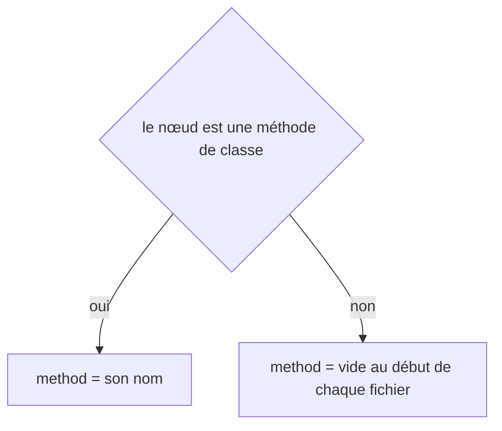
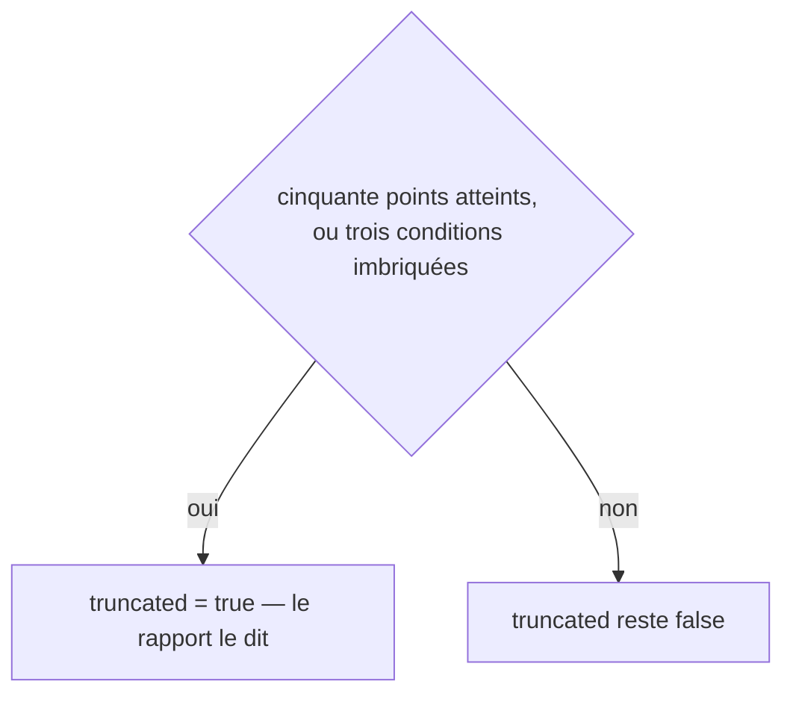
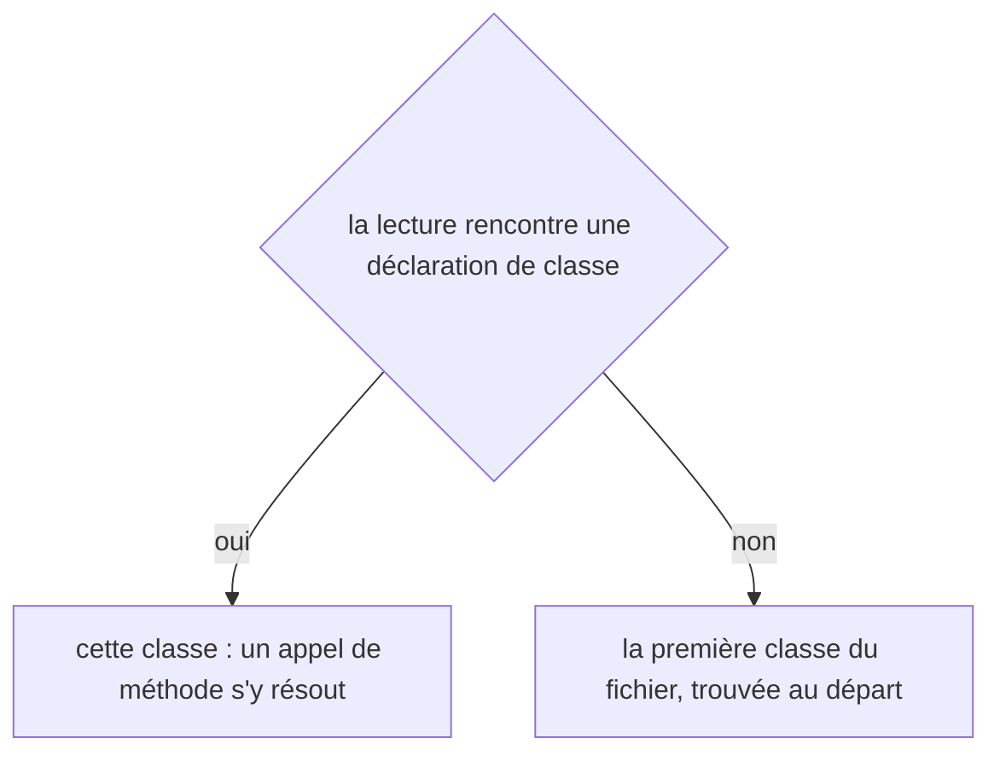
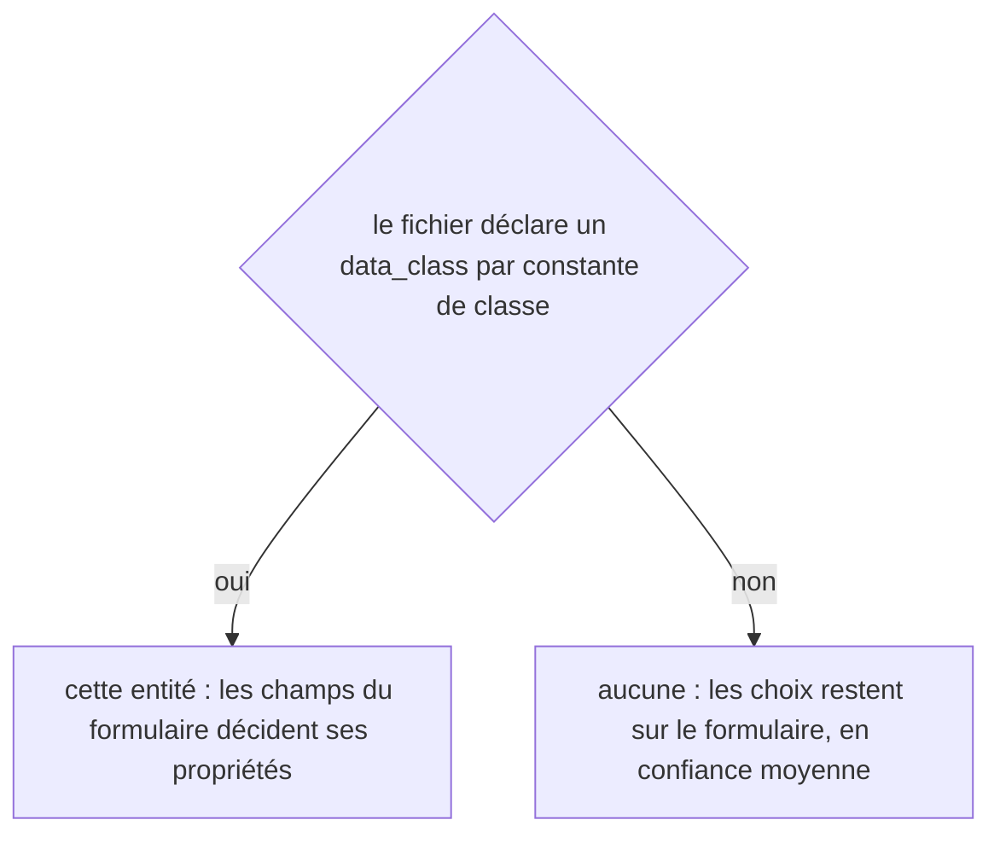

# workflows:inspect
`command.workflows.inspect` · type: commands · last updated: 2026-10-21 · commit: 240bcc3

## Summary

Documente tous les workflows d'un projet, ou de plusieurs à la suite : détection de stack, extraction des points d'entrée par l'adaptateur — natif pour Symfony, Laravel, Angular, Express et PHP sans framework, Claude sinon —, graphe de dépendances, décision de fraîcheur, écriture des pages et des fichiers de suivi, glossaire, index, menu, graphe d'ensemble et index de recherche. Avec `--link`, une fois tous les projets inspectés, chacun est relié aux voisins que déclare son config.xml : les appels d'un front appariés aux routes de son API (ADR-0038). Une seconde exécution sur un projet inchangé ne modifie aucun fichier hors `reports/`. La commande annonce chaque étape et finit sur ce qu'elle a fait et ce que ça a coûté.

## Trigger

| Element | Value |
|---|---|
| Entry point | `workflows:inspect` (command) |
| Security | — |
| Preconditions | Le chemin donné est un dossier existant, et aucune autre inspection ne tourne sur ce projet. |

## Journey

## Decisions

**`Jul6Art\DevTools\Command\WorkflowsInspectCommand::execute`**

**`Jul6Art\DevTools\Console\ConsoleProgressReporter::stage`**

**`Jul6Art\DevTools\Console\ConsoleProgressReporter::bar`**

**`Jul6Art\DevTools\Inspection\Graph\DecisionExtractor::scope`**

**`Jul6Art\DevTools\Inspection\Graph\DecisionExtractor::method`**

**`Jul6Art\DevTools\Inspection\Graph\DecisionExtractor::truncated`**

**`Jul6Art\DevTools\Inspection\Graph\DecisionExtractor::class`**

**`Jul6Art\DevTools\Inspection\Graph\DecisionExtractor::dataClass`**

## Data

Lit le code du projet sans jamais l'exécuter — par le pont Node pour JavaScript et TypeScript, par la console du framework quand il en a une —, ses manifestes et son dépôt git ; écrit `.devtools/`, dont glossary.xml et l'index de recherche search.idx, le dossier de documentation, plus un rapport horodaté. Avec `--link`, lit l'index et les fichiers de suivi des projets voisins et écrit graph/links.xml de chaque projet nommé. Les décisions viennent aussi des contraintes de validation d'une entité, des options d'un champ de formulaire et d'une méthode de la même classe appelée pour calculer la valeur ; un voter entre dans les mécanismes des routes qui demandent son attribut (ADR-0044).

## Cross-cutting mechanisms

Aucun listener : c'est une commande console. Le verrou `ProjectLock` interdit deux inspections simultanées sur le même projet.

## Points of attention

Les champs décidés listés ici sont ceux de l'outil lui-même — `scope`, `method`, `truncated` sont des états internes de l'extracteur, pas du métier. C'est la limite de l'extraction : elle trouve toute la logique conditionnelle atteinte, sans savoir laquelle intéresse un lecteur. Sur un projet applicatif, ce sont les champs d'entités qui remontent.

- **`--link` relie après avoir tout inspecté** : les liens d'un front dépendent des routes de l'API, et inversement ; chaque projet n'écrit que son propre links.xml, et un voisin jamais inspecté garde ses liens, avec un avertissement.
- **`--prune` emporte le dossier avec le README** : un contrôleur dont la dernière route disparaît ne laisse plus derrière lui un répertoire vide qui ne liste rien.
- **Une page écrite sous un gabarit antérieur est remise à jour, même quand rien n'a bougé**, et la section « Related workflows » suit les liens que graph/links.xml garde : une réinspection sans `--link` redonne les mêmes octets.

## Related workflows

—

## History

| Date | Commit | Change |
|---|---|---|
| 2026-09-18 | b8049a4 | rédaction initiale |
| 2026-09-19 | d9d6b8f | added test tests/Bridge/PHPStan/WorkflowDriftTest.php (+3) |
| 2026-09-20 | 9e40da9 | Deux trous comblés dans le pipeline, trouvés en passant le système à l'épreuve : l'élagage laissait derrière lui le dossier d'un groupe vidé, et les écouteurs Doctrine n'apparaissaient sur aucune page. Le reste de la commande est inchangé. (files changed: src/Inspection/Adapter/Symfony/SymfonyAdapter.php, src/Inspection/InspectionPipeline.php) |
| 2026-09-21 | e5a6438 | l'outil passe en anglais : ce que la commande écrit, et les titres des pages qu'elle produit (files changed: src/Ai/PageDraft.php, src/Console/SummaryRenderer.php, src/Inspection/InspectionPipeline.php, src/Rendering/GroupPageRenderer.php, src/Rendering/GroupPageSection.php, src/Rendering/Labels.php, src/Rendering/MenuRenderer.php, src/Rendering/PageRenderer.php, src/Rendering/PageSection.php, src/Rendering/ParsedPage.php, src/Stack/Knowledge/KnowledgeCanvas.php, src/Stack/Knowledge/XmlKnowledgeBriefStore.php, src/Tracking/TrackingStatus.php) |
| 2026-09-21 | e5a6438 | l'inspection remet une page restée sous un gabarit antérieur dans le gabarit courant (files changed: src/Inspection/InspectionPipeline.php, src/Rendering/PageRenderer.php) |
| 2026-10-20 | 2885138 | Aucun changement de fond : la détection reconnaît désormais une application Node sans framework (ADR-0050) et le rendu du menu a gagné la relecture de sa section « Not covered », sans rien changer à ce que fait cette commande. La prose a été relue contre le code et tient. (added test tests/Ai/MenuAfterApplyTest.php (+1)) |
| 2026-10-20 | 4979790 | l'extraction lit plus loin — contraintes, formulaires, voters, un saut d'appel — et deux de ses champs entrent dans les huit dessinés quand deux en sortent ; le gabarit passe à neuf sections : la navigation et la machine à états ouvrent « Decisions » (ADR-0044) (added decision Jul6Art\DevTools\Inspection\Graph\DecisionExtractor::class: — → (new \PhpParser\NodeFinder())->findFirstInstanceOf($statements, \PhpParser\Node\Stmt\ClassLike::class) (+11)) |
| 2026-10-20 | 4979790 | files changed: src/Inspection/Freshness/GitClient.php, src/Tracking/FileRelation.php, src/Tracking/FilesToWorkflows.php |
| 2026-10-20 | 4979790 | Signale les scénarios orphelins et liste au menu ceux qu'une réécriture met à revoir ; la limite mémoire passe à 1 Go. (added test tests/Claude/ClaudeHookTest.php (+7)) |
| 2026-10-20 | 58c02fb | Aucun changement de fond : la configuration apprend les catégories de retours du projet, le client git et les chemins de .devtools ce que demandent les retours, les règles et le journal, sans rien changer de ce que fait la commande ; des tests s'ajoutent. La prose tient. (added test tests/Assertion/AssertionProposalTest.php (+8)) |
| 2026-10-20 | 58c02fb | Aucun changement de fond : le client git lit plus simplement les fichiers du projet et les commits d'une plage, sans rien changer de ce que fait la commande. La prose a été relue et tient. (files changed: src/Inspection/Freshness/GitClient.php) |
| 2026-10-21 | 240bcc3 | Inspecte plusieurs projets à la suite et les relie avec --link (ADR-0038) ; écrit le glossaire (ADR-0037) et l'index de recherche (ADR-0039). (added decision Jul6Art\DevTools\Command\WorkflowsInspectCommand::execute: — → \Symfony\Component\Console\Command\Command::INVALID (+23)) |
| 2026-10-21 | 240bcc3 | Aucun changement de fond : le suivi d'un workflow sait s'allonger d'une révision, le renommage et l'initialisation ont été simplifiés (ADR-0036, ADR-0039), sans rien changer de ce que fait la commande. La prose a été relue et tient. (files changed: src/Ask/SearchIndexBuilder.php, src/Command/WorkflowsInspectCommand.php, src/Glossary/GlossaryCollector.php, src/Tracking/Initializer.php, src/Tracking/Rename/RenameDetector.php, src/Tracking/Rename/RenamePlan.php, src/Tracking/Rename/WorkflowRenamer.php, src/Tracking/TrackingDocument.php) |
