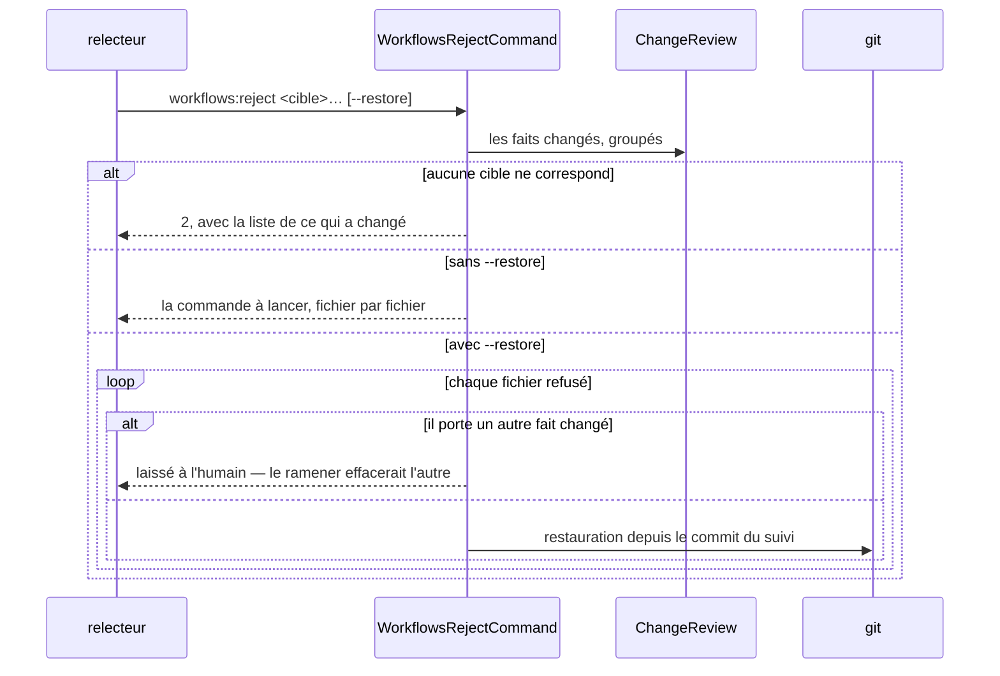
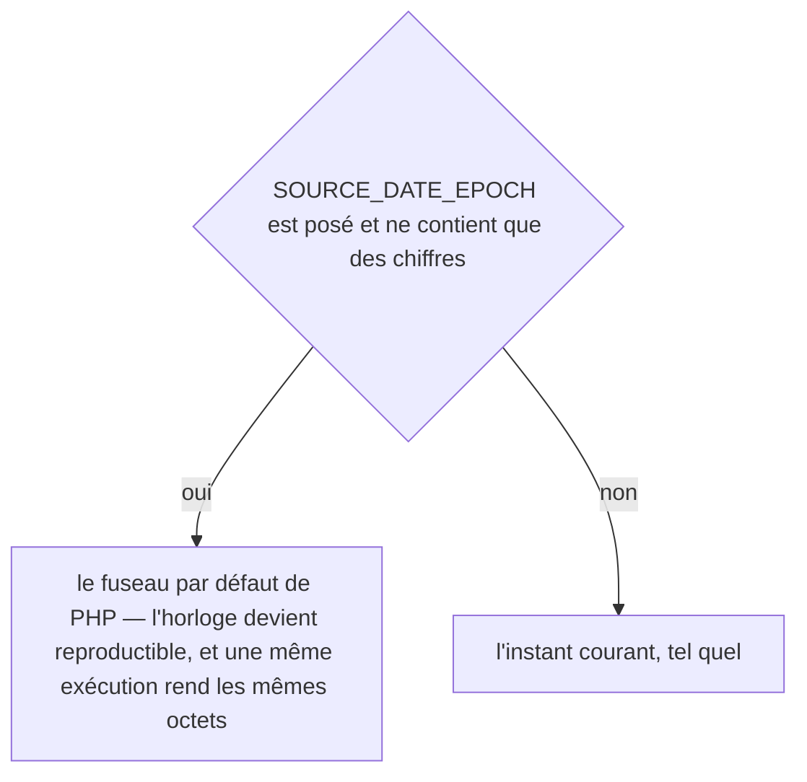
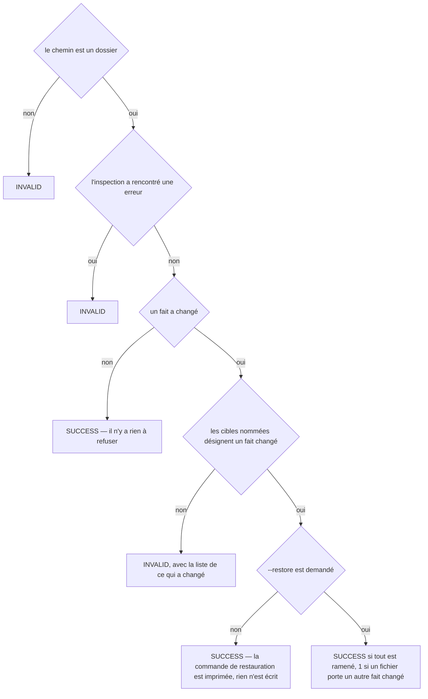
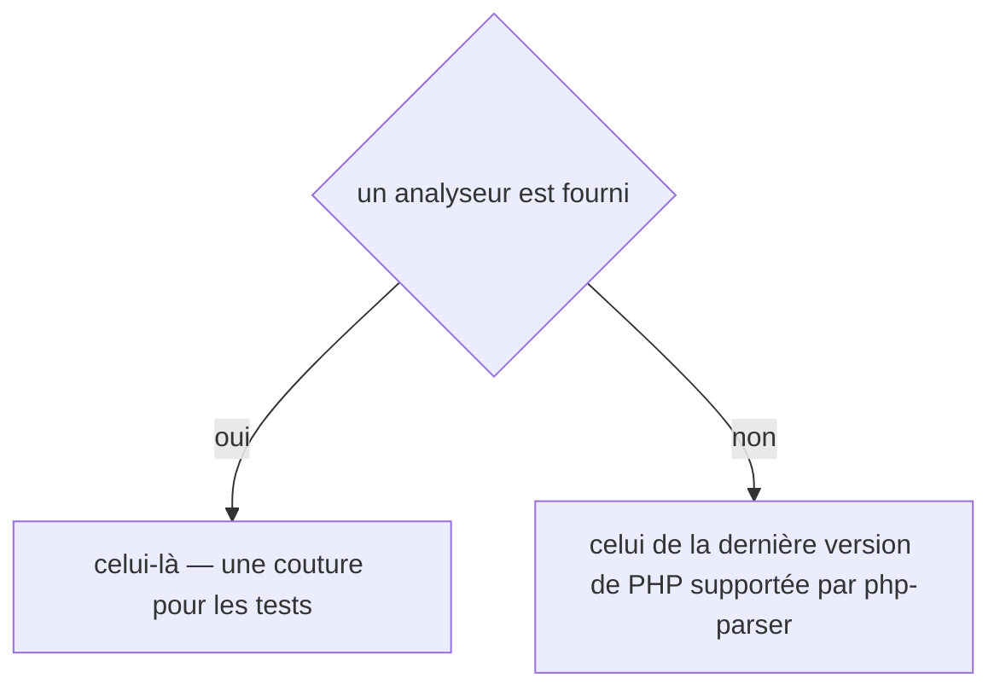
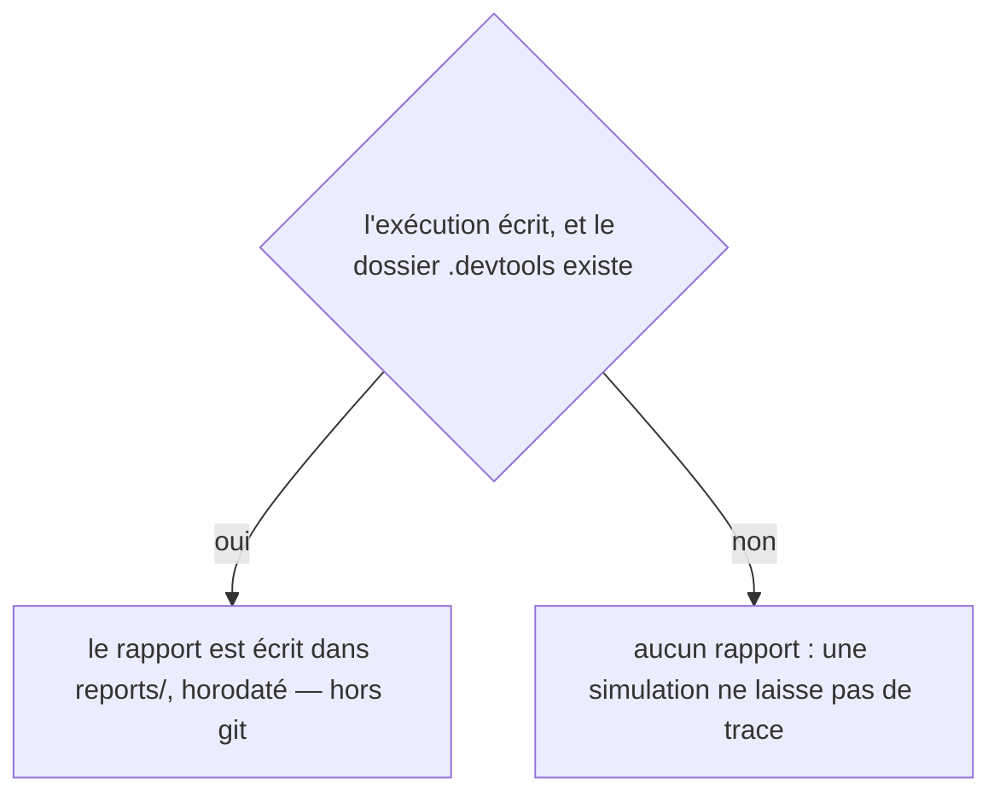
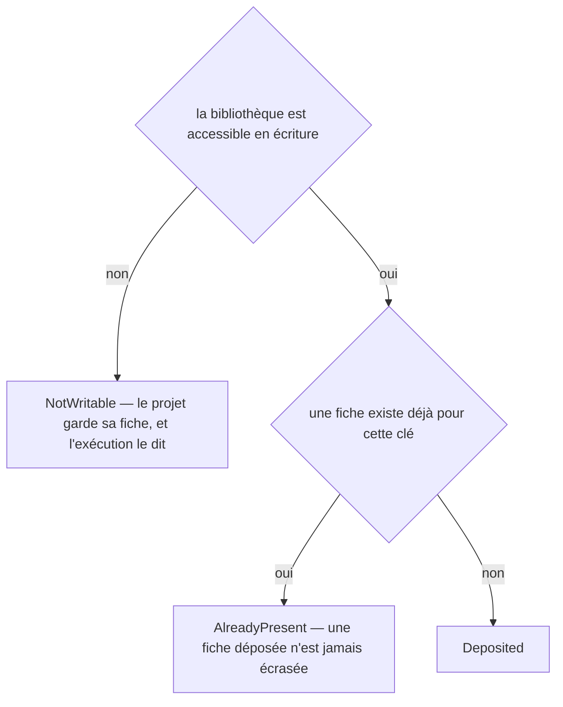
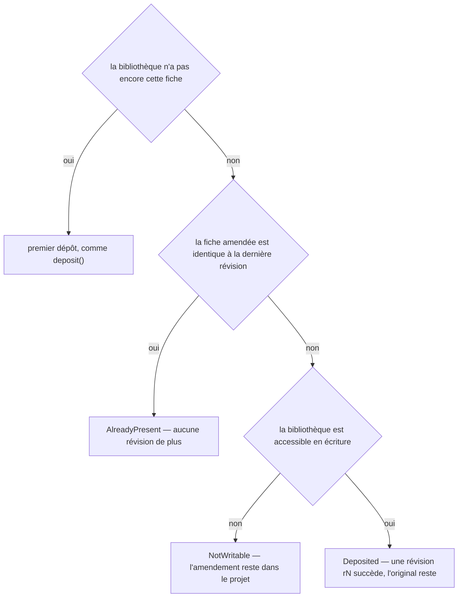
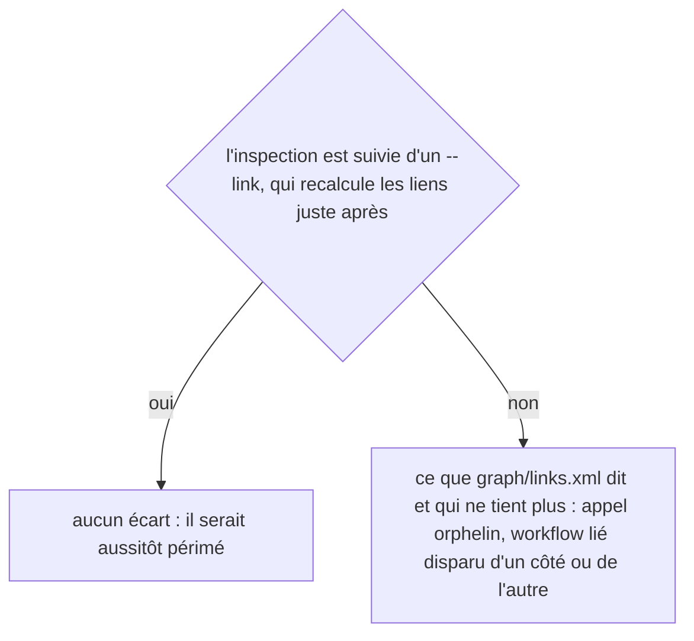
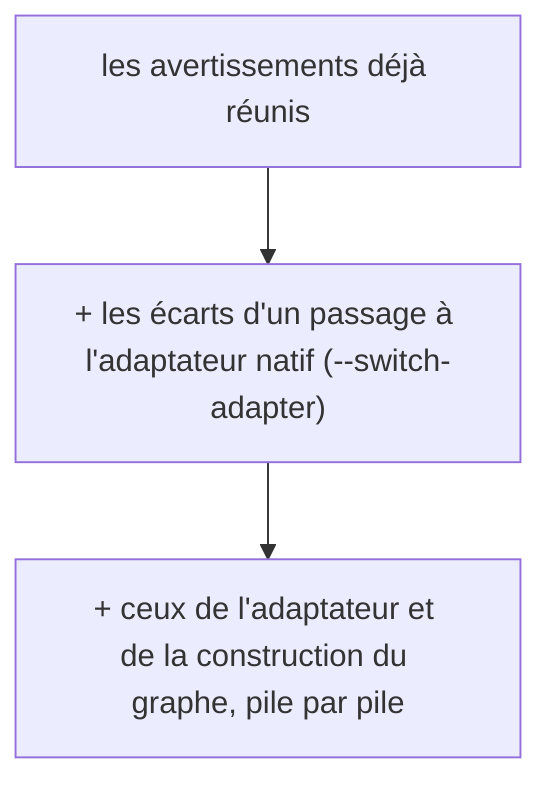

# workflows:reject
`command.workflows.reject` · type: commands · last updated: 2026-10-21 · commit: 240bcc3

## Summary

Le changement n'était pas voulu : **la documentation ne bouge pas, et c'est le code qui revient**. Sans `--restore`, la commande n'écrit rien du tout — elle imprime le `git restore` qui ramène le fichier à l'état où la page a été écrite. Avec, elle l'exécute : c'est la seule chose de tout DevTools qui touche au code d'un projet.

## Trigger

| Element | Value |
|---|---|
| Entry point | `workflows:reject` (command) |
| Security | — |
| Preconditions | Le projet porte un `.devtools/` déjà inspecté, et les cibles nommées désignent des faits qui ont changé. |

## Journey

## Decisions

**`DateTimeImmutable::timezone`**

**`Jul6Art\DevTools\Command\WorkflowsRejectCommand::execute`**

**`Jul6Art\DevTools\Inspection\Graph\PhpReferenceExtractor::parser`**

**`Jul6Art\DevTools\Inspection\InspectionReport::path`**

**`Jul6Art\DevTools\Stack\Knowledge\KnowledgeLibrary::deposit`**

**`Jul6Art\DevTools\Stack\Knowledge\KnowledgeLibrary::depositRevision`**

**`Jul6Art\DevTools\Inspection\InspectionReport::linkProblems`**

**`Jul6Art\DevTools\Inspection\InspectionReport::warnings`**

## Data

Aucune écriture dans la documentation. Avec `--restore`, le code des fichiers refusés revient à son état d'origine.

## Cross-cutting mechanisms

—

## Points of attention

- **Un fichier qui porte un autre fait changé n'est pas restauré** : le ramener effacerait en silence un changement que personne n'a refusé.
- **La restauration ramène le fichier entier**, au commit d'où la page a été écrite : un fait accepté mais non commité repart avec lui.
- **Refuser ne fait pas taire le contrôle** : tant que le code n'est pas revenu, la dérive reste visible — c'est ce qui distingue un refus d'un « ignore ».

## Related workflows

—

## History

| Date | Commit | Change |
|---|---|---|
| 2026-09-19 | d9d6b8f | Rédaction initiale. |
| 2026-09-20 | 9e40da9 | Aucun changement de fond : le pipeline d'inspection a bougé sur l'élagage et sur les écouteurs Doctrine, deux points que cette commande ne touche pas. La prose a été relue contre le code et tient. (files changed: src/Inspection/InspectionPipeline.php) |
| 2026-09-21 | e5a6438 | l'outil passe en anglais : ce que la commande écrit, et les titres des pages qu'elle produit (files changed: src/Ai/PageDraft.php, src/Command/WorkflowsRejectCommand.php, src/Console/ChangeRenderer.php, src/Inspection/InspectionPipeline.php, src/Rendering/GroupPageRenderer.php, src/Rendering/GroupPageSection.php, src/Rendering/MenuRenderer.php, src/Rendering/PageRenderer.php, src/Rendering/PageSection.php, src/Rendering/ParsedPage.php, src/Stack/Knowledge/KnowledgeCanvas.php, src/Stack/Knowledge/XmlKnowledgeBriefStore.php, src/Tracking/TrackingStatus.php) |
| 2026-09-21 | e5a6438 | l'en-tête de l'historique passe en anglais, et une page restée sous un gabarit antérieur est remise à jour (files changed: src/Inspection/InspectionPipeline.php, src/Rendering/PageRenderer.php) |
| 2026-10-20 | 2885138 | Aucun changement de fond : le rendu du menu a gagné la relecture de sa section « Not covered », que seul workflows:apply appelle ; des tests se sont ajoutés. La prose a été relue contre le code et tient. (added test tests/Command/WorkflowsDiffCommandTest.php) |
| 2026-10-20 | 4979790 | le chemin d'application gagne le dépôt en révision d'une fiche amendée, et un champ moins riche sort des huit dessinés ; le gabarit passe à neuf sections : la navigation et la machine à états ouvrent « Decisions » (ADR-0044) (added decision Jul6Art\DevTools\Stack\Knowledge\KnowledgeLibrary::depositRevision: — → \Jul6Art\DevTools\Stack\Knowledge\DepositOutcome::AlreadyPresent (+4)) |
| 2026-10-20 | 4979790 | files changed: src/Inspection/Freshness/GitClient.php, src/Tracking/FilesToWorkflows.php |
| 2026-10-20 | 4979790 | L'analyse relève désormais la limite mémoire de PHP à 1 Go, comme l'inspection ; des tests s'ajoutent au périmètre et symfony/process passe en 8.1.9. La prose a été relue et tient. (modified package symfony/process: 8.1.7 → 8.1.9) |
| 2026-10-20 | 58c02fb | Aucun changement de fond : la configuration apprend les catégories de retours du projet, le client git et les chemins de .devtools ce que demandent les retours, les règles et le journal, sans rien changer de ce que fait la commande ; des tests s'ajoutent. La prose tient. (files changed: src/Config/Config.php, src/Config/XmlConfigReader.php, src/Inspection/Freshness/GitClient.php, src/Tracking/DevToolsDirectory.php) |
| 2026-10-20 | 58c02fb | Aucun changement de fond : le client git lit plus simplement les fichiers du projet et les commits d'une plage, sans rien changer de ce que fait la commande. La prose a été relue et tient. (files changed: src/Inspection/Freshness/GitClient.php) |
| 2026-10-21 | 240bcc3 | Aucun changement de fond : l'analyse qu'il lance relève aussi les liens entre projets devenus faux (ADR-0038). La prose a été relue et tient. (added decision Jul6Art\DevTools\Inspection\InspectionReport::linkProblems: — → (new \Jul6Art\DevTools\Link\LinkCheck())->problems($directory, $links, array_map(static fn(\Jul6Art\DevTools\Inspection\Model\Workflow $workflow): string => $workflow->id->value, $workflows)) (+5)) |
| 2026-10-21 | 240bcc3 | Aucun changement de fond : le suivi d'un workflow sait s'allonger d'une révision, le renommage et l'initialisation ont été simplifiés (ADR-0036, ADR-0039), sans rien changer de ce que fait la commande. La prose a été relue et tient. (files changed: src/Glossary/GlossaryCollector.php, src/Tracking/Initializer.php, src/Tracking/Rename/RenameDetector.php, src/Tracking/Rename/WorkflowRenamer.php, src/Tracking/TrackingDocument.php) |
