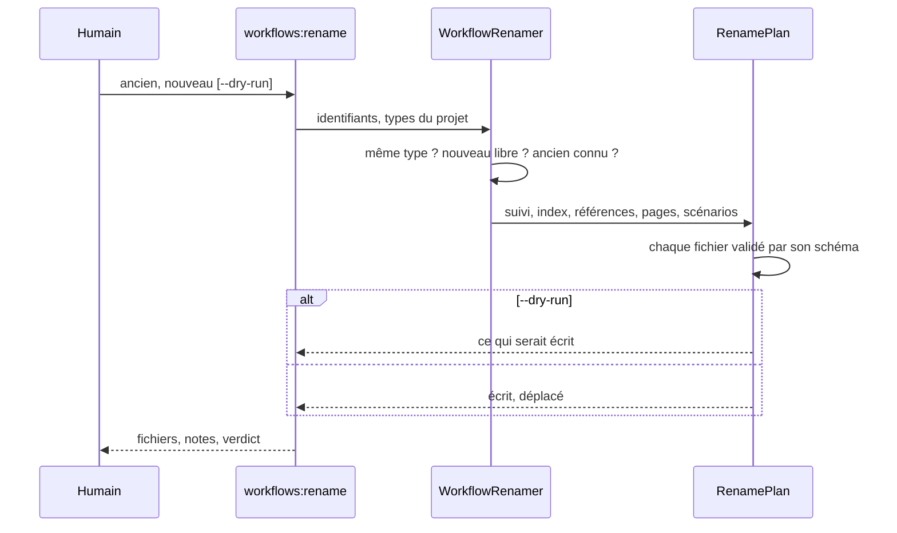
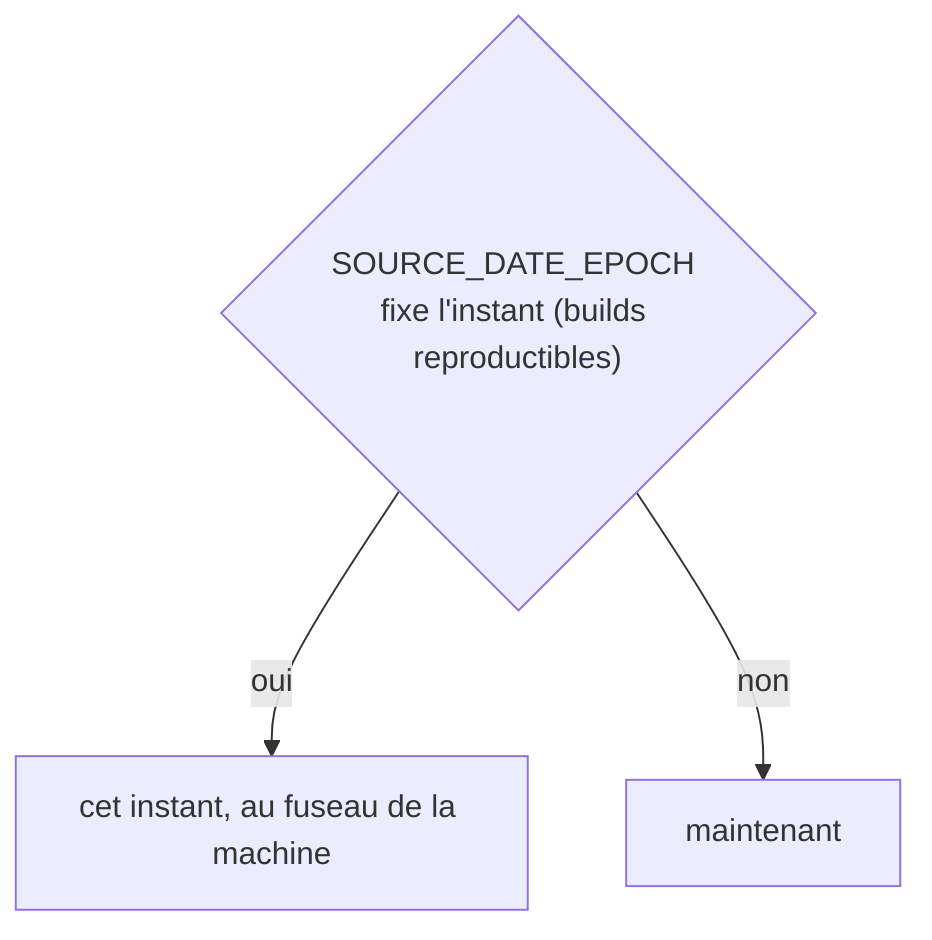
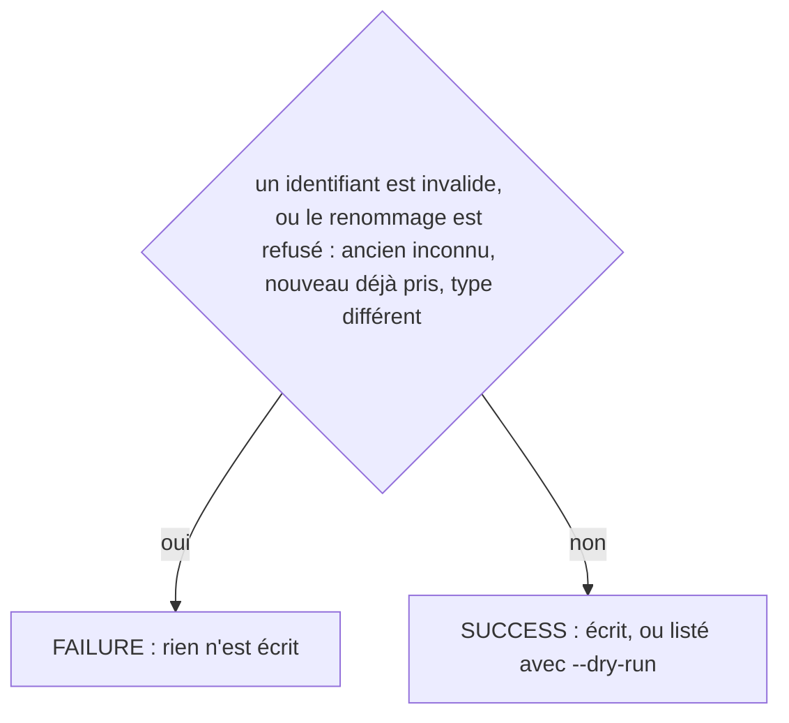
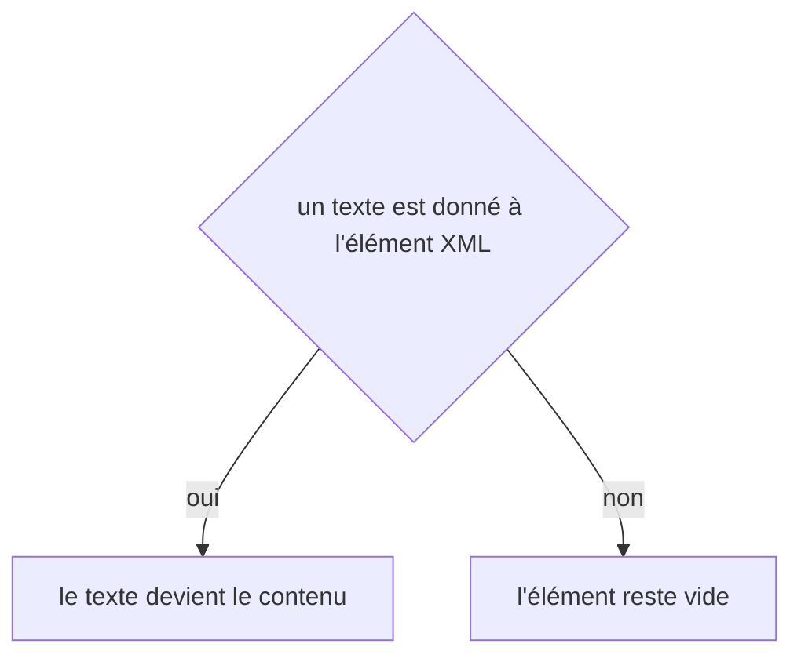

# workflows:rename
`command.workflows.rename` · type: commands · last updated: 2026-10-21 · commit: 240bcc3

## Summary

Renomme un workflow (ADR-0036) : sa page et son fichier de suivi passent au nouvel identifiant, son historique est gardé avec une révision de plus, et chaque référence suit — les dépendances des autres workflows, les liens des pages, l'index, la carte fichiers → workflows, les scénarios et leurs captures de référence, les retours, les règles, les assertions, le journal et le glossaire. Aucune page n'est redemandée à Claude. Un renommage vers un workflow existant, depuis un workflow inconnu ou d'un type à un autre est refusé, et n'écrit rien ; `--dry-run` liste ce qui serait écrit.

## Trigger

| Element | Value |
|---|---|
| Entry point | `workflows:rename` (command) |
| Security | — |
| Preconditions | Le projet a été inspecté et l'ancien identifiant est l'un de ses workflows. |

## Journey

## Decisions

**`DateTimeImmutable::timezone`**

**`Jul6Art\DevTools\Command\WorkflowsRenameCommand::execute`**

**`element::textContent`**

## Data

Lit l'index, les fichiers de suivi, les pages et tout ce qui, dans .devtools/, peut nommer un workflow ; écrit et déplace la page, le fichier de suivi, les scénarios et leurs captures, et réécrit chaque fichier qui nommait l'ancien identifiant. config.xml n'est jamais réécrit : un renommage qu'il mentionne est signalé.

## Cross-cutting mechanisms

Aucun.

## Points of attention

Tout est calculé, validé, puis écrit : un renommage refusé n'écrit rien. Les zones de travail — pending, runs, gate, reports, stats — ne sont pas réécrites : la prochaine exécution les refait. workflows:inspect propose lui-même les renommages probables — un workflow disparu et un nouveau du même type qui partagent 80 % de leurs fichiers — sans jamais les appliquer seul, sauf --apply-renames. La décision sur `element::textContent` est celle de DomBuilder : elle n'est pas propre à ce workflow.

## Related workflows

—

## History

| Date | Commit | Change |
|---|---|---|
| 2026-10-21 | 240bcc3 | rédaction initiale |
| 2026-10-21 | 240bcc3 | Le dossier baselines/ de l'ancien identifiant ne reste plus, vide, après le renommage ; seuls bougent les liens qui visent l'ancienne page, leur ancre gardée. (files changed: src/Tracking/Rename/RenamePlan.php, src/Tracking/Rename/WorkflowRenamer.php, src/Tracking/TrackingDocument.php) |
