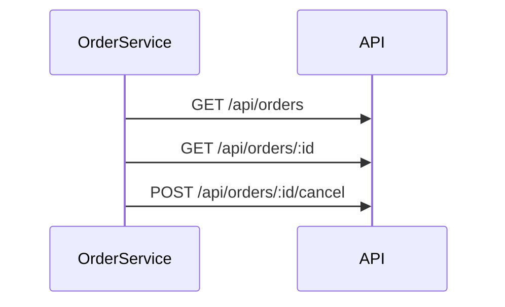

## Summary

Client HTTP des commandes : liste, détail et annulation.

## Preconditions

—

## Journey

## Decisions

—

## Data

Les commandes de l'API, sous `environment.apiUrl`.

## Cross-cutting mechanisms

Aucun intercepteur.

## Points of attention

Les observables sont froids : sans abonnement, rien n'est envoyé.

## Change

rédaction initiale
