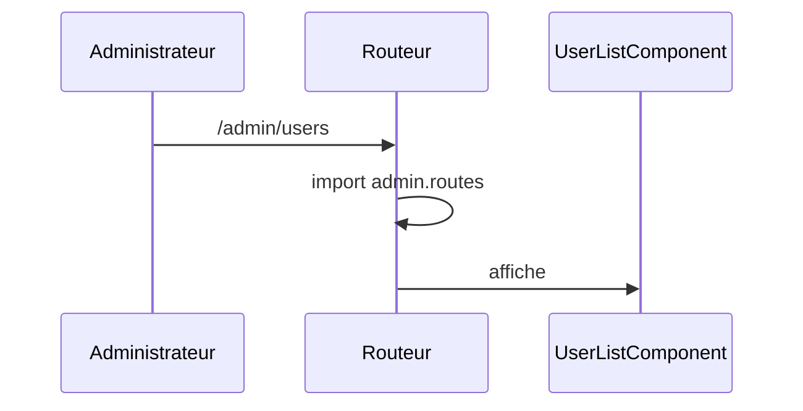

## Summary

Liste des utilisateurs, chargée paresseusement avec les routes d'administration.

## Preconditions

Être connecté : `canMatch` empêche même le chargement du module.

## Journey

## Decisions

—

## Data

Aucune.

## Cross-cutting mechanisms

`authGuard` en `canMatch` : sans connexion, la table d'administration n'est jamais téléchargée.

## Points of attention

Hors ligne, le premier accès échoue : le morceau de code n'est pas encore chargé.

## Change

rédaction initiale
