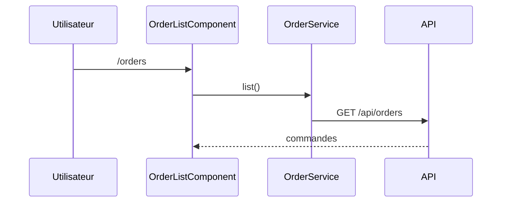

## Summary

Liste des commandes, chacune avec son statut, chargée depuis l'API.

## Preconditions

Être connecté (`authGuard`).

## Journey

## Decisions

—

## Data

Lit les commandes de l'API.

## Cross-cutting mechanisms

`authGuard`, hérité de la route parente `orders`.

## Points of attention

Le badge de statut est partagé avec le détail : le modifier change les deux écrans.

## Change

rédaction initiale
