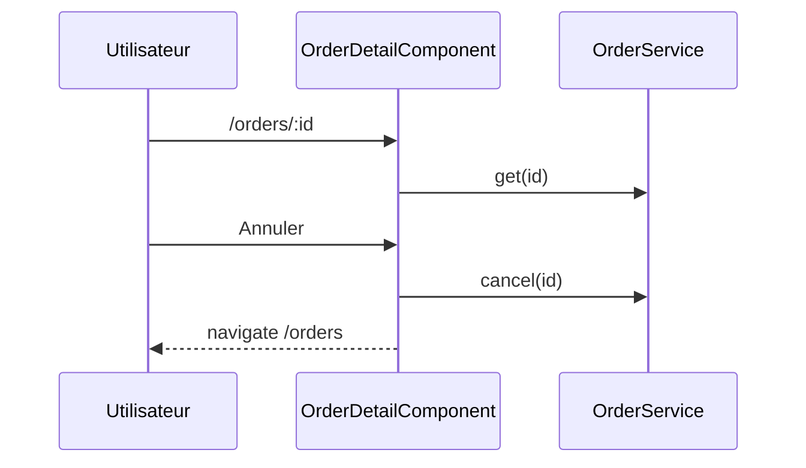

## Summary

Détail d'une commande et son annulation, après laquelle l'écran revient à la liste.

## Preconditions

Être connecté (`authGuard`).

## Journey

## Decisions

—

## Data

Lit une commande, l'annule par l'API.

## Cross-cutting mechanisms

`authGuard`, hérité de la route parente.

## Points of attention

L'annulation n'est pas confirmée : un clic suffit.

## Change

rédaction initiale
