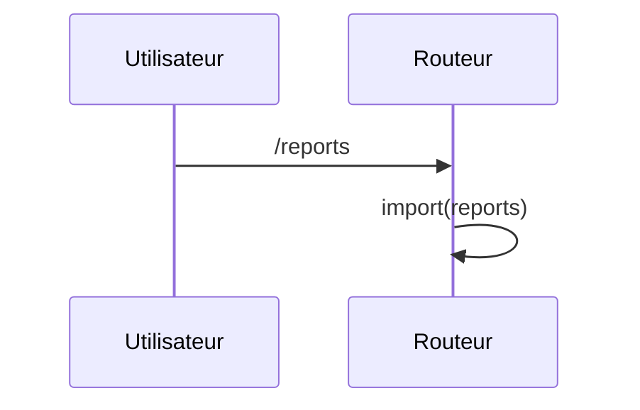

## Summary

Écran des rapports, chargé depuis un chemin calculé.

## Preconditions

—

## Journey

## Decisions

—

## Data

Aucune.

## Cross-cutting mechanisms

Aucun garde.

## Points of attention

Le chemin du composant est une variable : DevTools ne peut pas dire quel fichier sert l'écran.

## Change

rédaction initiale
