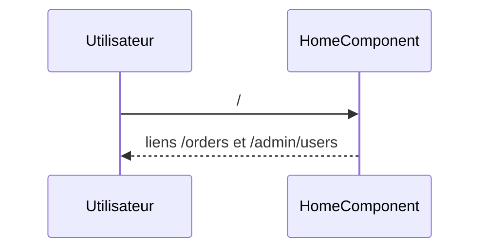

## Summary

Écran d'accueil : deux liens, vers les commandes et vers les utilisateurs.

## Preconditions

—

## Journey

## Decisions

—

## Data

Aucune.

## Cross-cutting mechanisms

Aucun garde : l'accueil est public.

## Points of attention

Les liens mènent à des écrans gardés : un visiteur non connecté revient ici.

## Change

rédaction initiale
