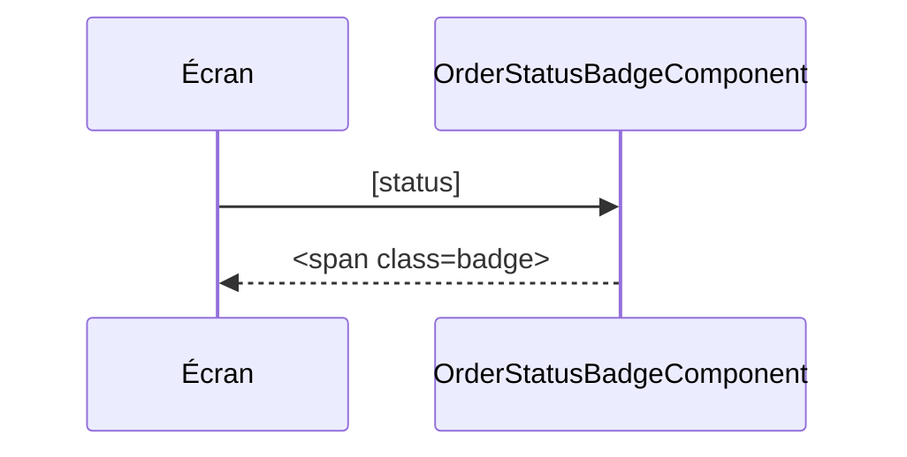

## Summary

Badge qui affiche le statut d'une commande, partagé par la liste et le détail.

## Preconditions

—

## Journey

## Decisions

—

## Data

Aucune : reçoit le statut en entrée.

## Cross-cutting mechanisms

Aucun.

## Points of attention

Le statut est affiché brut, sans traduction.

## Change

rédaction initiale
