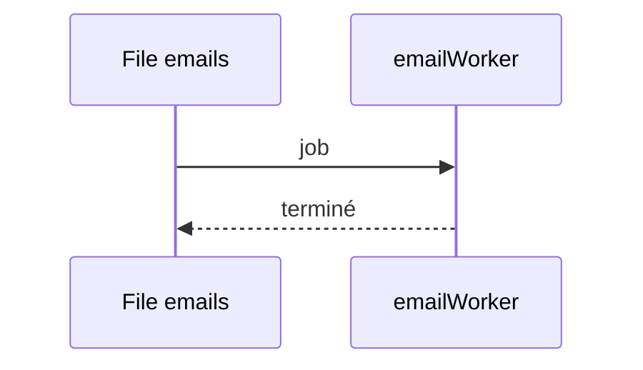

## Summary

Traite la file BullMQ `emails`.

## Preconditions

Un Redis joignable.

## Journey

## Decisions

—

## Data

Aucune.

## Cross-cutting mechanisms

Aucun.

## Points of attention

Le worker démarre au chargement du module.

## Change

rédaction initiale
