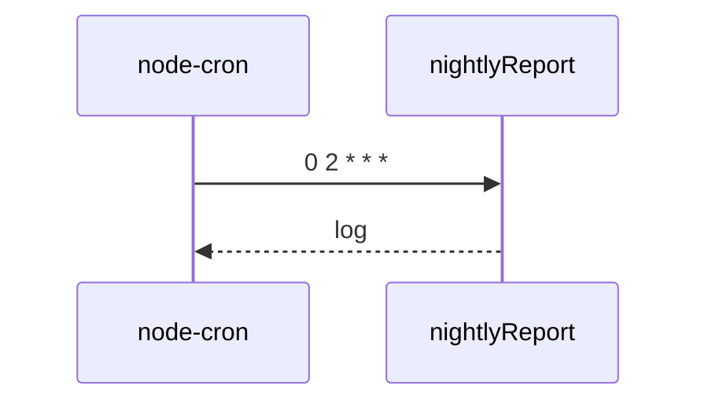

## Summary

Compte les commandes chaque nuit à 2 h.

## Preconditions

Le module est chargé par le processus.

## Journey

## Decisions

—

## Data

Lit les commandes.

## Cross-cutting mechanisms

Aucun.

## Points of attention

Sans chargement du module, rien ne se planifie.

## Change

rédaction initiale
