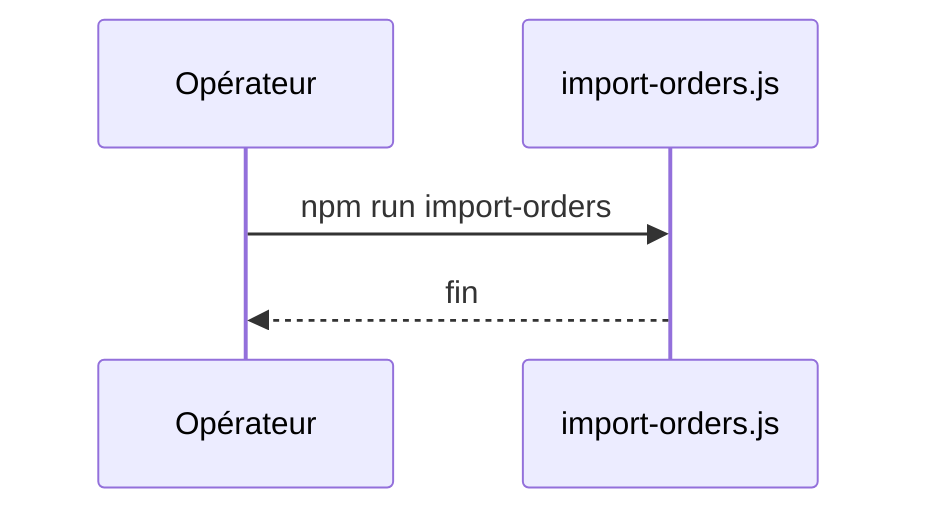

## Summary

Importe une commande d'exemple.

## Preconditions

—

## Journey

## Decisions

—

## Data

Écrit une commande en mémoire.

## Cross-cutting mechanisms

Aucun.

## Points of attention

L'import se perd à la fin du processus.

## Change

rédaction initiale
