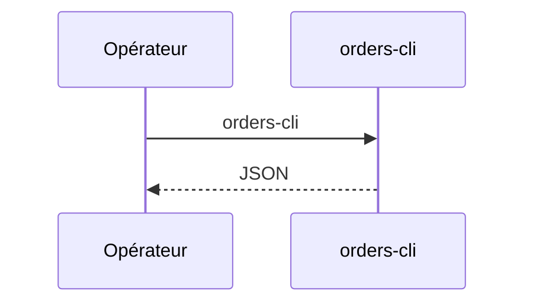

## Summary

Affiche les commandes en JSON, depuis la ligne de commande.

## Preconditions

—

## Journey

## Decisions

—

## Data

Lit les commandes du processus, donc aucune.

## Cross-cutting mechanisms

Aucun.

## Points of attention

Un nouveau processus n'a aucune commande en mémoire.

## Change

rédaction initiale
