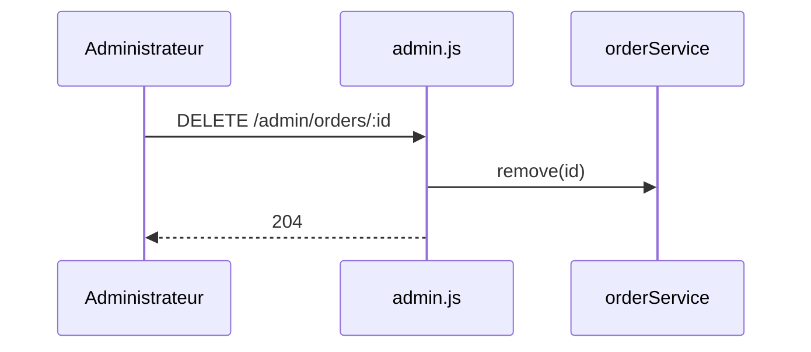

## Summary

Supprime une commande, réservé à l'administration.

## Preconditions

`requireAuth` au montage de `/admin`, puis `requireAdmin` sur la route.

## Journey

## Decisions

—

## Data

Supprime une commande.

## Cross-cutting mechanisms

Deux middlewares : l'un hérité du montage, l'autre de la route.

## Points of attention

Un identifiant inconnu supprime le dernier élément : `findIndex` rend -1.

## Change

rédaction initiale
