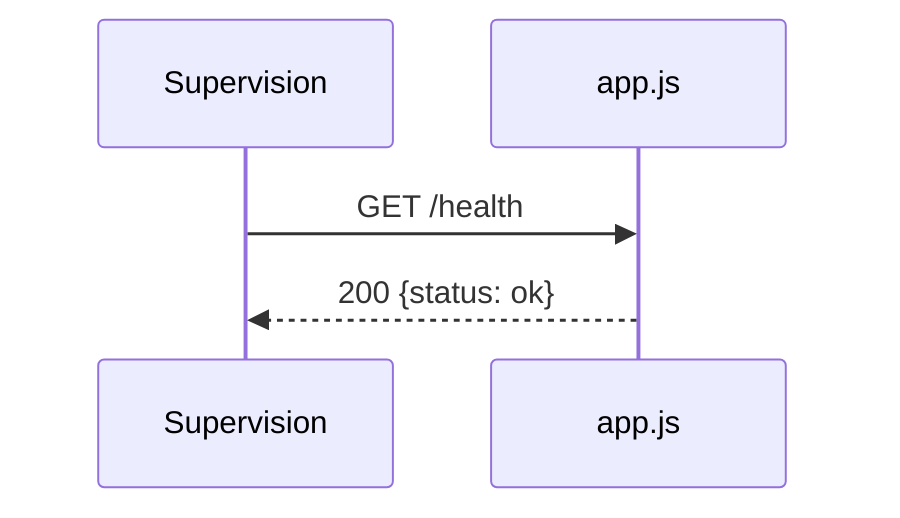

## Summary

Signale que le processus répond.

## Preconditions

—

## Journey

## Decisions

—

## Data

Aucune.

## Cross-cutting mechanisms

Déclarée sur l'application, hors de tout routeur.

## Points of attention

Ne vérifie aucune dépendance.

## Change

rédaction initiale
