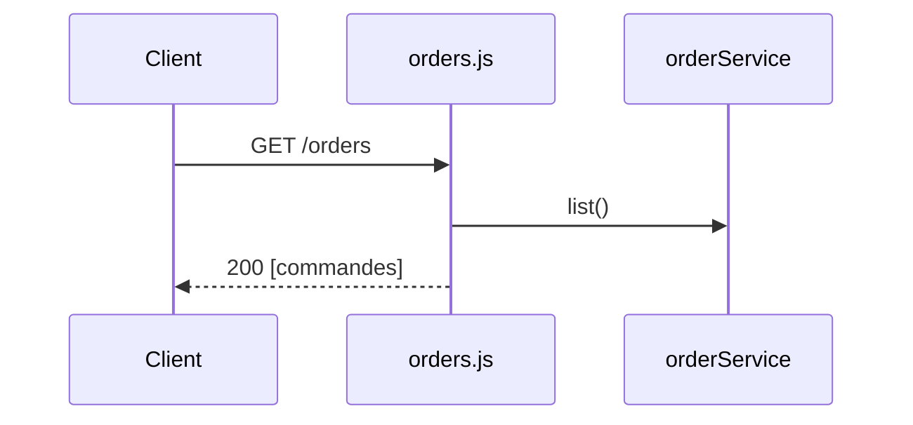

## Summary

Liste les commandes en JSON.

## Preconditions

—

## Journey

## Decisions

—

## Data

Lit les commandes en mémoire.

## Cross-cutting mechanisms

`express.json()` sur toute l'application.

## Points of attention

Les commandes vivent en mémoire : un redémarrage les perd.

## Change

rédaction initiale
