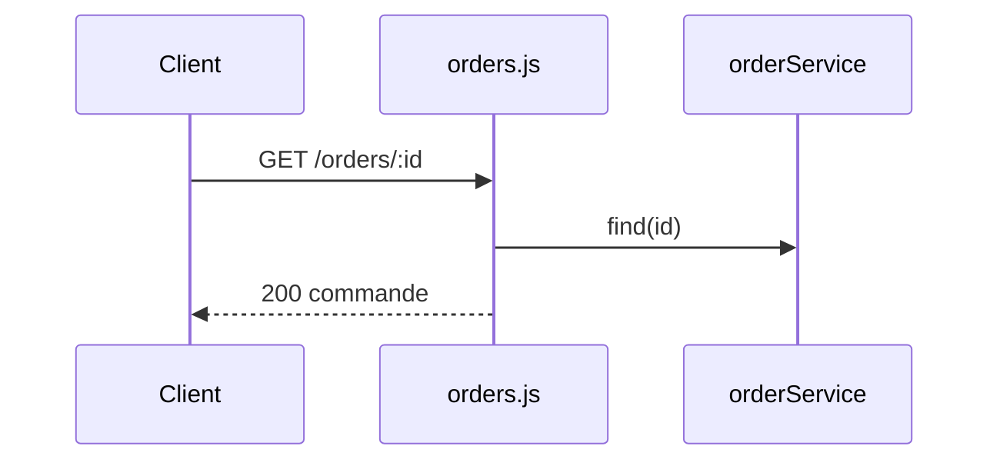

## Summary

Rend une commande par son identifiant.

## Preconditions

—

## Journey

## Decisions

—

## Data

Lit une commande.

## Cross-cutting mechanisms

Aucun.

## Points of attention

Un identifiant inconnu répond 200 avec un corps vide, pas 404.

## Change

rédaction initiale
