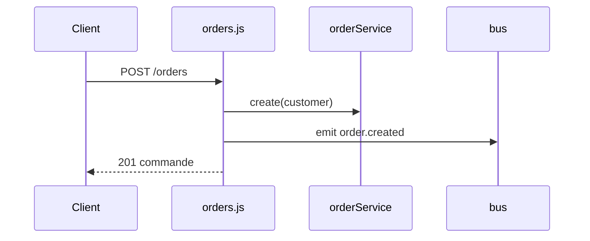

## Summary

Crée une commande et annonce `order.created`.

## Preconditions

Un en-tête `Authorization` (`requireAuth`).

## Journey

## Decisions

—

## Data

Écrit une commande en mémoire.

## Cross-cutting mechanisms

`notifyWarehouse` écoute `order.created` et s'exécute pendant la requête.

## Points of attention

`requireAuth` vérifie la présence de l'en-tête, pas sa valeur.

## Change

rédaction initiale
